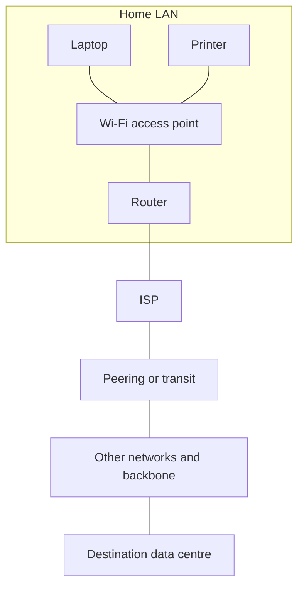
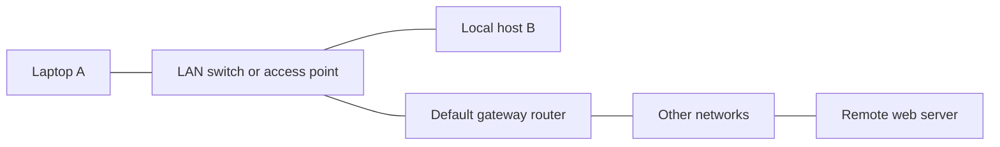
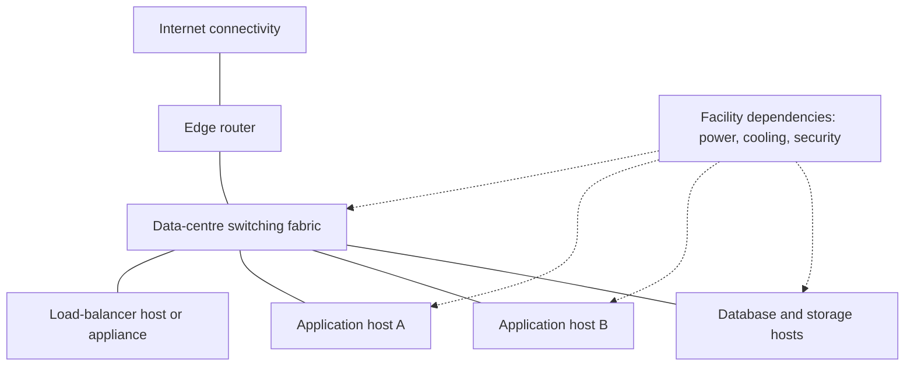
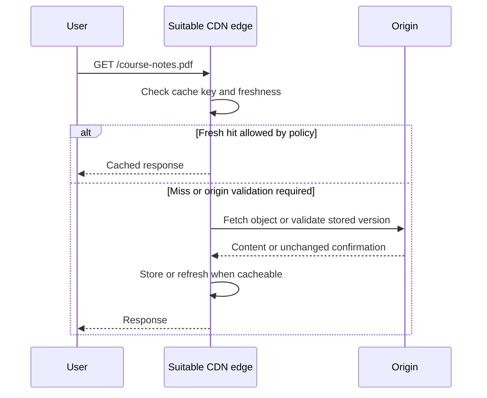
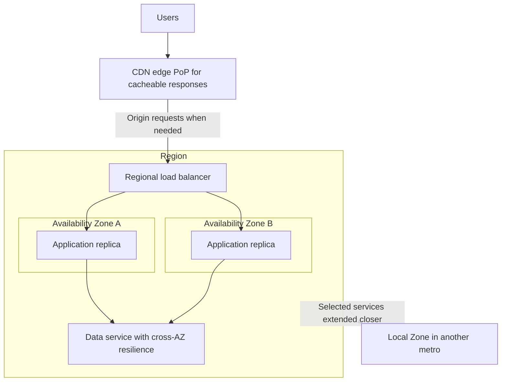

# Part 01 — Visual Companion

Use these diagrams with the [study notes](Part_01_Study_Notes.md). Each picture isolates a decision or dependency. Arrows show communication or containment as explained below; they are not all separate traceroute hops.

## 1. From a local link to connected networks

Read with [Connected devices](Part_01_Study_Notes.md#1-connected-devices-become-connected-networks) and [The physical path](Part_01_Study_Notes.md#2-a-request-has-a-physical-and-commercial-path).



The printer can remain reachable when the Internet link fails. The router joins the LAN to other networks. For an overseas destination, the backbone path may include landing stations and submarine cables; a nearby cached object may avoid that journey.

```text
ISP = provider selling access
IXP = infrastructure where networks interconnect
Data centre = facility hosting computing equipment
```

The Internet is an interconnection, not a mandatory geographic tree. A reply can follow another route.

## 2. The same data has different wrappers

Read with [Packets](Part_01_Study_Notes.md#3-packets-let-many-conversations-share-a-link).

```text
Application data
     ↓
[TCP header | data]                    TCP segment
     ↓
[IP header | TCP header | data]        IP packet
     ↓
[link header | IP packet | trailer]    link frame
     ↓
signals on cable, fibre or radio
```

For UDP, substitute a UDP header/datagram for TCP. IP headers identify network endpoints, transport headers identify service endpoints, and local-link framing carries the packet across that link.

```text
Laptop ── frame for gateway ──> Router ── new frame for next hop ──> Router
           IP packet inside              IP packet inside

At each routed boundary:
remove incoming framing → choose IP route → decrement TTL → build outgoing framing
```

Frame addresses change at routed boundaries. Source/destination IPs normally remain end to end, with NAT as an important exception. The destination transport/application reconstructs the communication; intermediate routers do not rebuild the user's file.

## 3. Four different ways a connection can feel bad

Read with [Performance measurements](Part_01_Study_Notes.md#4-diagnose-delay-capacity-and-missing-packets-separately).

```text
Capacity:    [ narrow link ]     versus     [ wider link ]
             fewer bits/s                   more bits/s

Delay:       sender ──────────────────────────> receiver
                     one-way latency
             sender <──────────────────────── receiver
                     return journey
             RTT includes both directions

Variation:   packet delays = 20 ms, 95 ms, 25 ms
             uneven delay = jitter

Loss:        sent      1 2 3 4 5 6
             received  1 2   4 5
                           ↑     ↑
                         missing packets
```

Throughput is the achieved data rate, rather than the link's capacity. A speed test estimates it for one destination and moment. A long physical path can have high capacity and high RTT simultaneously.

```text
Delay sources: [processing] + [queueing] + [transmission] + [propagation]
                                  ↑
                  congestion / bufferbloat often appear here
```

More capacity can shorten queues and transmission time, but it does not remove distance.

## 4. Choose the next local destination

Read with [Hubs, switches and routers](Part_01_Study_Notes.md#5-a-hub-repeats-a-switch-learns-a-router-chooses-networks).



For a local host B, the frame can cross the LAN directly. For the remote server, the laptop sends a frame addressed to the gateway. Its IP packet still names the remote destination.

| Equipment | Reads to make its main decision | Result |
|---|---|---|
| Hub | No address | Repeat signals to other ports |
| Switch | Destination MAC and learned table | Known port, or flood within VLAN when required |
| Router | Destination IP and route prefixes | Chosen next hop/interface |

A switch learns from the **source** MAC on arrivals. Unknown unicast/broadcast flooding does not turn it into a hub: it still interprets frames and limits flooding by VLAN. ARP resolves the local IPv4 neighbour's MAC, which is the gateway's MAC for this remote journey.

## 5. Separate physical connectivity from application dependencies

Read with [Data centres](Part_01_Study_Notes.md#6-data-centres-make-services-physical).



Solid lines depict connectivity, not one mandatory request sequence. Logical conversations can be user → load balancer → application → database, while the hosts exchange packets through the network fabric. Dashed arrows identify facility dependencies. A virtual machine or container still depends on physical hosting equipment.

## 6. A CDN serves hits and fetches misses

Read with [CDNs](Part_01_Study_Notes.md#7-cdns-move-reusable-responses-closer-to-users).



The edge can avoid a long origin journey on hits. Expiry, eviction, different request keys and validation can cause later origin contact too. Uncacheable personalised responses are forwarded according to policy. A new versioned filename creates a different key rather than relying on every old copy disappearing immediately.

## 7. Deployment locations and failure boundaries

Read with [Regions and zones](Part_01_Study_Notes.md#8-regions-and-zones-balance-location-with-failure-isolation).



The AZ boxes represent isolated failure domains within one region; each can contain multiple data centres. The Local Zone relationship shows an extension of selected services, not a packet route every request follows. CDN edges are a separate delivery footprint.

If AZ A fails, health checks must remove its target, AZ B must have capacity, and the data service must remain usable. “Two replicas” alone does not establish full resilience. See the [optional design decisions](Part_01_Study_Notes.md#9-optional-supplement-use-the-physical-model-in-design-decisions) for latency budgets and recovery objectives.

**Next:** [Commands and interpretation](Part_01_Additional_Resources.md) · [Interview questions](Part_01_Interview_Questions.md)
