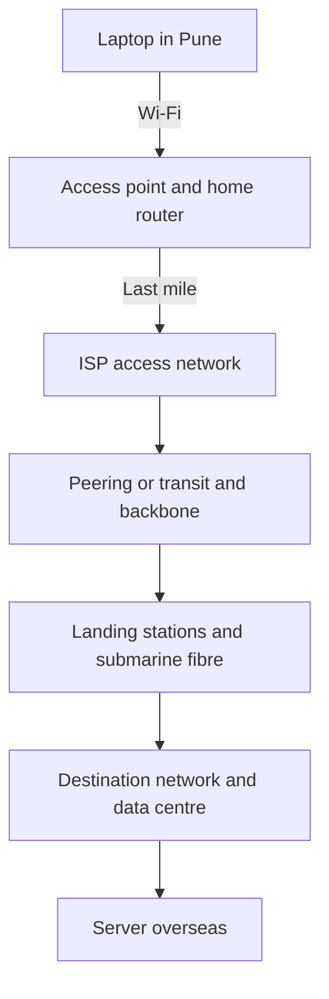
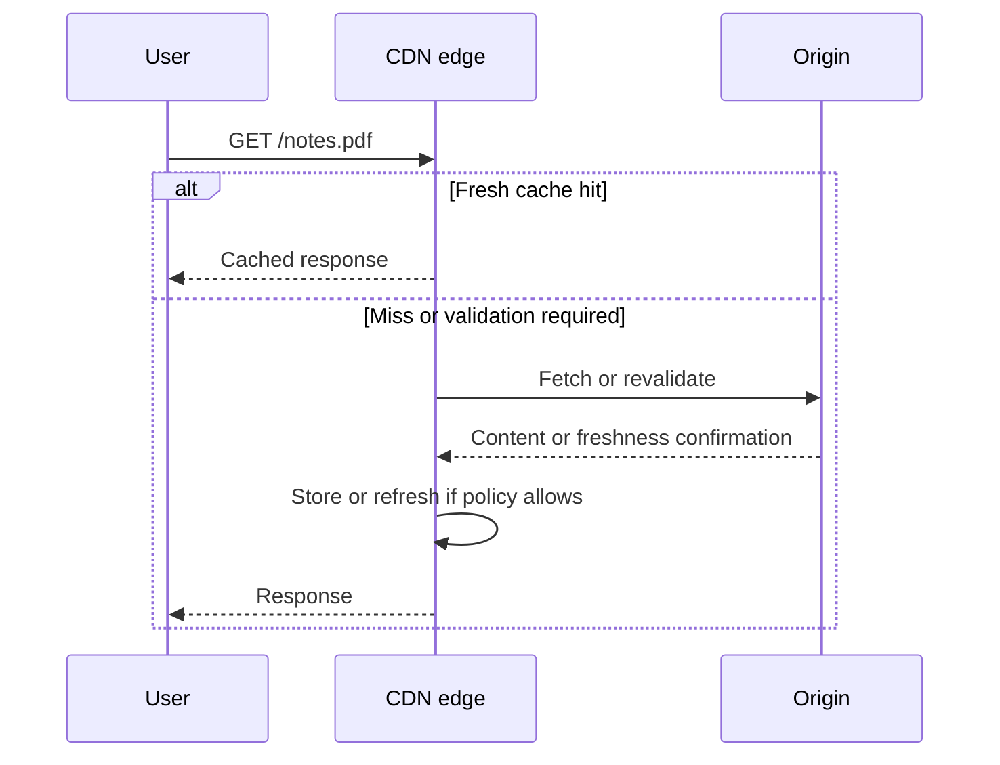

# Part 01 — Internet & Physical Networking

**Lecture:** 00:00–01:09:00 — Internet fundamentals → data transmission → Wi-Fi and network devices → data centres, CDN and cloud locations.

Start with the physical story. When a browser reaches an overseas application, signals leave your network interface, cross a local link, pass through other networks, and reach hardware hosting a service. “The cloud” and “the Internet” are useful abstractions, but every successful request depends on real equipment and agreed rules.

## 1. Connected devices become connected networks

A stand-alone laptop can run software without exchanging data with another computer. Connecting devices through copper cable, optical fibre or radio creates a **computer network**. A device on the network is a **node**; a communicating endpoint such as a laptop or server is a **host**. Its Ethernet port or Wi-Fi adapter is a **network interface**. The connection between devices is a **link**.

The devices must agree on message formats and behaviour. Those rules are **protocols**: how to label a destination, interpret a message or respond to an error. A physical connection alone does not supply meaningful communication.

When your browser requests a page, it acts as a **client**. The program providing the page acts as a **server**. These describe roles: one machine can provide a service while acting as a client of another service.

A **LAN**, Local Area Network, covers an area such as a home, office or campus. A **MAN** covers a metropolitan area, while a **WAN** spans wider distances. These are descriptions of geographical scope, not promises about speed. Join networks through routers and you create an **internetwork**. The global Internet is a network of independently operated networks that communicate through the Internet protocol suite.

The **Web** is one service using that infrastructure, mainly through HTTP and HTTPS. Email, DNS, SSH and many games or calls also use the Internet. **Wi-Fi is a local radio link**, so being connected to an access point does not prove Internet access is working. Your laptop and a local printer can communicate while the ISP link is down.

## 2. A request has a physical and commercial path

The lecture follows a message from Pune to a friend or server overseas. A possible route looks like this:



Your **ISP**, Internet Service Provider, supplies access. The **last mile** is the connection from its network to your premises. The provider carries traffic through higher-capacity **backbone** links and exchanges it with other networks. A fibre cable encodes data in light signals; repeaters along long cable routes amplify signals. Submarine fibre joins continents through coastal **landing stations**.

Networks can **peer**, exchanging traffic directly, or purchase **transit**, paying an upstream network for reachability beyond themselves. An **IXP**, Internet Exchange Point, provides infrastructure where networks interconnect. An ISP is a provider, an IXP is an interconnection facility/switching fabric, and a data centre hosts computing equipment. They cooperate but are not interchangeable.

This explains the lecture's money-flow example: a broadband bill supports access infrastructure and the capacity providers buy or operate beyond it. Fibre routes, equipment and international cable capacity have owners and operating costs. There is no single company controlling every Internet path.

The lecture's world → country → city → home hierarchy helps visualise scale, but traffic does not always traverse that exact tree. Content may remain inside an ISP or reach a nearby CDN. International traffic may take a long path because routing follows connectivity and policy as well as geography. The return path need not be the exact reverse.

Cellular and satellite access also have roles. A mobile tower normally connects onward through backhaul infrastructure, often fibre. Satellites can provide access in places poorly served by terrestrial links; their delays depend on the system and orbit. Ordinary intercontinental traffic relies heavily on submarine fibre.

A **hop** in an IP route is a forwarding step through a router. A cable, switch or landing station in a drawing is not automatically a separate visible hop. `tracert` discovers responses from routed steps using increasing IP TTL values. A router may forward traffic while declining to answer these probes, and IP geolocation provides an estimate rather than proof of its physical location.

## 3. Packets let many conversations share a link

A large photo or document does not travel as one indivisible object. Protocols carry data in smaller units so that many conversations can share links. This **packet switching** avoids reserving an entire circuit for one transfer. A lost piece can be recovered separately if the transport/application protocol provides recovery.

A packet contains a **header**, which carries control information, and a **payload**, the data it transports. At the IP layer, important header fields include source and destination IP addresses, a protocol indicator, and a hop-limiting value. In IPv4 this is **TTL**, Time to Live; each router decrements it to prevent packets circulating forever.

Different layers name their units differently:

```text
Application bytes
       ↓ TCP or UDP header adds service information
TCP segment / UDP datagram
       ↓ IP header adds network addresses
IP packet
       ↓ local-link header and trailer
Ethernet / Wi-Fi frame
       ↓ transmission
Electrical signals / light / radio
```

This wrapping is **encapsulation**. TCP's ports and sequence numbers belong to the TCP header, not the IP header. A **frame** carries an IP packet across one link. At a router, incoming framing is removed, the IP destination is examined, and suitable framing is built for the next link. IP addresses usually stay the same end to end, except when mechanisms such as NAT translate them. Link addresses change at routed boundaries, and TTL changes.

Packets often follow the same route during a connection, but routes can change and arrival order is not guaranteed. Routers forward packets; they do not reconstruct the user's file. TCP handles reliable, ordered byte-stream delivery at the endpoints. IP itself does not promise delivery, and UDP leaves extra recovery to the application.

The **MTU**, Maximum Transmission Unit, is the largest IP packet a link can carry in one link-layer payload. Ordinary Ethernet commonly uses 1500 bytes. IP and transport headers consume some of that space, leaving less for application data. Paths with smaller MTUs can need smaller packets; IPv4 fragmentation and “packet too big” signalling are supporting details, not reasons to memorise every header bit.

## 4. Diagnose delay, capacity and missing packets separately

“The Internet is slow” is a symptom, not a diagnosis. A large download and an interactive call stress different properties.

| Measure | Meaning | Useful interpretation |
|---|---|---|
| **Bandwidth** | Capacity of a link, in bits per second | How much traffic could fit |
| **Throughput** | Transfer rate actually achieved | How quickly the data really moves |
| **Latency** | Delay, often one-way unless specified | How long an interaction waits |
| **RTT** | Round-trip time | Outward trip plus return trip |
| **Jitter** | Variation in delay | How unevenly media arrives |
| **Packet loss** | Fraction of packets not received | Missing data or recovery work |

The lecture's speed test shows a throughput measurement around 245 Mbps and delay around 46.6 ms. The download result estimates achievable transfer rate to that test server under current conditions; it is not a direct, permanent measurement of every link's capacity. `ping` normally reports RTT, not one-way delay.

A packet's delay has several sources:

```text
Total delay = processing + queueing + transmission + propagation
              inspect      wait in    put bits      travel through
              /forward     buffers    onto link     the medium
```

More bandwidth reduces transmission time and can relieve queues when capacity is the bottleneck. It cannot eliminate distance-dependent propagation. A high-bandwidth link can therefore have stable but high RTT, while a lower-bandwidth local link can respond quickly.

**Congestion** occurs when traffic exceeds available capacity. Packets wait, and full buffers may discard them. Wireless interference or corrupted links can also cause loss. Excessive buffering creates **bufferbloat**: an upload fills a queue and everyone else's small interactive messages wait behind it. Jitter buffers smooth media arrivals, but they add delay.

Imagine a call with replies delayed by roughly the same amount every time: high latency. If some replies arrive promptly and others much later, jitter is high. Missing words may indicate loss. These problems can coexist but are not identical.

For transfer arithmetic, a decimal 1 GB file contains 8,000 megabits. At 100 Mbps, its ideal transfer time is `8,000 / 100 = 80 seconds`, before protocol overhead, congestion and other limits. Bits and bytes differ by a factor of eight.

Measure before choosing a remedy. Compare pings to the local gateway and a remote destination, inspect end-to-end loss, and use a throughput test for bulk capacity. Poor local results suggest Wi-Fi or LAN trouble. A distant server may require a closer location or CDN. A slow application/database will not be fixed merely by upgrading the home connection.

## 5. A hub repeats, a switch learns, a router chooses networks

| Device | Usual OSI layer | Forwarding decision | Typical role |
|---|---|---|---|
| **Hub** | 1: physical | Repeat incoming signals to other ports | Obsolete shared Ethernet |
| **Switch** | 2: data link | Forward using destination MAC and a learned MAC→port table | Connect LAN devices |
| **Router** | 3: network | Choose a next hop using destination IP prefixes | Connect networks |

A hub does not inspect an address. Devices historically shared a collision domain and competed for the medium. Modern full-duplex switched Ethernet avoids those shared-link collisions.

A **MAC address** identifies an interface for local link delivery, commonly using 48 bits. It can be changed, spoofed or randomised; it is not a permanent identity for a person. A switch learns **source** MAC addresses from arriving frames. For a known destination, it forwards to the associated port. For unknown unicast or broadcast, it floods within the relevant **VLAN**, excluding the incoming port. Entries expire so the table adapts when devices move.

A **VLAN**, Virtual LAN, separates a switched network into logical broadcast domains. This controls how widely local broadcasts spread. A layer-2 switch forwards within those domains. A layer-3 switch can also perform routing, but that is an additional routing function.

A router removes incoming framing, consults its **routing table**, chooses the most specific matching IP prefix, decrements TTL and forwards using the next link. A default route provides a fallback when no more specific route applies.

For an ordinary local destination, the laptop can send directly through the switch/access point. For a remote one, it sends to its **default gateway**. In IPv4, **ARP**, Address Resolution Protocol, discovers the needed local MAC address.

```text
Packet: [source IP = laptop] [destination IP = overseas server]
Frame:  [source MAC = laptop] [destination MAC = local gateway]
```

The frame gets the packet to the next link endpoint; it is not addressed to the overseas server's MAC. Part 2 explains how the host distinguishes local and remote destinations.

A Wi-Fi **access point** bridges wireless clients into the LAN. Its radio medium is shared, so signal quality, interference and competing clients affect performance. A home “router” commonly combines an access point, switch ports, router, DHCP server and NAT device. Restarting that box can reset several functions; it does not tell you which one caused the fault.

## 6. Data centres make services physical

A **data centre** brings together servers, storage and network equipment, usually arranged in racks. Applications need more than CPU capacity: power feeds, batteries/generators, cooling, physical access controls and resilient connectivity support continuous operation. Costs include equipment, power, cooling, space and network capacity.

The lecture launches an Ubuntu EC2 instance in Oregon, then traces traffic from inside the cloud provider's network. A virtual machine is still running on physical hardware in a particular location. Containers also share underlying hosts. The historical Project Natick underwater-data-centre example illustrates the importance of cooling; reproducing that engineering is outside this course.

An incoming request reaches networking equipment and may pass a load balancer before an application handles it. The application can consult storage, a database or a cache. Part 5 turns those dependencies into an architecture. Do not confuse the logical request flow with a literal cable chain: switches connect the physical machines carrying those conversations.

**Optional supplement:** A **Top-of-Rack (ToR) switch** connects rack equipment; a leaf/spine fabric can connect many racks. **Colocation** means renting space, power and connectivity in someone else's facility. **PUE**, Power Usage Effectiveness, is total facility power divided by IT-equipment power, a facility-efficiency measure rather than an application performance metric.

## 7. CDNs move reusable responses closer to users

A **CDN**, Content Delivery Network, is a distributed delivery service. Its **edge locations**, or **PoPs** (Points of Presence), can cache HTTP responses near users. The **origin** holds the source content.

In the lecture, course notes originate in Oregon while a user in Pune may reach a nearer delivery location. The point is shorter repeated journeys, not a promise that a specific city always serves every request. DNS and network routing help select an appropriate edge according to provider policy.



A **cache hit** can avoid the origin trip. A **miss** needs an origin fetch before the edge can serve the object. Expiry, eviction, a different cache key or a validation policy can contact the origin again; it is not only the first user ever who does so.

HTTP cache rules define freshness. `Cache-Control: max-age` supplies a freshness lifetime. `Age` indicates how long a stored response has aged. A validator such as an **ETag** lets the origin confirm an unchanged object without resending its body. **Invalidation/purge** removes a copy before its ordinary expiry.

Images, scripts, styles, fonts, PDFs and recorded-video segments are common cache candidates. Personalised responses require care to prevent sharing private data. Generated content can sometimes be cached safely, and a CDN can also proxy uncached dynamic requests. “Static” is a useful starting example; **cacheability depends on policy and content semantics**.

Versioned filenames such as `app.a1b2.js` give new releases new cache keys. Keep reusable versioned assets fresh for longer while controlling entry-point HTML freshness. For media, range requests can retrieve portions without downloading the whole object.

A CDN reduces repeated origin traffic and often user latency. It does not store your database or eliminate application query time. **Edge computing** places selected processing near users; that is related to, but broader than, caching.

## 8. Regions and zones balance location with failure isolation

| Term | Meaning | Main reason to use it |
|---|---|---|
| **Region** | Geographic deployment area containing multiple AZs | Choose locality and regional services |
| **Availability Zone (AZ)** | One or more data centres engineered as an isolated failure domain within a region | Limit the impact of a location failure |
| **Local Zone** | Extension of selected regional services into another metro | Put latency-sensitive compute closer |
| **Edge location** | Distributed delivery PoP, sometimes supporting limited edge execution | Deliver reusable responses nearby |

An AZ is not necessarily one building. A region is not necessarily a whole country. Local Zones extend selected compute/storage/networking capabilities rather than duplicating every regional service. A CDN edge is primarily part of the delivery footprint, not a general replacement for regional compute.

```text
Region
├── AZ A: application replica + regional infrastructure
├── AZ B: application replica + regional infrastructure
└── Low-latency private connectivity between AZs
        └── Selected services can extend to a Local Zone in another metro

CDN edge PoPs form a separate distributed delivery footprint.
```

A multi-AZ deployment improves resilience only if its dependencies can survive. A load balancer must detect unhealthy targets, the surviving application needs enough capacity, and database/session state must remain accessible. A few requests can fail during detection and recovery; multiple locations do not imply zero interruption.

Choose locations using users' latency, data residency, available services, cost and failure tolerance. Region/AZ counts and product availability change, so the recording's counts are not revision facts. A subnet belongs to a particular AZ in AWS; several subnets can exist in the same AZ. There is no general “three AZs means only three public subnets” limit.

## 9. Optional supplement: use the physical model in design decisions

A latency budget divides acceptable response time among network, application and storage work. If a user sees eight seconds while the API reports 200 ms, inspect DNS, connection setup, transfer size, repeated requests and browser rendering. Server timing covers only part of the journey. Caching, compression, fewer round trips and closer infrastructure solve different portions.

The **bandwidth-delay product** estimates data needed in flight to fill a path: `bandwidth × RTT`. At 100 Mbps and 100 ms, that is 10 megabits, approximately 1.25 MB. A TCP window too small for the path can limit throughput. Protocol tuning belongs in Part 3's optional depth; the main lesson is that available capacity does not guarantee achieved throughput. **QoS**, Quality of Service, can prioritise traffic but cannot create missing capacity.

For a worldwide learning platform, cache shared PDFs, images and video segments at a CDN while account/progress operations reach application services. Popular media can be pre-positioned when the provider supports it. Monitor cache hit ratio, origin traffic and user-facing errors. Egress and cross-region transfer can influence cost, but prices and charging rules depend on the provider.

A cable cut or region failure motivates diverse network providers/routes and, when justified, another region. **Active-passive** keeps a standby for failover; **active-active** serves traffic in more than one location and requires more coordination. DNS-based failover can lag because of caching. A read-only fallback may be useful when writes are unavailable. **RTO** is the target recovery time; **RPO** expresses tolerable data loss in time. These are business requirements, not guarantees produced by adding boxes to a diagram.

For real-time games, separate asset delivery from live sessions: the CDN can deliver patches while regional or Local Zone compute handles gameplay. Losing the server hosting a live session can still disconnect players. Recovery behaviour matters as much as location choice.

## A final pass through the story

A client sends data through its interface and LAN. Link framing reaches the next local destination; routers forward IP packets through connected networks. Delay, capacity and loss determine the journey's quality. Data-centre hardware runs the service, CDN edges reuse suitable responses, and regions/zones organise locality and failure isolation.

Use the [visual companion](Part_01_Diagrams.md) to reconstruct that story, the [command reference](Part_01_Additional_Resources.md) to interpret measurements, and the [interview checkpoint](Part_01_Interview_Questions.md) to explain it aloud. [Part 2](../02_IP_Addressing_Subnets_And_DNS/Part_02_Study_Notes.md) gives the interfaces addresses and resolves names into destinations.
