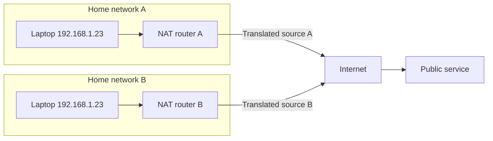
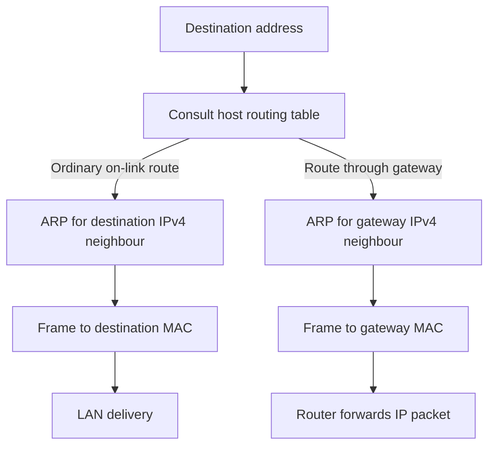
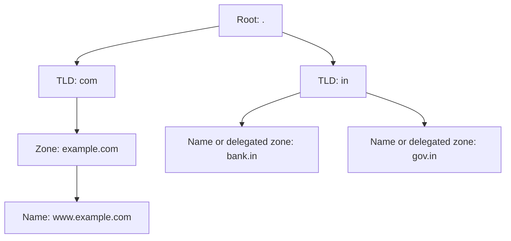
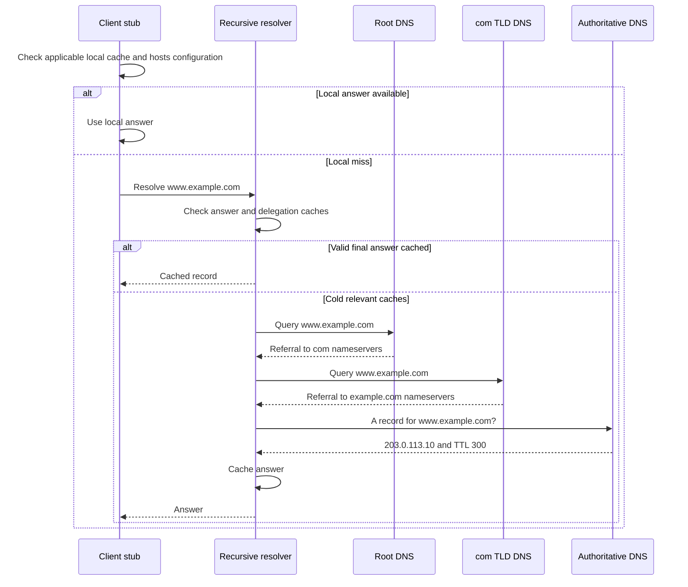

# Part 02 — Visual Companion

These diagrams accompany the [study notes](Part_02_Study_Notes.md). They show how a name becomes an address, how prefixes influence forwarding, and which system answers each question.

## 1. Repeated private addresses can exist in separate scopes

Read with [Address scope](Part_02_Study_Notes.md#1-an-address-identifies-an-interface-within-a-scope) and the following IPv4/NAT section.



The private addresses are reused in isolated networks. Arbitrary duplication inside the same LAN creates a conflict. NAT/PAT can translate each network's outbound conversations; it does not make those private addresses globally routed.

```text
One router's example PAT table:
Internal source           Public mapping
192.168.1.23:51500   ↔     198.51.100.7:62001
192.168.1.24:51500   ↔     198.51.100.7:62002

Replies matching those remembered mappings go back to the respective clients.
```

The public address is an illustration from a documentation range. The translated port is part of distinguishing these connections.

## 2. IPv4 and IPv6 notation represent bits

Read with [IPv6](Part_02_Study_Notes.md#3-ipv6-provides-a-much-larger-address-space).

```text
IPv4: 32 bits = four 8-bit octets
192       .168       .1         .10
11000000  .10101000  .00000001  .00001010

IPv6: 128 bits = eight 16-bit groups
2001 : 0db8 : 0000 : 0000 : 0000 : 0000 : 0000 : 0001
                         ↓
                    2001:db8::1
```

In IPv6, remove leading zeros per group and compress one consecutive zero run. The larger space does not remove prefixes, firewalls or the need for encryption. `::1` is loopback, while `2001:db8::1` above is a documentation example.

## 3. A mask extracts the network boundary

Read with [Subnet masks and local delivery](Part_02_Study_Notes.md#4-a-mask-turns-an-address-into-a-subnet-boundary).

```text
IP      192.168.1.10     11000000.10101000.00000001.00001010
Mask    255.255.255.0    11111111.11111111.11111111.00000000
AND     192.168.1.0      11000000.10101000.00000001.00000000
                        └──────── network ─────────┘ └host┘
```



The mask explains the basic on-link decision. The actual routing table can include multiple interfaces and more specific routes. ARP discovers a **local** MAC; it does not find an overseas server's MAC through the Internet. IPv6 uses Neighbor Discovery instead.

## 4. Longer prefixes make smaller aligned blocks

Read with [CIDR arithmetic](Part_02_Study_Notes.md#5-cidr-makes-allocation-and-routing-flexible) and [Assignable addresses](Part_02_Study_Notes.md#6-network-broadcast-and-assignable-addresses-are-different-counts).

```text
192.168.10.0/24 — 256 addresses

Split into two /25 blocks:
[ .0 ───────────── .127 ] [ .128 ───────────── .255 ]

Split into four /26 blocks:
[ .0–.63 ] [ .64–.127 ] [ .128–.191 ] [ .192–.255 ]

/24: 8 host bits → 256 addresses
/25: 7 host bits → 128 addresses
/26: 6 host bits →  64 addresses
```

Block starts must align. `192.168.10.50/26` names an interface within the first block; it does not make `.50` a valid network start.

```text
192.168.10.0/26
┌──────────┬─────────────────────────────────┬───────────┐
│ Network  │ Traditional assignable hosts    │ Broadcast │
│ .0       │ .1  .2  .3  ...  .62            │ .63       │
└──────────┴─────────────────────────────────┴───────────┘
64 total → 62 traditional host addresses
```

Supported `/31` point-to-point links and `/32` host routes are exceptions to subtracting two. Platform reservations are another consideration: standard AWS IPv4 `/24` subnets normally leave 251 assignable addresses.

## 5. DNS delegation is a tree of responsibility

Read with [DNS records and names](Part_02_Study_Notes.md#7-dns-separates-memorable-names-from-changing-addresses).



Arrows represent hierarchy/delegation, not the path of the eventual HTTP request. DNS authority is distributed among operators. `bank.in` is below the TLD `in`; registration policy does not turn it into a separate TLD.

```text
www.example.com.
 │    │      │ └─ root label
 │    │      └─── TLD
 │    └────────── registrable domain: example.com in this example
 └─────────────── subdomain label

https://www.example.com:443/products?id=7
       └── DNS hostname ─┘    └─ requested path/query ─┘
```

Registration boundaries vary by suffix policy. DNS resolves the hostname's records, not a URL path or webpage.

## 6. The recursive resolver follows referrals

Read with [Resolution and caching](Part_02_Study_Notes.md#8-a-resolver-walks-the-hierarchy-and-caches-the-result).



Each referral returns to the resolver, which then asks the next server. The root does not recurse to fetch the host's IP. Cached delegations can skip some steps even when a fresh final record is needed. A missing name can also be cached as a negative answer.

## 7. Cached DNS records explain a gradual cutover

Read with [Caching](Part_02_Study_Notes.md#8-a-resolver-walks-the-hierarchy-and-caches-the-result) and [Operational surprises](Part_02_Study_Notes.md#10-optional-supplement-plan-for-operational-surprises).

```text
Before move:
Authoritative A record = old IP
Resolver A caches old IP for its TTL
Resolver B caches old IP at a different moment

After authoritative record changes:
Resolver A → old IP until its cached entry expires
Resolver B → new IP after refreshing
New lookups can therefore reach different endpoints temporarily.
```

Lower the TTL sufficiently ahead of the change, wait for the old TTL, prepare the new endpoint, switch records, and retain the old endpoint during the transition. Clearing the OS cache does not clear resolver A's upstream cache. DNS TTL is time in seconds; IP TTL is a forwarding limit.

## 8. Name authenticity and brand trust are separate checks

Read with [Ownership and trust](Part_02_Study_Notes.md#9-names-combine-technical-delegation-with-ownership-and-trust).

```text
DNSSEC validates: “This DNS data is authentic for the name queried.”
TLS validates:   “This connection's certificate matches the intended hostname.”
User intent:     “Is that hostname the bank or service I actually meant?”
```

A lookalike domain can have valid DNS data and a valid TLS certificate. DNSSEC does not stop an attacker registering a different name; encryption does not make that name the intended brand. Part 4 develops the TLS/security layers.

**Continue:** [Resources and commands](Part_02_Additional_Resources.md) · [Interview questions](Part_02_Interview_Questions.md)
