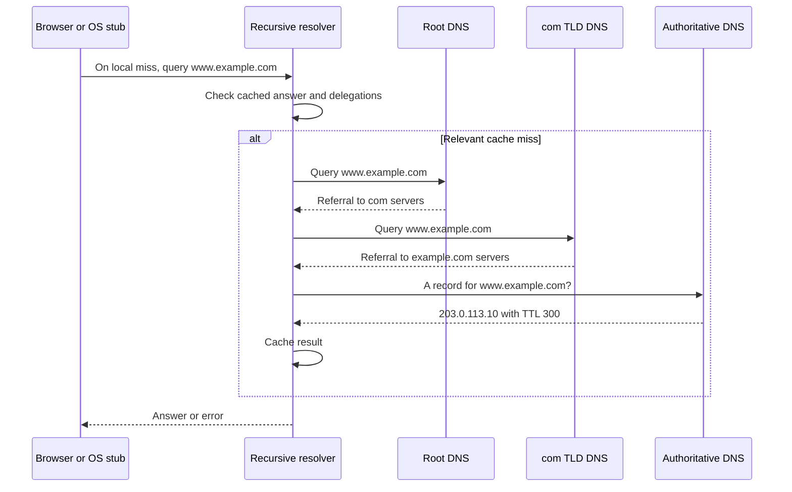

# Part 02 — IP Addressing, Subnets & DNS

**Lecture:** 01:09:00–02:06:35 — Internet addressing → subnets and CIDR → DNS.

A packet needs a destination, a host needs a route to it, and people need names they can remember. IP addresses, subnet prefixes and DNS solve these connected problems. None replaces the others: a name lookup provides records, while routing delivers packets toward an address.

## 1. An address identifies an interface within a scope

The lecture compares an IP address with a phone number: the sender needs an unambiguous destination. More precisely, an **IP address** is a logical address assigned to a network interface. It is not a permanent identifier for a person or an entire computer.

A laptop may have Wi-Fi and Ethernet interfaces, several IPv6 addresses, an IPv4 address and virtual network interfaces. Moving networks can change its addresses. Above IP, transport **ports** distinguish service endpoints on a host; Part 3 explains them.

Address uniqueness depends on scope. Two uncoordinated hosts using `192.168.1.23` on the same LAN can cause delivery conflicts. Separate home networks can reuse that address because private addressing is not routed across the public Internet. Shared service addresses are coordinated designs, not permission to assign duplicates arbitrarily.

With **static configuration**, an administrator deliberately assigns addressing information. With **DHCP**, Dynamic Host Configuration Protocol, a client obtains a leased IPv4 configuration automatically, normally including its address, subnet mask, gateway and DNS resolver. DHCP is not DNS: one configures the host; the other answers name queries.

**Loopback** reaches the same host: `127.0.0.1` in IPv4 and `::1` in IPv6. If your web application works only at `localhost`, a friend's browser does not reach it by typing that name: their loopback points to their own machine. The service also needs an appropriate listening interface, routing and access rules.

On a typical desktop, an unexpected `169.254.x.x` IPv4 link-local address can indicate DHCP failed. Such addressing has a local scope; it is not an ordinary public Internet address.

## 2. IPv4 is small enough to read—and small enough to exhaust

IPv4 uses **32-bit addresses**, written as four decimal **octets**, each holding eight bits and ranging from 0 to 255:

```text
192       .168       .1         .10
11000000  .10101000  .00000001  .00001010
 8 bits     8 bits     8 bits     8 bits
```

That gives `2^32 = 4,294,967,296` representable addresses. Not all can be ordinary public hosts: private, loopback, multicast and other special-purpose ranges are reserved. Growing numbers of devices and earlier inefficient allocations created address pressure.

**Private IPv4 addresses** are designed for use inside private networks:

| Range | CIDR notation |
|---|---|
| `10.0.0.0`–`10.255.255.255` | `10.0.0.0/8` |
| `172.16.0.0`–`172.31.255.255` | `172.16.0.0/12` |
| `192.168.0.0`–`192.168.255.255` | `192.168.0.0/16` |

Only `172.16` through `172.31` are in that private range, not every address beginning with `172`. [RFC 1918](https://www.rfc-editor.org/rfc/rfc1918) defines these allocations.

A **public IP** is intended for globally routed addressing. Public does not mean reachable by every application: routing, firewalls and a listening service still matter. Private does not mean automatically protected: hosts inside an organisation can still attack an exposed service.

**NAT**, Network Address Translation, rewrites addresses. Home routers commonly also translate transport ports, called **PAT**, so several internal clients share a public IPv4 address. The device remembers mappings for returning traffic.

```text
Internal source                 Translated source              Destination
192.168.1.23:51500  ──────────→  198.51.100.7:62001  ─────────→  203.0.113.10:443
192.168.1.24:51500  ──────────→  198.51.100.7:62002  ─────────→  203.0.113.10:443

Replies to the remembered public IP/port mappings return to the right client.
```

The public addresses shown are documentation examples. Real translation behaviour depends on the NAT implementation and flow. New inbound connections normally need an explicit mapping or another reachability mechanism. NAT is separate from encryption and firewall policy.

CIDR reduced allocation waste, private addressing/NAT enabled reuse, and IPv6 provides more address space. **Subnetting alone does not solve IPv4 exhaustion**: it divides an existing block rather than creating addresses. IPv4 remains in use alongside IPv6.

## 3. IPv6 provides a much larger address space

IPv6 uses **128 bits**, commonly shown as eight 16-bit hexadecimal groups. Hexadecimal uses digits `0–9` and `a–f`; letter case does not change the address.

Leading zeros in each group may be omitted. One consecutive run of zero groups may be compressed to `::`:

```text
Full:        2001:0db8:0000:0000:0000:0000:0000:0001
Compressed:  2001:db8::1
```

Expand `::` to enough all-zero groups to restore eight groups. It can appear only once, otherwise the omitted groups would be ambiguous. The address space has `2^128 ≈ 3.4 × 10^38` possibilities.

| Property | IPv4 | IPv6 |
|---|---|---|
| Address size | 32 bits | 128 bits |
| Usual notation | Four decimal octets | Eight hexadecimal groups, compressible |
| Local address discovery | ARP | Neighbor Discovery |
| Broadcast | Available | No broadcast, uses multicast where appropriate |
| Loopback | `127.0.0.1` | `::1` |
| Address conservation | Private reuse/NAT widely used | NAT generally unnecessary for conservation |

IPv6 still uses prefixes and subnets; ordinary LANs commonly use `/64`. **SLAAC**, Stateless Address Autoconfiguration, is one mechanism hosts use to configure IPv6 addresses. **Dual stack** means running IPv4 and IPv6 together rather than switching every dependency at once.

IPv6 is not automatically encrypted and does not remove the need for access rules. Its larger space makes direct addressing easier, but reachability remains a policy decision. Deep transition mechanisms and header engineering are outside this part.

## 4. A mask turns an address into a subnet boundary

A **subnet** is a logical IP network formed by dividing address space. This helps allocate ranges to departments, environments, application tiers or locations. It also supports route organisation and security policy, although the subnet itself does not enforce isolation.

An IPv4 **subnet mask** marks the network prefix with contiguous leading `1` bits and host bits with `0` bits. `255.255.255.0` has 24 leading ones, written `/24`.

Bitwise **AND** retains an address bit only where both the address and mask have a one. This extracts the network:

```text
Address: 192.168.1.10    11000000.10101000.00000001.00001010
Mask:    255.255.255.0   11111111.11111111.11111111.00000000
AND:     192.168.1.0     11000000.10101000.00000001.00000000
                        └──────── network ─────────┘ └host┘
```

In a basic LAN, a host compares its own and the destination's masked network addresses. For `192.168.1.23/24`, `192.168.1.99` is local, while `192.168.2.10` is outside that subnet.

For the local destination, **ARP**, Address Resolution Protocol, discovers the destination's MAC. For a remote destination reached through the default route, ARP discovers the gateway's MAC instead. An ARP request is a **link-layer broadcast**, not an IP packet addressed to the subnet's directed-broadcast address.

Hosts actually consult routing tables, which can contain more specific routes and multiple interfaces. The subnet comparison explains the ordinary single-LAN case rather than replacing all routing logic.

A **VLAN** defines a layer-2 broadcast domain, while a subnet defines a layer-3 address network. They commonly align. Devices in one ordinary subnet need link-layer connectivity, which may be extended rather than confined to one room. Traffic between different subnets needs routing and appropriate access policy.

## 5. CIDR makes allocation and routing flexible

**CIDR**, Classless Inter-Domain Routing, describes address blocks by prefix length. It replaced reliance on fixed address classes, allowing blocks to match demand and allowing aligned routes to be combined. It is more than a short way to write a mask.

Before classless allocation, fixed blocks could give a company far more space than it needed. A flexible prefix limits waste. **VLSM**, Variable Length Subnet Masking, applies different subnet sizes where needs differ. **Route aggregation**, or summarisation, represents several aligned prefixes by one larger prefix; that larger block is sometimes called a **supernet**.

| Subnet | CIDR |
|---|---|
| A logical IP network/division | A classless prefix system for allocation and routing |
| Example: a private application network | Its description: `10.0.11.0/24` |

For IPv4 prefix length `p`:

```text
Host bits       = 32 − p
Total addresses = 2^(32 − p)
```

A longer prefix leaves fewer host bits, so **larger prefix number means smaller block**.

Work through the lecture's calculation using `192.168.10.50/26`:

1. Six host bits remain, giving `2^6 = 64` addresses.
2. The last mask octet is `11000000 = 192`, so the mask is `255.255.255.192`.
3. Blocks align at multiples of 64: `.0`, `.64`, `.128`, `.192`.
4. `.50` falls in `.0–.63`. Its network is `192.168.10.0/26`.

```text
192.168.10.0/24 = four aligned /26 blocks

[ .0–.63 ] [ .64–.127 ] [ .128–.191 ] [ .192–.255 ]
 64 total     64 total       64 total       64 total
```

The same method works across octets. A `/22` mask is `255.255.252.0`, so blocks advance by four in the third octet. `172.16.20.0/22` spans `172.16.20.0–172.16.23.255`, containing 1024 addresses.

To size a traditional subnet for 500 hosts, allow at least 502 addresses including network and broadcast. The next power of two is 512, leaving nine host bits: `32 − 9 = /23`. This gives 510 usable hosts, whereas a `/24` gives only 254.

| Prefix | Mask | Total addresses | Traditional host use |
|---|---|---:|---:|
| `/0` | `0.0.0.0` | 4,294,967,296 | All-address match, not an ordinary LAN |
| `/8` | `255.0.0.0` | 16,777,216 | 16,777,214 |
| `/16` | `255.255.0.0` | 65,536 | 65,534 |
| `/22` | `255.255.252.0` | 1,024 | 1,022 |
| `/23` | `255.255.254.0` | 512 | 510 |
| `/24` | `255.255.255.0` | 256 | 254 |
| `/25` | `255.255.255.128` | 128 | 126 |
| `/26` | `255.255.255.192` | 64 | 62 |
| `/27` | `255.255.255.224` | 32 | 30 |
| `/28` | `255.255.255.240` | 16 | 14 |
| `/29` | `255.255.255.248` | 8 | 6 |
| `/30` | `255.255.255.252` | 4 | 2 |
| `/31` | `255.255.255.254` | 2 | Both on supported point-to-point links |
| `/32` | `255.255.255.255` | 1 | Single address/host route |

## 6. Network, broadcast and assignable addresses are different counts

In a traditional IPv4 subnet, the **network address** has all host bits zero and identifies the subnet. The **directed-broadcast address** has all host bits one and addresses the subnet's hosts collectively, subject to network policy.

For the `/26` example:

```text
Network      192.168.10.0
First host   192.168.10.1
Last host    192.168.10.62
Broadcast    192.168.10.63
Total        64
Usable       62 = 64 − 2
```

The network and broadcast are not assigned to normal hosts in that traditional model. A broadcast is not automatically forwarded across routers: directed-broadcast forwarding is generally restricted.

“Subtract two” has exceptions. [RFC 3021](https://www.rfc-editor.org/rfc/rfc3021) allows both addresses on supported `/31` point-to-point links. A `/32` names one address/host route, not a conventional subnet with zero hosts. IPv6 has no broadcast.

A platform can reserve additional addresses. Standard AWS IPv4 subnets reserve the first four and last address: network, router, reserved DNS-related address, future use and the final reserved address. Thus a `/24` normally offers 251 assignable addresses there. AWS does not support ordinary VPC broadcasts despite reserving the final address. Its IPv6 allocation has platform reservations as well; consult [AWS subnet sizing](https://docs.aws.amazon.com/vpc/latest/userguide/subnet-sizing.html) instead of applying textbook rules blindly.

The lecture's `0.0.0.0/16` is a mathematical illustration, not a sensible host allocation. Use private or documentation ranges for examples. In a route table, `0.0.0.0/0` means any IPv4 destination; in a firewall source field it means any IPv4 source. Context changes the rule's purpose, not the prefix's matching range.

## 7. DNS separates memorable names from changing addresses

People remember `www.example.com`; routers forward toward numeric IP addresses. **DNS**, Domain Name System, supplies records for names. A service can change its IP without changing the name people use, and one name can return multiple addresses.

A **URL** carries more than a hostname:

```text
https://www.example.com:443/products?id=7
scheme  hostname        port path      query
```

DNS looks up the hostname; it does not fetch `/products`, inspect the query or render a page. A literal-address connection can avoid DNS, although web hosting and certificate checks often still need the intended hostname.

DNS is a distributed hierarchy:

```text
.                         root
├── com                   TLD
│   └── example.com       domain
│       └── www.example.com
└── in                    TLD
    ├── bank.in
    └── gov.in
```

A **TLD**, Top-Level Domain, is the label immediately below the root, such as `com` or `in`. `bank.in` is below `in`, not a separate TLD. Registration boundaries can span more than two labels, so “the last two labels always identify the registered domain” is unsafe.

A **zone** is an administratively managed portion of the tree. Its **authoritative nameservers** publish its records. Delegation through **NS records** lets different operators manage different portions without one giant central database.

| Record | Carries | Common use |
|---|---|---|
| **A** | IPv4 address | Web hostname → IPv4 |
| **AAAA** | IPv6 address | Web hostname → IPv6 |
| **CNAME** | Alias to another name | Service subdomain → provider hostname |
| **MX** | Mail-server names and priorities | Mail delivery |
| **TXT** | Text values | Verification and email policies |
| **NS** | Authoritative nameserver names | Zone authority/delegation |
| **SOA** | Zone administrative information | Authority and timing data |
| **PTR** | Reverse name mapping | Address → hostname |

A CNAME's target is a name, not an IP. It is a DNS alias rather than an HTTP redirect. Ordinary CNAME data cannot coexist with other ordinary data at the same owner name, constraining its use at a zone apex. Provider-specific alias features are separate mechanisms.

## 8. A resolver walks the hierarchy and caches the result

The client's **stub resolver** asks a **recursive resolver** for the final answer or an error. A configured resolver may belong to the ISP, organisation or a public service such as `8.8.8.8`. That address is Google's recursive resolver, not a root or TLD server.

Browser/OS caches and local hosts configuration may already supply an answer. On a local cache miss, the recursive resolver checks its own cache. If it also lacks the answer and needed delegations, it walks the hierarchy.



The authoritative server does not “verify the website is honest”; it publishes DNS data for its zone. The browser subsequently connects to the returned address using the required transport/application protocol.

The client request is **recursive**: “do the lookup for me.” Root/TLD responses in the resolver's walk are **iterative** referrals: “ask these servers next.” The resolver, not the browser's HTTP request, follows them. A warm resolver can skip root/TLD work using cached delegations, even when it needs a fresh final record.

A record's **TTL**, Time to Live, is its cache lifetime in seconds. It is different from the IP packet's hop-limiting TTL. Longer DNS TTLs reduce repeat work but slow visible changes; short TTLs permit faster refreshes at the cost of more queries. A **negative cache** can remember an absent name, reported as **NXDOMAIN**.

“Propagation” mostly means caches expiring, not an update being pushed to every machine. Lower a record's TTL at least one previous-TTL period before a planned move, wait, prepare the new target/certificate, change the record, and retain the old endpoint while cached answers expire. Then restore the normal TTL. Clearing an OS cache does not clear an upstream recursive cache.

## 9. Names combine technical delegation with ownership and trust

ICANN coordinates the global naming system. A **registry** operates a namespace such as a TLD, a **registrar** supplies domain registration services, and an owner configures delegation/records. These roles are distinct from the hosting provider running website content.

The lecture's bank-domain example illustrates registration policy. Restricted namespaces can raise the barrier to convincing impersonation. The technical hierarchy is still `.` → `in` → `bank.in` and any delegated names beneath it; do not describe registration policy as “bypassing” or replacing TLD lookup.

An attacker can register a different lookalike name, host a copied login page, and send a deceptive link while DNS works correctly. **Typosquatting** uses misspellings; other lookalikes exploit visual similarity. A valid HTTPS connection authenticates the presented hostname under certificate trust and encrypts communication to it. It does not prove that the name belongs to the brand the user intended.

**DNSSEC**, DNS Security Extensions, uses signed DNS data so validating resolvers can detect unauthentic answers. It does not encrypt queries or stop registration of another domain. **DoH**, DNS over HTTPS, and **DoT**, DNS over TLS, protect transport to the DNS service; the resolver still participates in the lookup. Deep trust-chain/key-management details are optional beyond this course.

**Optional supplement:** Brand defence can combine exact-hostname checks, monitoring lookalike registrations and certificate issuance, defensive registrations, email authentication and takedown processes. SPF, DKIM and DMARC are email controls rather than proof that any linked website is trustworthy. Part 4 explains TLS and layered security.

## 10. Optional supplement: plan for operational surprises

When connecting networks, plan non-overlapping CIDRs. Two isolated VPCs can reuse `10.0.0.0/16`, but directly joining overlapping ranges makes destination routing ambiguous and can prevent peering. Renumbering, translation or a different connectivity design may be needed. Allocate blocks with room for growth, replacements and separate environments.

For a three-AZ application VPC such as `10.20.0.0/16`, one readable scheme uses public `10.20.1.0/24`–`10.20.3.0/24`, application `10.20.11.0/24`–`10.20.13.0/24`, and database `10.20.21.0/24`–`10.20.23.0/24`. This is an example, not a universal sizing rule. Each subnet occupies one AZ in AWS. Routes and filters, developed in Part 4, determine public/private access; addresses alone do not. Very small subnets can run out during deployments.

For inconsistent DNS failures, compare resolver answers and all authoritative nameservers. One returned address may lead to a dead server, an authoritative copy may be stale, or NXDOMAIN may remain cached. **SERVFAIL** means resolution failed; DNSSEC validation failure is one possible cause, not the only one. Requesting DNSSEC-related records alone does not prove the chain validates.

DNS can distribute multiple A/AAAA answers or choose geographic targets. Its caching and client behaviour limit fast failover and even load distribution. A request-aware load balancer can use health/load and layer-7 routing; DNS is useful for coarser distribution rather than a substitute for every balancing function.

For IPv6 adoption, a dual-stack rollout can begin at the CDN/load balancer, preserving A records while publishing AAAA when the target is ready. Check listening addresses, security rules, logs and IP storage/parsing. Test both families and monitor them separately. IPv4 firewall rules do not automatically apply to IPv6.

## Connect the pieces before moving on

A host obtains an address and routing configuration. DNS gives it records for a desired hostname. Routing selects direct delivery or a next hop, with ARP/Neighbor Discovery resolving local link delivery. CIDR makes those network boundaries readable and calculable.

Use the [visual companion](Part_02_Diagrams.md), [commands and examples](Part_02_Additional_Resources.md), and [interview questions](Part_02_Interview_Questions.md) to check the mechanisms. [Part 3](../03_Internet_Communication_And_Transport_Protocols/Part_03_Study_Notes.md) explains the transport conversation carried between these addresses.
