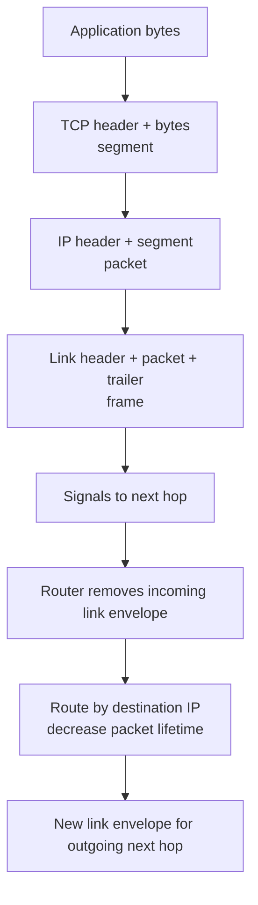
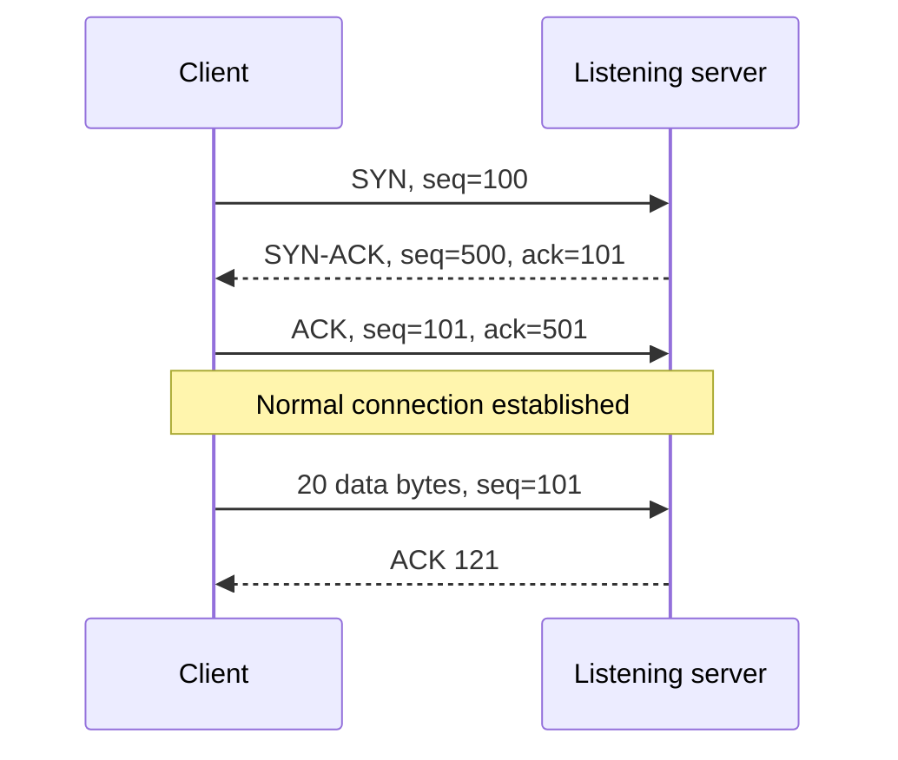
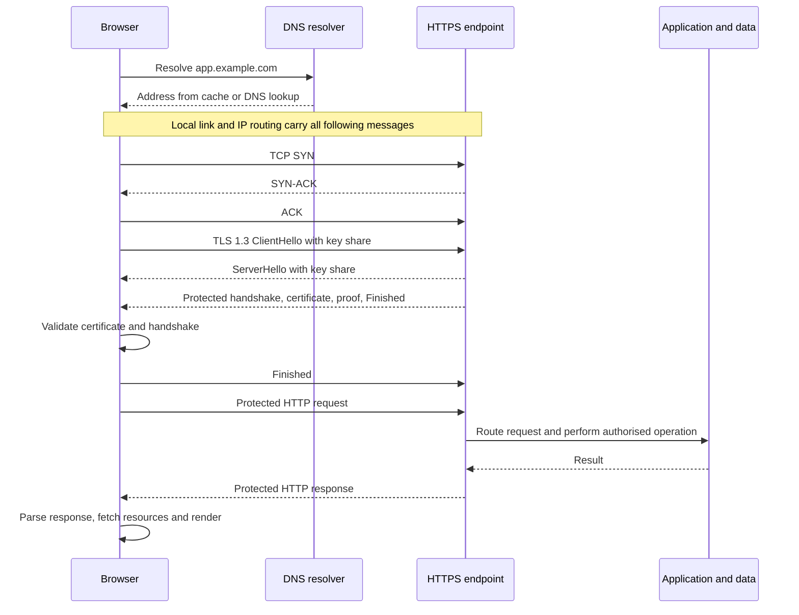
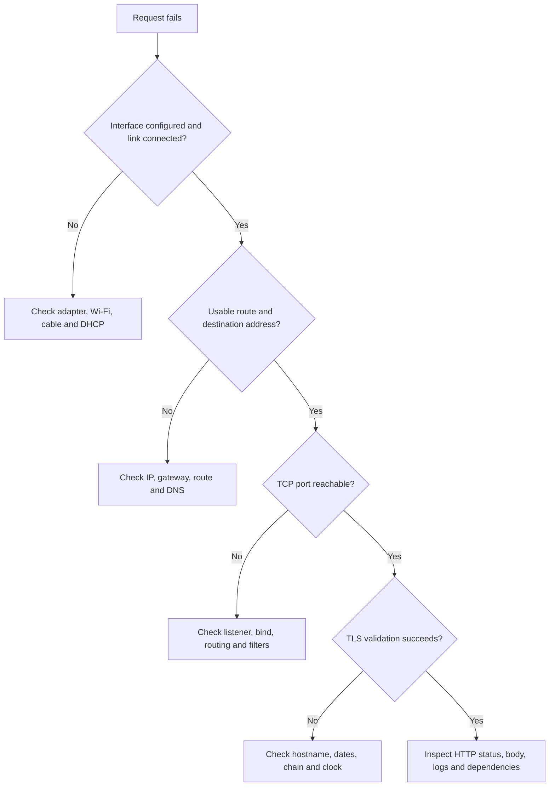

# Part 03 — Diagrams

Each picture isolates a mechanism. Read its arrows before memorising its shape; networking diagrams can show dependencies, actual messages or physical paths, and those meanings are different.

## 1. Seven teaching layers become four practical groups

```text
OSI reference model                    TCP/IP model
7 Application    --+
6 Presentation   --+----------------> Application
5 Session        --+
4 Transport      -------------------> Transport
3 Network        -------------------> Internet
2 Data link      --+----------------> Network access / Link
1 Physical       --+
```

Arrows mean **grouping of responsibilities**, not traffic moving sideways between machines. OSI helps describe devices and failure layers. The deployed TCP/IP suite groups formatting, protection and sessions with application protocols. A browser does not create seven separate physical connections.

Read with [The OSI vocabulary](Part_03_Study_Notes.md#the-osi-vocabulary) and [TCP/IP puts the practical pieces together](Part_03_Study_Notes.md#tcpip-puts-the-practical-pieces-together).

## 2. Encapsulation and the next hop



Downward arrows mean adding an envelope and transmitting. The router steps show that a **new local frame** carries the routed packet onward. For remote traffic, the first destination MAC belongs to the next-hop router, not the final server. Ordinary routing preserves IP endpoints, while NAT is an explicit exception. TCP/TLS processing normally remains at the communication endpoints or terminating proxies.

Read with [Encapsulation](Part_03_Study_Notes.md#encapsulation-the-same-payload-inside-different-envelopes).

## 3. TCP synchronises two sequence spaces



Horizontal arrows are actual TCP messages. SYN consumes one sequence number; the twenty bytes occupy positions 101–120, so ACK 121 names the **next expected byte**. The final handshake ACK confirms that the client received the server's SYN. It does not authenticate the user or encrypt later data.

Read with [Establishing both directions](Part_03_Study_Notes.md#establishing-both-directions).

## 4. A gap holds back delivery to the application

```text
Sender                                      Receiver
1000..1099  ------------------------------> accepts, sends ACK 1100
1100..1199  --------X lost
1200..1299  ------------------------------> buffers, sends ACK 1100
1100..1199  ------------------------------> gap filled, sends ACK 1300
            retransmission

Application receives: 1000..1099, 1100..1199, 1200..1299
                      in byte order, with no duplicate bytes
```

Arrows show transmitted ranges, and the `X` is actual network loss. ACK 1100 remains unchanged until that byte is available; SACK may additionally describe buffered ranges. The diagram teaches why retransmission can preserve correct bytes while increasing latency. It does not show a successful database commit or other application outcome.

Read with [Recovering bytes after packet loss](Part_03_Study_Notes.md#recovering-bytes-after-packet-loss).

## 5. TCP closes each sending direction

```text
Active closer                               Peer
FIN  -------------------------------------> no more bytes from closer
     <------------------------------------ ACK
     <------------------------------------ FIN: peer also finished
ACK  ------------------------------------->
TIME-WAIT                                  peer can finish closing
    | re-ACK a repeated FIN if needed
    v
CLOSED
```

FIN arrows close **directions of a stream**, not physical wires. ACK and FIN can be combined, so this typical four-message layout is not a rule that every close has exactly four packets. TIME-WAIT belongs normally to the active closer and also lets old duplicate segments expire. RST is an abort, not this graceful exchange.

Read with [TCP builds an ordered byte stream](Part_03_Study_Notes.md#tcp-builds-an-ordered-byte-stream).

## 6. UDP delivers datagrams rather than repairing a stream

```text
UDP sender                 Network                 Receiver application
Datagram A  -------------------------------------> gets A
Datagram B  -----------X lost
Datagram C  -------------------------------------> gets C

UDP itself sends no ACK or retransmission for missing B.
The application decides whether to retry, conceal loss or continue.
```

The arrows represent independent datagrams. A voice application may continue because an old syllable arriving too late is unhelpful. A DNS resolver can retry a missing lookup. QUIC builds reliable streams above UDP. The transport choice does not mean that every streaming service uses the same protocol or that UDP is always faster.

Read with [UDP leaves delivery policy to the application](Part_03_Study_Notes.md#udp-leaves-delivery-policy-to-the-application).

## 7. One fresh HTTPS request across the stack



Arrows are protocol messages or local application steps. The HTTPS endpoint could be the server or a terminating load balancer. This is a conceptual **fresh HTTP/1.1–2 connection** using a normal full TLS 1.3 handshake; caches, reuse, client authentication and retries are omitted. HTTP/3 uses QUIC instead of the separate TCP handshake. Other browser resources may require additional requests, not a single universal response containing everything.

Read with [Application protocols](Part_03_Study_Notes.md#application-protocols-turn-bytes-into-useful-conversations). Part 4 adds the security controls and certificate detail.

## 8. Diagnose the first unsupported dependency



Arrows mean the **next investigation**, not proof from a single ping. ICMP can be filtered. A TCP success establishes only transport reachability; TLS and application behaviour still need evidence. Avoid changing multiple layers simultaneously because that destroys the ability to explain the result.

Read with [Troubleshooting](Part_03_Study_Notes.md#troubleshooting-follows-the-dependency-chain) and the [interpreted command examples](Part_03_Additional_Resources.md).