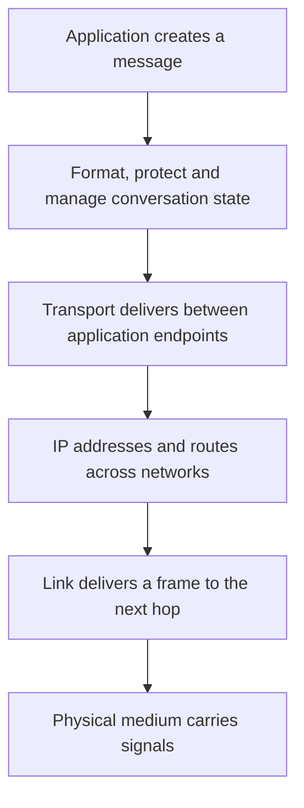
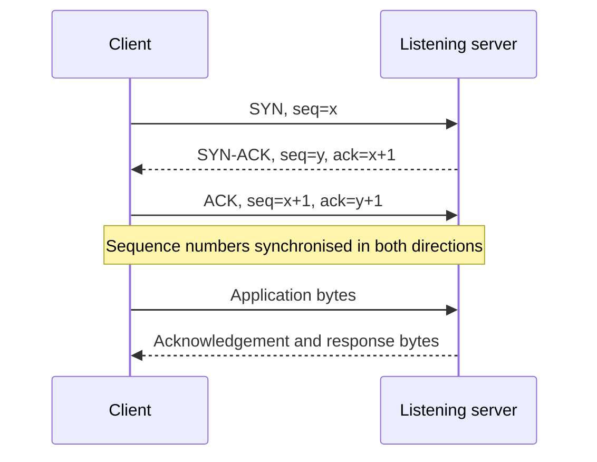

# Part 03 — Internet Communication & Transport Protocols

The physical network from Part 1 gives data a path, and Part 2 supplies addresses and name resolution. Now follow the data between **applications**: how it is wrapped, delivered to the right service, recovered after loss, and interpreted as a web request.

Lecture order: **02:06:35 — How Communication Happens on the Internet**, then **02:37:10 — Types of Layer 4 Protocols**, ending at 02:49:20. The instructor's chat story and TCP/UDP examples provide the main thread. Sections marked **Optional depth** retain useful extensions from the original notes without making them prerequisites.

## A message needs several kinds of help

Imagine Shubham sending Purushottam a chat message. The application creates the message, software formats and protects it, transport delivers bytes between endpoints, IP selects a destination across networks, and a local link carries signals to the next device. Separating these jobs means the chat application can keep working when the laptop switches from Ethernet to Wi-Fi.

These are logical responsibilities, not seven separate programs or cables. The browser uses operating-system networking and libraries rather than implementing the entire network itself. A **protocol** specifies the messages and rules followed by communicating peers; a **layer** groups related responsibilities and provides a service to the layer above it.



The downward arrows show dependencies. Transport can use IP over Wi-Fi, fibre or mobile networks because it depends on the service provided below, rather than one particular cable. Layering adds headers and sometimes duplicates work, but makes changes and diagnosis much easier.

## The OSI vocabulary

The **Open Systems Interconnection model**, or OSI, describes seven layers. It is a reference model used to explain networks. The Internet's deployed protocol suite is TCP/IP, introduced shortly.

| OSI layer, top to bottom | Responsibility | Familiar example |
|---|---|---|
| 7 Application | Rules for exchanging application data | HTTP, DNS, SMTP, SSH |
| 6 Presentation | Representation, encoding, compression and encryption functions | Encoding text or compressing data |
| 5 Session | Establishing and managing a conversation | Session establishment and coordination |
| 4 Transport | Delivery between application endpoints | TCP, UDP, ports |
| 3 Network | Logical addresses and routing | IP, ICMP, router |
| 2 Data link | Frames and delivery on a local link | Ethernet, Wi-Fi, MAC, switch |
| 1 Physical | Signals carried through a medium | Radio, fibre, copper, hub |

For the chat example, read down the table on sending and back up on receiving. The receiver interprets signals, accepts the frame and IP packet, delivers data to the correct endpoint, and eventually displays the message.

The model is a vocabulary rather than a rigid classification of every modern protocol. Encryption resembles a presentation function, but TLS also establishes security state. Login and authorisation usually happen in application protocols, not in a separate universal "session-layer authentication" component. Likewise, a chat conversation is an application concept, not proof of an independently implemented OSI session layer.

A conventional switch forwards using layer 2 information; a router forwards using layer 3 information. An L4 load balancer selects connections using transport information, while an L7 load balancer can inspect HTTP information such as hostnames or paths. Real products may perform several jobs, so "router = layer 3" describes its forwarding role, not every feature in its software.

## Encapsulation: the same payload inside different envelopes

Each layer adds the control information it needs. The generic term **PDU**, or protocol data unit, means the resulting unit at that layer. **Encapsulation** adds envelopes while sending; **decapsulation** removes them while receiving. Neither term means encryption.

```text
Application data                         message or bytes
[TCP header | application bytes]         TCP segment
[IP header | TCP header | bytes]          IP packet
[Ethernet header | IP packet | FCS]       Ethernet frame
Signals representing the frame           physical transmission

TCP header: ports, sequence, acknowledgement, flags, window
IP header: source/destination IP, lifetime, next protocol
Frame: local source/destination addresses and error detection
```

An HTTPS request includes TLS protection between HTTP and TCP. The simple nesting above concentrates on the networking envelopes rather than showing every security record.

For a remote destination, your laptop's first frame is addressed to the **next hop**, normally the default gateway. It is not addressed to the remote web server's MAC. A router removes the incoming link frame, consults its routing table, reduces the packet's remaining lifetime, and creates an appropriate frame for the outgoing link. MAC addresses therefore identify local-link delivery rather than an end-to-end Internet destination.

```text
Laptop                Home router                ISP router
IP: laptop -> server  IP: laptop -> server        IP: laptop -> server
MAC: laptop -> router MAC: router -> next hop     new local frame
       frame 1                 frame 2                  frame 3
```

Ordinary routing preserves source/destination IP addresses, but NAT explicitly changes addressing and often ports. An IPv4 router also updates fields affected by its TTL decrement, including the IPv4 header checksum. The packet is therefore not literally bit-for-bit unchanged.

Wireshark makes the nesting visible as **Frame → Ethernet/Wi-Fi → IP → TCP/UDP → TLS/HTTP**. A frame check sequence detects link corruption; a transport checksum detects certain corruption across transport data. Checksums do not recover missing packets or authenticate a sender.

**Optional depth — MTU and MSS.** The maximum transmission unit, **MTU**, limits the IP packet size carried by a link; a common Ethernet MTU is 1500 bytes. TCP's **MSS** limits TCP payload per segment and leaves room for headers. IPv4 may fragment packets when permitted; IPv6 routers do not fragment and instead signal the problem so the sender can adapt. Path MTU Discovery helps avoid oversized packets. If small responses work but large ones hang, a tunnel or blocked size-feedback message may be involved. Detailed fragmentation mechanics are outside the lecture's main path.

## TCP/IP puts the practical pieces together

The four-layer TCP/IP model groups application, presentation and session responsibilities together, and groups physical transmission with link access.

| OSI responsibilities | TCP/IP layer | Examples |
|---|---|---|
| Application + Presentation + Session | Application | HTTP, TLS, DNS, SSH, SMTP |
| Transport | Transport | TCP, UDP |
| Network | Internet | IP, ICMP |
| Data link + Physical | Network access / Link | Ethernet, Wi-Fi and their media |

This makes "where does HTTPS belong?" less confusing: it is application-level communication protected by TLS above its transport. For HTTP/1.1 or HTTP/2 over HTTPS, the familiar stack is **HTTP → TLS → TCP → IP → link**. HTTP/3 uses a different transport arrangement, discussed below.

### Delivering to one service among many

An IP address locates an interface in a network; a **port** helps the operating system deliver TCP or UDP traffic to the right endpoint. A port is a 16-bit number, from 0 to 65535. TCP and UDP have separate port spaces, so TCP 53 and UDP 53 are different endpoints.

A **socket** is an operating-system communication endpoint. A server binds it to a local address/port; a TCP server then listens for connections. A client commonly receives a temporary, or **ephemeral**, source port. Actual ephemeral ranges vary by operating system, even though 49152–65535 is the registered dynamic/private range.

```text
client 192.168.1.23:54321  --->  server 203.0.113.10:443
         temporary port                 listening port
```

Within TCP, source IP, source port, destination IP and destination port identify a connection. Adding the transport protocol gives the familiar **five-tuple**. Many clients can connect to the same server port because their connection tuples differ. "IP:port" is useful endpoint notation, but it is not the complete definition of a socket.

Binding to `127.0.0.1:8080` accepts local IPv4 traffic only; binding to `0.0.0.0:8080` listens on all local IPv4 interfaces. This permits delivery to those interfaces but does not create Internet reachability or override a firewall. Part 4 uses this distinction to explain unreachable servers.

## TCP builds an ordered byte stream

IP provides best-effort packet delivery: packets may be lost, duplicated or reordered. **Transmission Control Protocol**, TCP, adds a connection with state at both ends and presents applications with an ordered **byte stream**. Files, SSH commands and ordinary web/API exchanges benefit from this because missing or reordered bytes would change their meaning.

TCP does not preserve application message boundaries. If an application writes two messages, the peer may read them in one read or several reads. The application protocol must define lengths, delimiters or framing.

### Establishing both directions

Before a normal TCP data exchange, each side announces its initial sequence number and acknowledges the other's. The server is listening before receiving the client's SYN.



The third step confirms to the server that its own SYN reached the client. A SYN consumes one sequence number, explaining the `+1`. The handshake establishes transport state and tests communication in both directions; it does not verify the user's identity or make the server trustworthy.

### Recovering bytes after packet loss

TCP numbers bytes, not application messages. An acknowledgement normally states the **next byte expected**. Suppose the receiver expects byte 1000:

```text
Sender sends bytes 1000..1099   -> arrives -> ACK 1100
Sender sends bytes 1100..1199   -> lost
Sender sends bytes 1200..1299   -> arrives -> ACK 1100 again
Sender retransmits 1100..1199   -> arrives -> ACK 1300
Application receives bytes in order, with no duplicate bytes delivered.
```

The receiver can buffer later bytes while a gap is filled. Timeouts or duplicate acknowledgements help the sender detect loss; **selective acknowledgement**, SACK, can additionally report received ranges. Loss still happened on the network. TCP's retransmission hid it from the application's byte stream at the cost of time and extra traffic.

TCP cannot make an indefinitely broken network work. A connection may stall and eventually fail. Even an ACK means the peer's TCP stack accepted bytes, not that its application committed an order or saved a database transaction. An application-level response is needed to confirm an application outcome; retries of business operations need their own safeguards.

### Two limits on the sending rate

**Flow control** protects the receiver. It advertises a receive window describing how much more data it can accept. **Congestion control** protects the network by adapting how much the sender puts in flight. A slow receiver and a congested network are different problems; both can restrict throughput. Slow start and congestion avoidance are useful names to recognise, while algorithm internals are optional.

TCP is **full duplex**: both endpoints can send simultaneously. It can also close each direction independently. A typical graceful close is `FIN → ACK`, then the peer's `FIN → ACK`; some messages can be combined. FIN means there will be no more bytes in that direction. RST aborts a connection rather than closing it gracefully.

**Optional depth — connection states.** `LISTEN`, `SYN-SENT`, `ESTABLISHED` and closing states appear in `ss` or `netstat`. The endpoint performing the active close normally enters **TIME-WAIT** after the final ACK. It can acknowledge a retransmitted FIN and allow old duplicates to expire before an equivalent connection is reused. TIME-WAIT is expected behaviour; pooling and connection reuse reduce unnecessary connection churn. It does not mean every connection close always requires four separate packets.

## UDP leaves delivery policy to the application

**User Datagram Protocol**, UDP, delivers individually framed datagrams without a transport handshake, acknowledgements, retransmission, ordering or built-in congestion control. Its eight-byte header contains source port, destination port, length and checksum. TCP has a minimum 20-byte header before options.

A datagram that arrives retains its boundary. It can still be lost, duplicated or reordered, and checksums do not fix that. UDP checksums can be omitted in ordinary IPv4 UDP; IPv6 generally requires them.

The lecture contrasts downloadable notes with a live class. Complete documents need reliable bytes, while interactive audio/video often values the newest data over waiting for a missing old frame. This explains a common UDP choice, not a claim that every live stream uses UDP: buffered video frequently uses HTTP, and real-time products may have TCP fallbacks.

| Choice | TCP | UDP |
|---|---|---|
| Setup | Stateful handshake | No UDP handshake |
| Application view | Ordered byte stream | Separate datagrams |
| Loss/reordering | Retransmission and ordering | Application decides how to respond |
| Rate protection | Flow and congestion control | Must be handled above UDP when needed |
| Header | 20 bytes minimum | 8 bytes |
| Typical uses | Web/API over HTTP/1.1–2, SSH, mail, DB connections | DNS, DHCP, NTP, interactive media, games, QUIC |

UDP's lower transport overhead does not guarantee a faster application. Media systems still use jitter buffers, adaptive bitrate, loss concealment, limited retransmissions and congestion control above UDP. A jitter buffer trades a little delay for smoother playback. DNS can retry missing queries rather than requiring a continuously reliable stream.

**Optional depth — QUIC and HTTP/3.** UDP is a building block, not a ban on reliability. QUIC adds reliable streams, congestion handling, connection management and integrated TLS security above UDP. HTTP/3 uses QUIC; HTTP/1.1 and HTTP/2 use TCP. A loss affecting one QUIC stream need not block delivery on another, although congestion still affects the shared connection. Detailed QUIC internals are beyond this course.

## Application protocols turn bytes into useful conversations

### HTTP and HTTPS

**HTTP** is a request/response protocol for resources, including HTML, JSON, images and arbitrary bytes. In an HTTP/1.1 exchange, a request has a method, target, headers and optional body. A response has a status, headers and optional body.

```http
GET /tasks/42 HTTP/1.1
Host: app.example.com
Accept: application/json

HTTP/1.1 200 OK
Content-Type: application/json

{"id":42,"title":"Read networking notes"}
```

This is an illustrative request followed by its response, not one message sent in one direction. HTTP/2 and HTTP/3 encode messages differently; the methods and resource semantics remain recognisable.

| Method | Typical intent | Retry implication |
|---|---|---|
| GET / HEAD | Retrieve a representation / its headers | Safe and idempotent by defined semantics |
| POST | Submit data for processing, often creating something | May duplicate an operation on retry |
| PUT | Create or replace at the chosen resource URI | Idempotent by defined semantics |
| PATCH | Apply a partial modification | Idempotency depends on the operation |
| DELETE | Remove the chosen resource | Idempotent effect, even if responses differ |
| OPTIONS | Ask about communication capabilities | Safe and idempotent |

**Idempotent** means repeating an operation has the same intended effect as performing it once, not that every response is identical. A DELETE may return success first and "not found" later. An idempotency key can make a business POST safe to retry when the server implements duplicate detection.

Recognise **1xx** informational responses, **2xx** success, **3xx** redirection/cache validation, **4xx** request-side errors and **5xx** server/upstream errors. Common examples are 200, 201, 204, 301/302, 304, 400, 401, 403, 404, 429, 500, 502, 503 and 504. A 401 concerns missing/invalid authentication; 403 means access is refused. A 304 tells a client to reuse its cached representation.

HTTP is **stateless** at the protocol level: the server need not remember previous requests to interpret the current one. Cookies, sessions and tokens provide application state. Stateless does not mean the application has no database or that it opens a fresh connection for every request.

**HTTPS** protects HTTP using TLS: confidentiality, integrity and normally server authentication. For HTTP/1.1–2, it is HTTP over TLS over TCP. Port 80 conventionally serves HTTP and port 443 HTTPS; a port number by itself does not enforce those protocols.

A conceptual fresh HTTPS request proceeds through DNS, a connection, TLS negotiation and certificate validation, HTTP exchange, then browser rendering. Reused connections and caches can avoid some steps. Part 4 explains TLS validation and where security controls fit.

### SSH, SMTP and DNS transport choices

**SSH**, normally TCP 22, establishes an encrypted remote administration channel, verifies a host key and authenticates a user. Its key exchange and application authentication happen above TCP; the TCP handshake does not replace them.

**SMTP** moves email over TCP. Server-to-server delivery commonly uses port 25; submission commonly uses 587 or implicit TLS on 465. A conversation includes `EHLO`, `MAIL FROM`, `RCPT TO` and `DATA`. DNS MX records help locate receiving mail servers. Transport success to one server is not proof the human recipient read the email.

**DNS** commonly uses UDP 53 for ordinary queries, but supports TCP 53 too. A truncated UDP response can trigger a TCP retry; zone transfers commonly use TCP. Clients can also choose TCP without first receiving a truncated response. Encrypted DNS uses additional protocols such as DNS over TLS or HTTPS, rather than making plain DNS inherently encrypted.

**Optional depth — reusing web connections.** HTTP/1.1 persistent connections are the default unless closed; a `Connection: keep-alive` header is not required to activate them. HTTP/2 multiplexes streams over TCP, reducing application-level connection overhead, but TCP loss can delay all streams awaiting missing bytes. HTTP/3 uses QUIC streams. Connection pooling often improves backend performance more than repeatedly opening new connections. Header compression, prioritisation and transport algorithm details can wait.

## Troubleshooting follows the dependency chain

Do not infer a failed layer from one symptom. A failed ping might mean ICMP is blocked, while a successful TCP connection still says nothing about a certificate or API response.

| Check | Evidence and useful command | What remains possible |
|---|---|---|
| Link and configuration | Connected interface, `ipconfig /all` or `ip addr` | Incorrect route, DNS or remote failure |
| Route/IP reachability | Gateway settings, `ping`, `tracert` / `traceroute` | ICMP may be filtered |
| Name resolution | `nslookup example.com` or `dig example.com` | Valid DNS may point to an unavailable service |
| TCP port | `Test-NetConnection example.com -Port 443` or `nc -vz example.com 443` | TLS/application failure |
| TLS | `curl -v` or `openssl s_client` | Authentication or application logic failure |
| HTTP and dependencies | Status/body, logs, timings | Backend, database or frontend-specific failure |

A refusal generally indicates an active rejection or no listener. A timeout can mean filtering, a route problem, congestion or an unresponsive endpoint. Check the service's bind address and local response as well as the cloud/network path.

To separate performance phases, remember that curl's timing fields are **cumulative since the start**: DNS ends at `time_namelookup`, TCP setup ends at `time_connect`, TLS ends at `time_appconnect`, and the first response byte appears at `time_starttransfer`. Subtract adjacent milestones for phase durations. Time to first byte includes network and protocol overhead, not just server CPU time.

The [resource companion](Part_03_Additional_Resources.md) provides short command examples and interpreted output. The [diagram companion](Part_03_Diagrams.md) connects layering, reliable delivery and one full HTTPS request.

## One-minute revision

Follow one request: resolve a name, find a route, send frames hop by hop, establish transport, protect HTTP with TLS, and deliver the response to the correct socket. OSI supplies seven-layer vocabulary; TCP/IP groups the deployed responsibilities into four layers. Encapsulation adds ports, IP addresses and local-link addressing at different levels. TCP recovers an ordered byte stream after loss; UDP offers separate best-effort datagrams. Neither a TCP ACK nor an open port proves a successful application operation. Use commands to identify the failing dependency before changing configuration.

Continue with [Part 4 — Internet Security](../04_Internet_Security/Part_04_Study_Notes.md), or check understanding with [eight essential interview questions](Part_03_Interview_Questions.md).