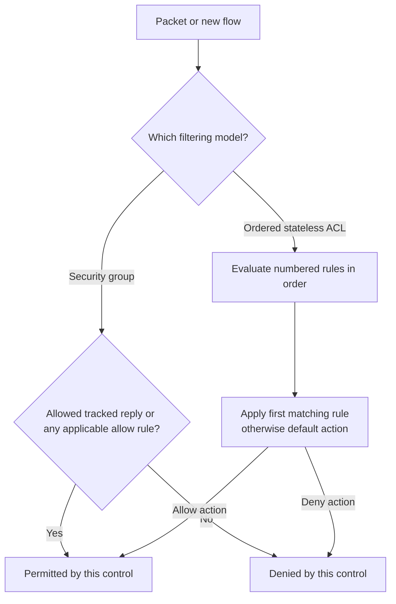
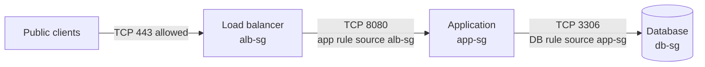
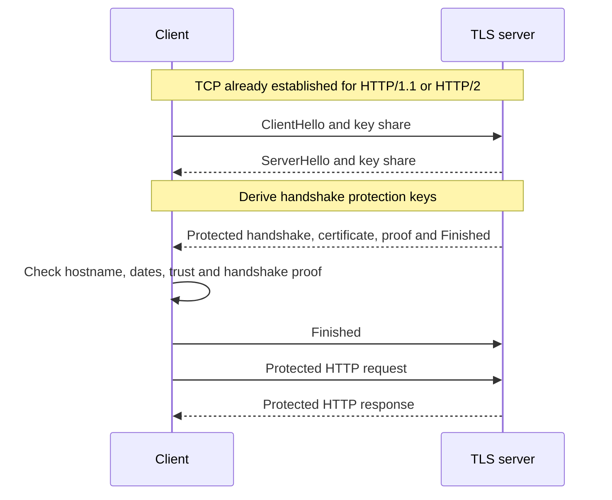
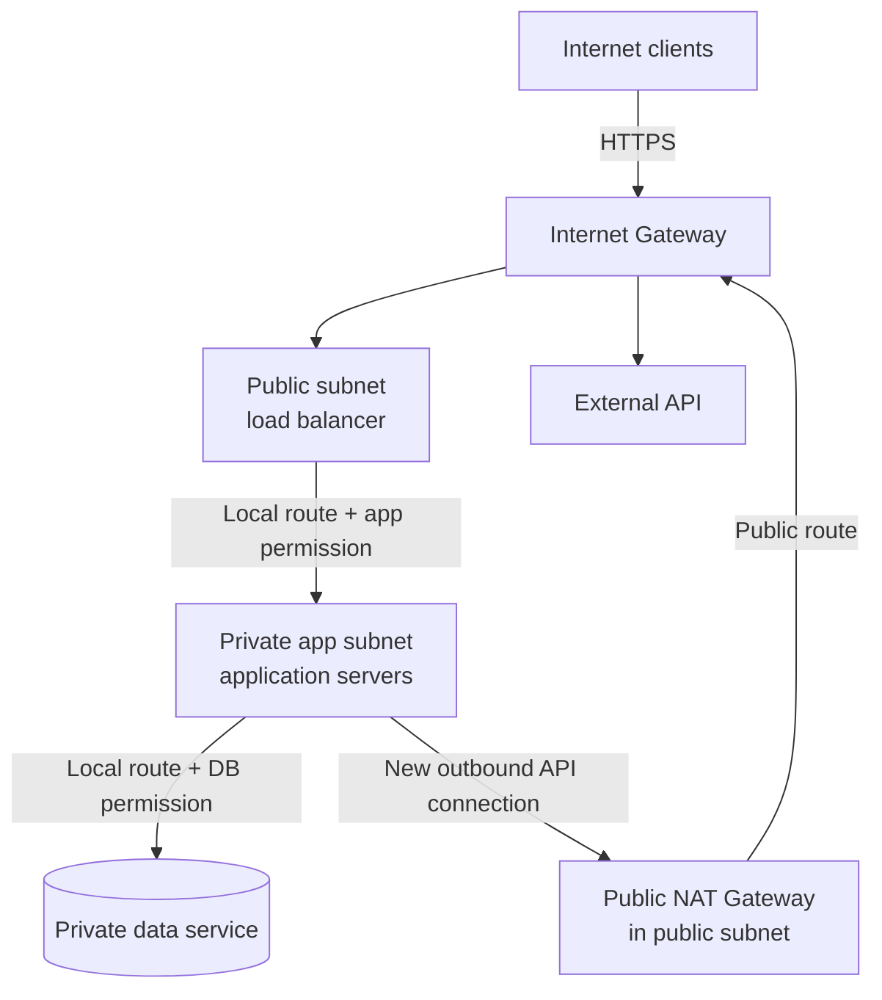

# Part 04 — Diagrams

These diagrams distinguish three questions: is there a route, does policy permit the traffic, and is the communication protected? An arrow means only what its accompanying explanation says.

## 1. Direction is relative to the boundary

```text
Client ----request----> [ App ] ----API request----> Provider
               ingress       egress
Client <---response---- [ App ] <---API response---- Provider
                egress       ingress
```

Arrows are packet direction relative to the app. The provider's reply is ingress even though the app initiated that connection. Stateful filtering recognises such return traffic. Egress restrictions apply to new outgoing connections and help limit misuse after compromise.

Read with [Direction comes before permissions](Part_04_Study_Notes.md#direction-comes-before-permissions).

## 2. Rule evaluation depends on the control



Arrows are decision steps. SG permissions combine, while a NACL uses ordered allow/deny rules and independently evaluates return packets. "Permitted" here does not imply that routing, other filters, TLS or application authorisation succeed.

Read with [Firewalls](Part_04_Study_Notes.md#firewalls-control-reachability) and [Security groups](Part_04_Study_Notes.md#security-groups-express-access-between-resources).

## 3. Grant access to the tier that needs it



Arrows are permitted new connection paths. SGs are policies associated with network interfaces, not separate boxes a packet physically visits. App and DB outbound rules must permit any connections they initiate; tracked responses to allowed connections are automatic. Group references follow eligible resource membership, not usernames, and do not create routes.

Read with [Follow the allowed application path](Part_04_Study_Notes.md#follow-the-allowed-application-path).

## 4. Reachability requires several independent conditions

```text
Client -> route/public entry -> network filters -> host filter -> listener
                                  SG + NACL           UFW       address:port
                                                                    |
                                                               TLS, then app

127.0.0.1:8080 = local IPv4 only
0.0.0.0:8080   = all local IPv4 interfaces, still subject to the path above
```

Arrows mean required delivery conditions, not a universal physical ordering for every provider. A localhost test begins inside much of this path. It proves the local service can answer that request, but leaves the external path and bind choice unresolved. Opening a port changes a filter, not a listener or certificate.

Read with [The nginx demonstration](Part_04_Study_Notes.md#the-nginx-demonstration-connects-service-and-network-checks) and [Ports and binding](Part_04_Study_Notes.md#a-port-selects-the-service-and-the-bind-address-limits-its-audience).

## 5. TLS 1.3 establishes keys and validates the endpoint



Arrows are conceptual handshake messages, with several messages grouped for readability. Key establishment starts in the hellos. The server proves possession of the certificate's private key; the client also needs a valid trusted chain and matching hostname. Optional client authentication and resumption are omitted. Encryption protects content, not the honesty of the website or its application code.

Read with [A conceptual TLS 1.3 exchange](Part_04_Study_Notes.md#a-conceptual-tls-13-exchange).

## 6. Trust comes from the client, not a certificate's mere presence

```text
Client trust store: trusted root CA
                            |
                    verifies intermediate CA
                            |
                    verifies server certificate
                            |
         hostname matches + dates valid + allowed use
                            |
          server proves possession of matching private key
                            |
                   handshake can be accepted
```

Vertical lines represent validation dependencies. Servers normally send the leaf and needed intermediates; the root is already trusted by client configuration. Revocation processing varies by client. A self-signed certificate can be explicitly trusted in a controlled private environment, but its presence alone does not establish public browser trust.

Read with [TLS protects the connection](Part_04_Study_Notes.md#tls-protects-the-connection-and-authenticates-the-domain-endpoint).

## 7. VPC inbound and outbound paths are different



The incoming user path ends first at the public load balancer. The **separate outgoing path** starts at the app and follows NAT → IGW → external API. NAT returns replies using existing mappings; it is not an incoming user gateway to the app. SGs and other controls still filter both paths.

```text
Public subnet route table          Private app route table
10.0.0.0/16 -> local                10.0.0.0/16 -> local
0.0.0.0/0   -> IGW                  0.0.0.0/0   -> public NAT

Optional separate data subnet route table
10.0.0.0/16 -> local                no Internet default route
```

Public/private status comes from the route, not the subnet's name or the presence of an instance public IP. Direct public IPv4 instance access additionally needs a public address and permissions. The lecture's six-subnet layout has public/private pairs in three AZs. Giving the database a local-only route table requires separate data subnets; a DB sharing the app subnet shares its NAT route.

Read with [VPCs](Part_04_Study_Notes.md#vpcs-arrange-public-entry-points-and-private-services) and [Separate paths](Part_04_Study_Notes.md#keep-the-inbound-and-outbound-paths-separate).

## 8. Independent controls limit damage

```text
Identity       MFA, roles, least privilege
Network        routes, private placement, SG/NACL, WAF
Host           updates, hardening, host firewall
Application    authentication, authorisation, input validation
Data           encryption, access controls, tested backups
Operations     logs, metrics, alerts, incident response
```

This is a set of complementary controls, not a promise that every attacker traverses every row in order. A leaked credential might bypass some network controls; authorisation, limited permissions and monitoring should still constrain its consequences. A valid TLS connection may carry malicious input, so application controls remain necessary.

Read with [Combine controls](Part_04_Study_Notes.md#combine-controls-so-one-mistake-has-limited-reach) and the [applied interview scenarios](Part_04_Interview_Questions.md#optional-applied-scenarios).
