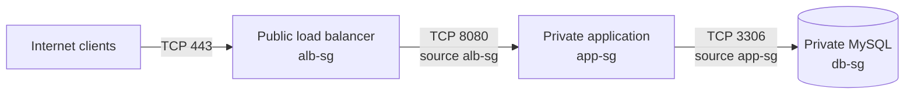
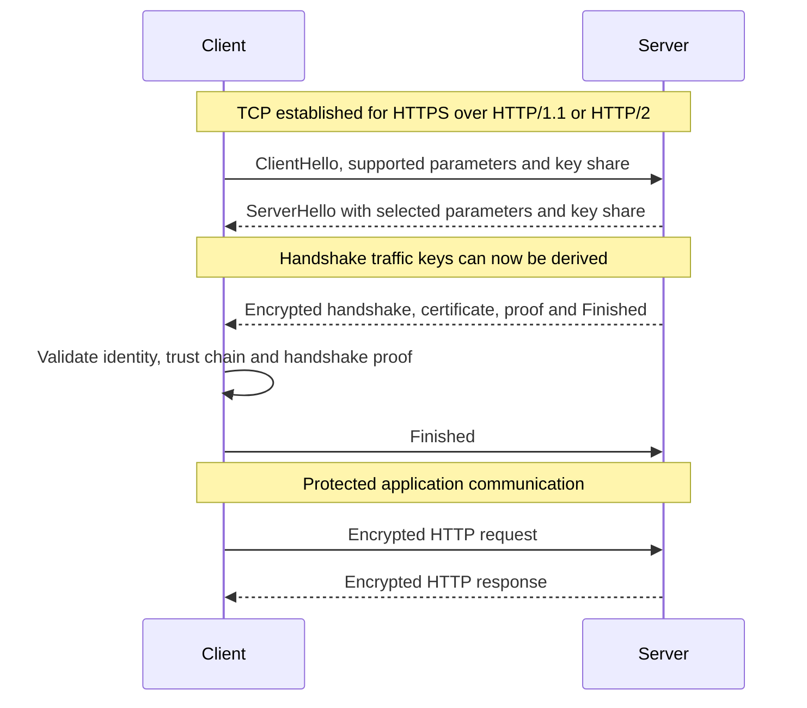
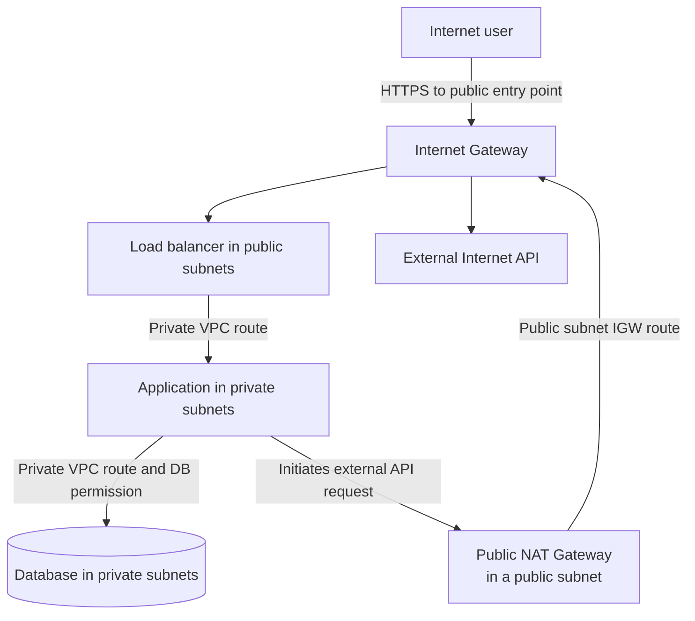

# Part 04 — Internet Security

Parts 1–3 explain how traffic reaches an application. Security asks who should be able to reach it, what they may do, and how to protect the data on the way. The lecture follows a useful practical story: install nginx on EC2, discover that the web page is blocked, fix network permissions, add HTTPS, then organise the application inside a VPC.

Lecture segment: **02:49:20–03:30:07 — How Security Works on the Internet**. The teaching order below follows ingress/egress, firewalls, security groups, ports, TLS, UFW and VPCs. **Optional depth** retains selected production/interview context from the original material.

## Direction comes before permissions

**Ingress** is traffic entering the system or boundary you are discussing. **Egress** is traffic leaving it. Direction is relative: an app's request to a database is egress from the app and ingress to the database. A reply to an app-initiated external API connection is still ingress to the app, even though it belongs to an outbound-initiated connection.

```text
User request  ------> [ Web service ] ------> External API request
             ingress               egress
User response <------ [             ] <------ External API reply
              egress               ingress
```

The arrows represent packet direction. Security rules commonly distinguish new incoming connections from return traffic. A **stateful** filter remembers allowed connections and recognises their replies; a **stateless** filter evaluates each packet separately and needs rules for both directions.

A public web entry point usually needs incoming HTTPS. It rarely needs incoming SSH from every address. Outgoing permissions matter too: a compromised application could otherwise send stolen data or contact attacker infrastructure. Restricting egress requires knowing legitimate dependencies such as DNS, package repositories, external APIs and monitoring.

**Least privilege** means allowing the minimum access needed for the job. It is easier to reason about a small set of necessary paths than a long rule list with unexplained exceptions.

## Firewalls control reachability

A **firewall** permits or blocks traffic according to policy. A host firewall runs inside the operating system; a network firewall filters elsewhere along the path. Depending on its capabilities, it may consider protocol, addresses, ports, connection state or application content.

A transport flow can be described by the **five-tuple**: source IP, source port, destination IP, destination port and protocol. Basic filtering uses these fields. A Web Application Firewall, **WAF**, examines HTTP requests to address application-facing patterns. A WAF needs access to HTTP content, usually after TLS termination at a compatible entry point.

| Control | Decision scope | Example |
|---|---|---|
| Stateless packet filter | Each packet independently | Network ACL |
| Stateful firewall | Packets plus tracked connection state | Security group, many host firewalls |
| WAF | HTTP requests and application patterns | Managed web firewall |
| Next-generation firewall | Broader application identification and inspection | Enterprise network security appliance |

For an ordered rule set, the first matching rule may determine the result; otherwise a default policy applies. AWS security groups use a different model: all applicable allow rules are considered together. Do not memorise "first match wins" as a property of every firewall.

A **drop** silently discards traffic. A **reject** returns an error, such as a TCP reset or an ICMP message. A client seeing a timeout cannot tell from that alone whether a firewall dropped the packet or a different part of the path failed.

The firewall reduces the **attack surface**, the set of reachable services. It does not repair a vulnerable application, validate every user action, scan every file, or replace authentication. Malicious input can still arrive through a deliberately allowed HTTPS connection.

### The nginx demonstration connects service and network checks

The instructor installs and starts nginx on an Ubuntu EC2 instance, but the browser cannot reach its HTTP page. SSH worked because TCP 22 was allowed; HTTP 80 was initially blocked by the security group. Allowing the needed HTTP source made the page reachable.

```bash
sudo apt install nginx
sudo systemctl start nginx
sudo ss -tulpn
curl -I http://localhost
```

These commands illustrate separate questions: is the process running, is it listening, and can it answer a local request? A successful localhost response does not prove that it listens on an external interface, has a usable route/public entry point, or passes the host firewall, security group and network ACL. It narrows the investigation rather than proving one universal cause.

## Security groups express access between resources

In AWS, a **security group**, SG, acts as a stateful virtual firewall for associated network interfaces. It has **allow rules only**: traffic without an applicable permission is denied. Rules are evaluated as a set rather than an ordered allow/deny list; permissions from multiple attached groups combine.

When a connection is allowed, tracked return traffic is permitted even if a separate reverse-direction rule would not otherwise allow that reply. A new outgoing connection still needs an applicable outbound rule. A newly created ordinary SG commonly starts with no inbound permissions and an allow-all outbound rule; the VPC's default security group has its own initial rules, so inspect the actual configuration.

A source of `203.0.113.10/32` means one IPv4 address. `0.0.0.0/0` matches every IPv4 address and is often displayed as "Anywhere IPv4". IPv6 uses separate rules, with `::/0` for every IPv6 address. A console's "My IP" commonly inserts the current public IPv4 address as a `/32`; a changed network or public IP can therefore invalidate that access rule.

Allowing public TCP 443 is normal for a public web entry point. Allowing public SSH or database traffic expands exposure without serving the product's normal users. Restrict administration to an appropriate admin source, VPN, bastion or managed session-access mechanism.

### Follow the allowed application path



The arrows are permitted new connections, not a physical series of firewall appliances. The application accepts its service traffic from the load balancer's SG, and the database accepts its port only from the application's SG. Responses use the tracked connection state.

| Resource group | Allow inbound | Allow new outbound connections |
|---|---|---|
| `alb-sg` | TCP 443 from required public clients | TCP 8080 to `app-sg` |
| `app-sg` | TCP 8080 from `alb-sg` | TCP 3306 to `db-sg`, required external APIs/DNS |
| `db-sg` | TCP 3306 from `app-sg` | Only connections the DB itself needs to initiate |

The table is a simplified application policy, not a complete production ruleset for every platform dependency. Allow port 80 at the load balancer only if an HTTP redirect or another intended use requires it.

An **SG reference** follows resource membership rather than a fixed list of changing instance IPs. It permits traffic from associated interfaces when the provider's referencing rules apply. It does not copy the referenced group's rules, create a network route, or grant application-level identity. A new autoscaled app instance still needs the correct group attachment and network path.

**Optional depth — SG versus NACL.** A network ACL is attached at the subnet level. AWS NACLs are stateless, support allow and deny, and evaluate numbered rules in order. Return packets need explicit permissions, often involving ephemeral ports. SGs are stateful, allow-only and associated with interfaces. They complement one another; a broad SG permission cannot bypass a blocking NACL. Cross-VPC SG references have supported cases and restrictions, so do not assume either that all cross-VPC references work or that none do.

## A port selects the service, and the bind address limits its audience

TCP and UDP ports are 16-bit numbers. The same port number can exist separately in TCP and UDP, and a conventional service port can be changed by configuration. Opening TCP 443 does not create a web server or force the listening program to speak TLS.

| Common service | Conventional port and transport | Remember |
|---|---|---|
| SSH | TCP 22 | Remote administration |
| HTTP | TCP 80 | Plain HTTP, often redirected |
| HTTPS | TCP 443, or UDP 443 for HTTP/3 | TLS configuration is still necessary |
| DNS | UDP and TCP 53 | Not UDP-only |
| SMTP | TCP 25, 587 or 465 | Relay versus submission/TLS conventions differ |
| MySQL / PostgreSQL | TCP 3306 / 5432 | Usually private application access |
| Redis / MongoDB | TCP 6379 / 27017 | Avoid unnecessary public exposure |

Well-known ports occupy 0–1023, registered ports 1024–49151 and dynamic/private ports 49152–65535. Operating systems choose actual ephemeral source-port ranges according to their settings. Ports help the OS select sockets, which belong to processes; they are not globally unique application IDs.

```text
Client 198.51.100.7:54321  ---->  Server 203.0.113.10:443
       temporary source                service destination

127.0.0.1:8080   listens only on local IPv4 loopback
0.0.0.0:8080     listens on all local IPv4 interfaces
[::]:8080       IPv6 wildcard, IPv4 handling depends on OS settings
```

A wildcard bind is a local listening choice. Firewall policy and routing still determine who can connect. Two ordinary listeners cannot independently bind the same local IP, transport and port without suitable sharing mechanisms; multiple accepted TCP connections can nevertheless use the same server port because their remote endpoints differ.

## TLS protects the connection and authenticates the domain endpoint

Plain HTTP allows observers on the path to read or modify requests. **Transport Layer Security**, TLS, provides confidentiality through encryption, integrity through tamper detection, and normally authentication of the server endpoint. **SSL** is its obsolete predecessor; people still use "SSL certificate" informally for a certificate used with TLS.

TLS does not automatically authenticate the human user. Login credentials, sessions and tokens belong to application authentication; **mutual TLS**, mTLS, additionally uses client certificates when required.

A **certificate** binds a public key to names and other information, signed by an issuer. During the handshake the server proves possession of the corresponding private key. The client checks that the certificate matches the requested hostname, is within its validity period, and chains through appropriate intermediate certificates to a trusted root certificate authority, **CA**. Revocation handling depends on the client and deployment; do not assume every connection performs the same online revocation lookup.

```text
Trusted root CA
      | signs
Intermediate CA
      | signs
Server certificate: permitted hostnames + public key + dates
      |
Server proves possession of the matching private key
      |
Client accepts only if the required validation succeeds
```

The root is trusted because it is in the client's trust configuration, not because a server happens to send it. Servers generally send the leaf and intermediate chain; the client already has its trust anchors.

### A conceptual TLS 1.3 exchange



This is a normal full TLS 1.3 server-authentication exchange at a conceptual level; optional retries, resumption and client authentication are omitted. Key establishment starts with the hello messages, so a diagram that postpones all key exchange until after certificate validation misrepresents TLS 1.3. Symmetric session keys protect the bulk data efficiently. Detailed key schedules and cipher suites are optional.

**SNI**, Server Name Indication, lets a client indicate the hostname so a server hosting several sites can select the right configuration/certificate. HTTPS protects HTTP paths, headers and bodies on the network; destination IPs and some connection metadata remain observable. The hostname can also be exposed by DNS or the handshake depending on the protocols and configuration in use.

A valid certificate secures communication with the named endpoint. A phishing site can obtain a valid certificate for its own lookalike domain. HTTPS does not prove honest business intent, repair SQL injection or protect data after an authorised endpoint decrypts it.

### Making the nginx example serve HTTPS

Allowing TCP 443 is only one condition. nginx also needs a TLS listener, a suitable certificate/private key and correct configuration. A client needs a valid hostname and trust chain. The lecture mentions **Certbot**, a tool used to obtain and renew certificates, commonly from Let's Encrypt.

```bash
sudo apt install certbot python3-certbot-nginx
sudo certbot --nginx -d your-real-domain.example
sudo certbot renew --dry-run
```

These illustrate server configuration rather than instructions to run against the placeholder. Domain-control validation and reachable challenge handling must be configured appropriately. Certificate lifetimes change with issuer policy; use automated renewal and monitor expiry instead of assuming a permanent or fixed-duration certificate. A missing intermediate, wrong name, expired certificate, incorrect client clock or untrusted issuer can all cause a TLS error.

**Optional depth — where TLS ends.** A load balancer may terminate TLS and forward HTTP internally, terminate then open a new TLS connection to the backend, or pass encrypted traffic through to a backend that terminates it. Re-encryption protects the internal hop but adds certificate/configuration work. "HTTPS to the load balancer" alone does not prove that every internal hop is encrypted. HSTS tells supporting browsers to use HTTPS for a domain, subject to its policy and browser state.

## UFW adds a host-level control

**Uncomplicated Firewall**, UFW, is a Linux interface to host packet-filtering rules, commonly through iptables and the system's filtering backend. It provides readable allow, deny, limit and status commands. The cloud SG and host firewall are separate controls; both must permit the intended traffic.

A small policy example for a disposable Ubuntu server is:

```bash
sudo ufw default deny incoming
sudo ufw default allow outgoing
sudo ufw allow from 203.0.113.10 to any port 22 proto tcp
sudo ufw allow 80/tcp
sudo ufw allow 443/tcp
sudo ufw enable
sudo ufw status verbose
```

The admin address is an example documentation address, not the address to use literally. Permit the access actually needed **before** enabling a remote firewall. On systems where it is appropriate, `sudo ufw allow OpenSSH` permits the named SSH application profile more broadly; it is not equivalent to a source-restricted rule.

`sudo ufw status numbered` helps inspect rules. `sudo ufw delete allow 80/tcp` removes a matching permission. `sudo ufw limit 22/tcp` adds rate limiting, but does not replace key-based authentication or appropriate source restrictions. Changing or deleting a rule changes reachability, not the service's listening configuration.

**Optional depth — containers.** Docker can install forwarding/NAT rules that make published container ports reachable despite expectations based on UFW's ordinary host-input rules. Check the actual published bindings, runtime networking and externally observed access. The appropriate integration depends on Docker's firewall backend, so do not assume one iptables chain solves every deployment. Binding a development service to loopback can reduce its exposure.

## VPCs arrange public entry points and private services

A **Virtual Private Cloud**, VPC, is an isolated virtual network where you choose address ranges, subnets and routes. In AWS a subnet belongs to one availability zone, **AZ**. Spreading resources across AZs reduces dependence on a single zone, but only if the application and its dependencies actually have suitable redundancy.

The lecture chooses VPC `10.0.0.0/16`, then three AZs with six subnets: one public and one private in each AZ. The `/16` contains 65,536 addresses before provider reservations and allocation decisions. A simple non-overlapping plan is:

| AZ | Public subnet | Private subnet |
|---|---|---|
| a | `10.0.1.0/24` | `10.0.11.0/24` |
| b | `10.0.2.0/24` | `10.0.12.0/24` |
| c | `10.0.3.0/24` | `10.0.13.0/24` |

A **route table** chooses a next target based on destination, using the most specific matching route. A local VPC route permits a routing path between subnets; security controls still decide whether traffic may pass.

```text
Public route table                 Private app route table
10.0.0.0/16 -> local                10.0.0.0/16 -> local
0.0.0.0/0   -> internet gateway     0.0.0.0/0   -> public NAT gateway
```

A **public subnet** has a route to an internet gateway, IGW. A subnet's label is route-based: it remains public even if a particular instance has no public IP. For direct public IPv4 access, that instance additionally needs a suitable public address, permitted traffic and a working service. A public load balancer can instead be the entry point for private application servers.

A **private subnet** has no direct IGW route. It may have a default route through a public NAT gateway for outbound Internet access, or no Internet default route at all. A resource in an isolated subnet can still communicate over permitted private routes.

### Keep the inbound and outbound paths separate



The user path reaches the load balancer, which establishes the permitted connection to the private application. The separate outgoing path begins at the application, uses NAT and exits through the IGW. Replies return through the NAT's existing mapping. There is no inbound user path through NAT to the application.

For this **public NAT gateway** pattern, the gateway resides in a public subnet and uses an elastic public IP. NAT translates addressing and tracks mappings; SGs/NACLs perform configurable filtering. NAT and IGW are not interchangeable, and neither replaces application authentication.

In the lecture's six-subnet layout, an app and DB sharing one private subnet share its route table. If that table has a NAT default route, the DB also has that routing path, subject to its security rules. To give the DB **no Internet route**, add separate private data subnets with local-only route tables. That is an optional refinement with more subnets, not a property automatically provided by the six-subnet design.

**Optional depth — resilience and private connectivity.** A NAT gateway is an AZ-scoped dependency in this pattern. Using one per AZ avoids making all private app subnets depend on a single zone's NAT path, at additional cost. VPC endpoints can provide private paths to supported cloud services. VPC peering connects suitable VPCs, but overlapping address space and routing restrictions matter. Hybrid networks and Transit Gateway design are beyond this first pass.

The lecture deletes its demo VPC. Do not generalise the console demonstration into "deleting any VPC deletes all workloads automatically." Dependencies may need to be removed first, and deletion behaviour differs by resource and operation. The useful learning point is to understand dependencies and clean up a disposable demonstration deliberately.

## Combine controls so one mistake has limited reach

**Defence in depth** uses several controls because each has gaps. Private network placement reduces exposure, security groups limit paths, TLS protects connections, host hardening reduces exploitable software, application authentication identifies users, authorisation restricts actions, and monitoring reveals failures. None makes the others unnecessary.

| Layer | Concrete practice | Failure it helps limit |
|---|---|---|
| Identity | MFA, least-privilege roles, short-lived credentials | Stolen or overpowered credentials |
| Network | Private data placement, SG references, appropriate NACL/WAF rules | Unnecessary reachability and lateral access |
| Host | Updates, hardening, host firewall | Vulnerable or unnecessarily exposed services |
| Application | Authentication, authorisation, input validation | Misuse through allowed endpoints |
| Data | Encryption in transit/at rest, access controls, tested backups | Disclosure and data loss |
| Operations | Logs, metrics, alerts, incident response | Undetected compromise or prolonged outage |

The cloud provider secures its underlying infrastructure; customers secure their identities, configurations, application code and data according to the service's **shared responsibility** model. A managed service changes the division of work, not the need to understand it.

Common mistakes include public databases, unnecessary world-open SSH, credentials committed to code, overly broad IAM permissions, unintended public storage, missed certificate renewal and untested backups. Reduce the **blast radius**, the damage a single compromised component can cause, by giving each component only the access it needs.

**Optional scenarios.** A leaked credential should be revoked/rotated promptly and its activity investigated; removing it from the latest source file is insufficient. DDoS can exhaust bandwidth, connection state or application capacity, so upstream protection, edge caching, rate limits and application controls address different mechanisms. Autoscaling alone may turn an attack into a large bill. Zero trust adds explicit identity and authorisation rather than assuming an internal network location is trustworthy. These are useful extensions, not extra configurations required to understand the lecture.

## One-minute revision

Describe every permission with a direction, source/destination, protocol and port. SGs track connections and combine allow rules; NACLs inspect packets with ordered allow/deny rules. A listening service, permitted path and suitable routing are all required for reachability. TLS protects a connection to a validated domain endpoint; it does not certify an application's intentions or authorise users. Public/private subnet status comes from routes, while NAT provides an outbound translation path for private resources. Layer network controls, host/application security, data protection and monitoring so one failure has limited reach.

Use the [diagram companion](Part_04_Diagrams.md) for the security-group, TLS and VPC paths, the [resources](Part_04_Additional_Resources.md) for interpreted commands, and the [interview questions](Part_04_Interview_Questions.md) to check understanding. Continue to [Part 5 — System Design Fundamentals](../05_System_Design_Fundamentals/Part_05_Study_Notes.md).