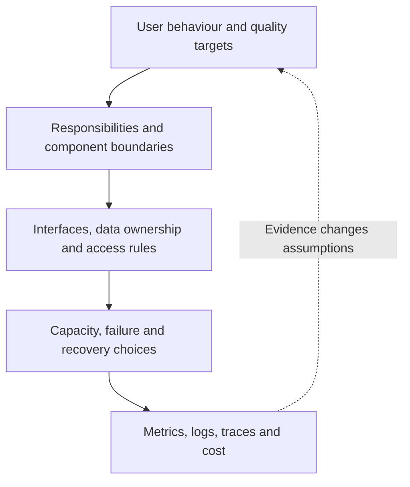
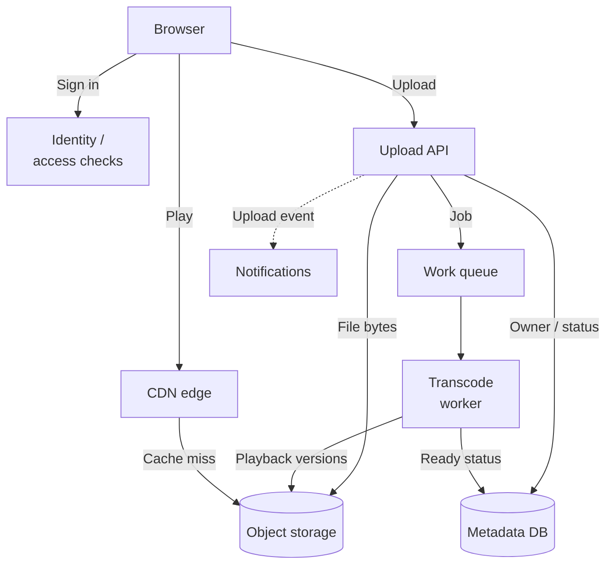
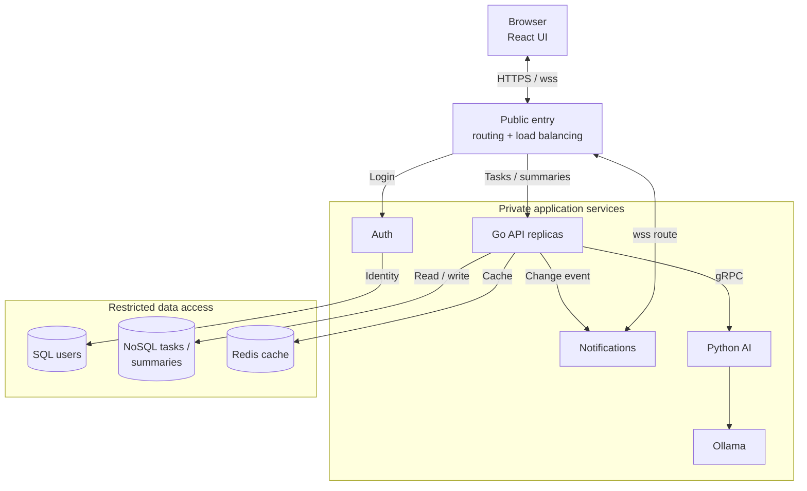
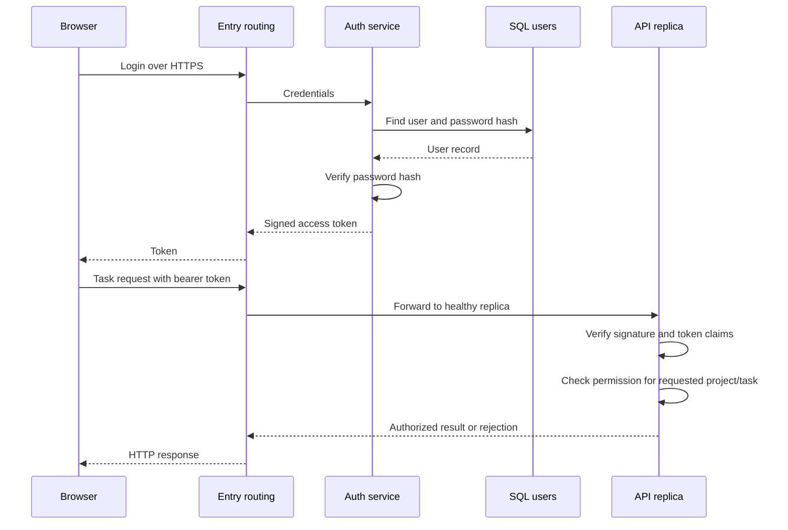
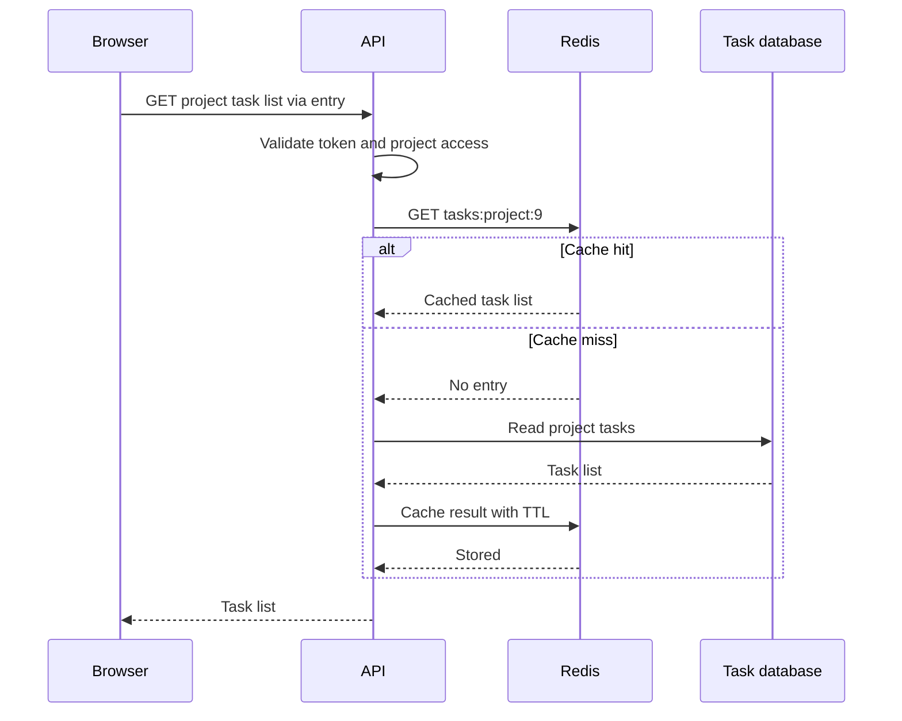
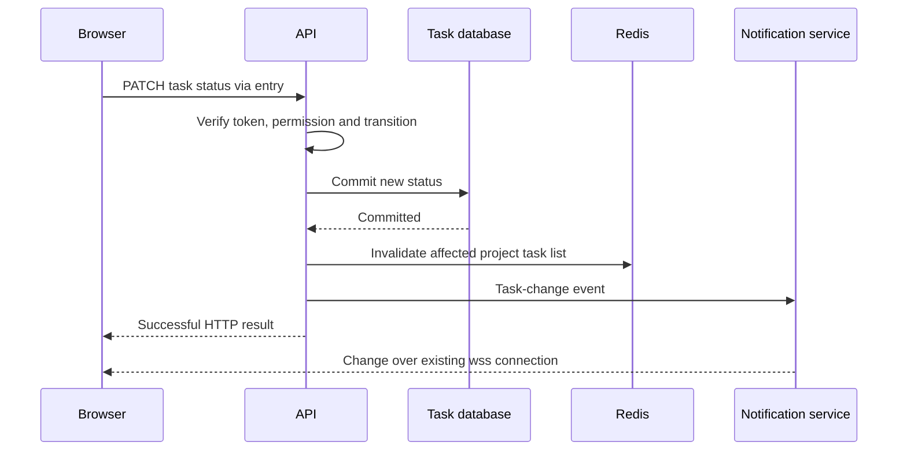
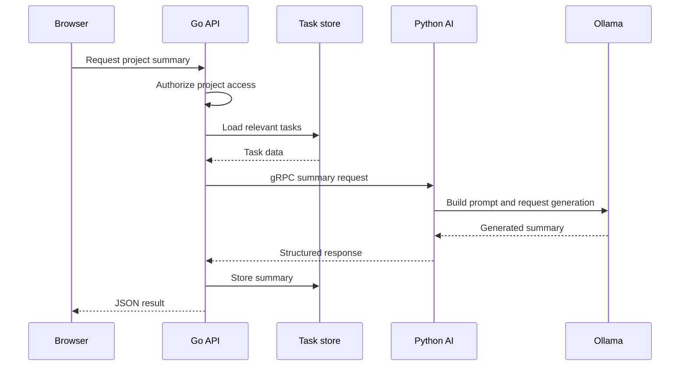
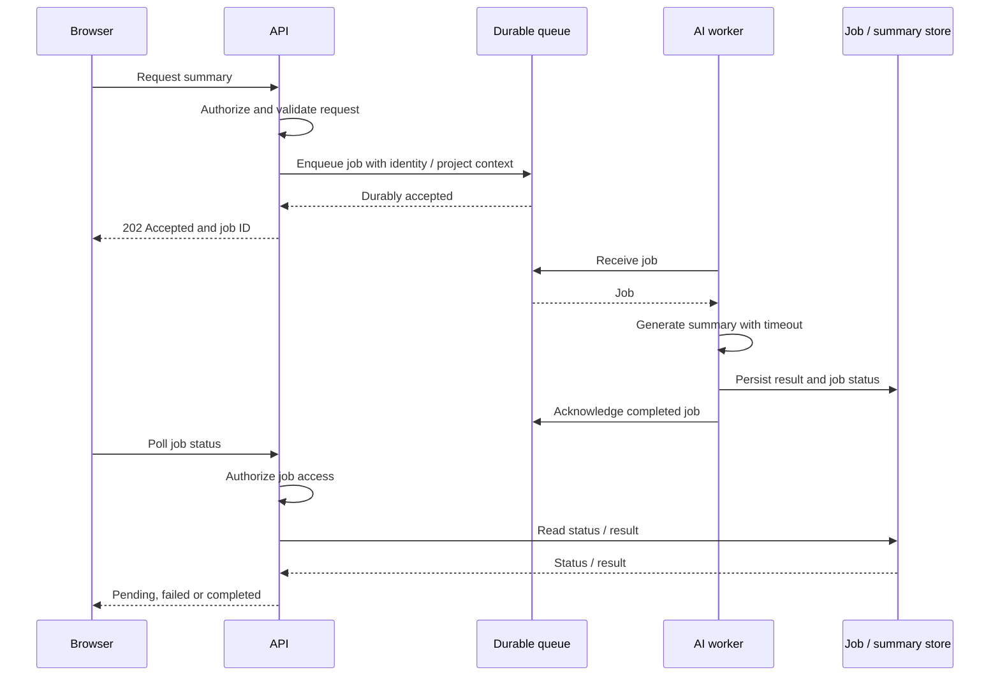
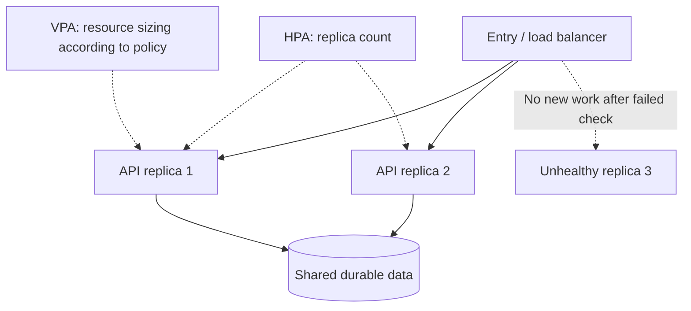
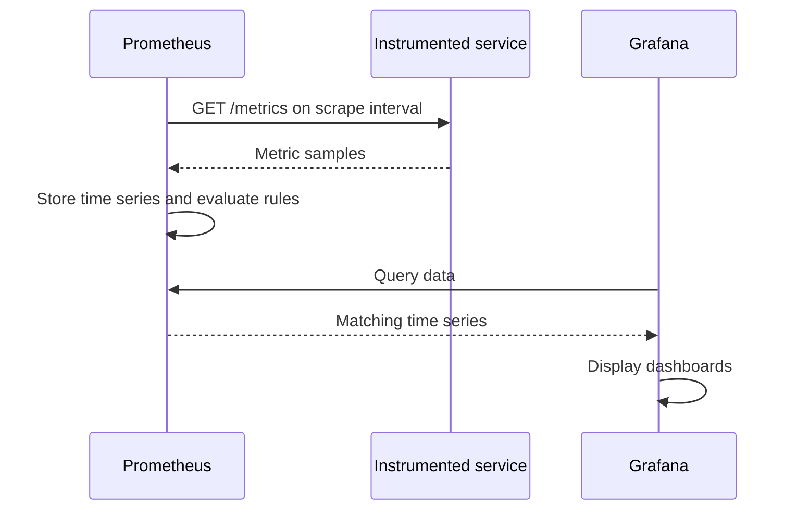

# Part 05 — Diagrams

These drawings explain the same project at different levels. Read the matching [Study Notes](Part_05_Study_Notes.md) section, then follow one user action through the relevant diagram. Arrows show the labelled interaction, rather than a universal network topology. The queue is a source supplement to the lecture's basic synchronous AI path.

## Diagram 1: Requirements become decisions

Related notes: [Design starts with a user promise](Part_05_Study_Notes.md#design-starts-with-a-user-promise).



“Task edits survive an AI outage” constrains dependencies and resource limits. “Users can only edit their projects” constrains every data path, including cached reads. Measurements close the loop: design is revisited when requirements or evidence change.

## Diagram 2: A video page hides several workflows

Related notes: [The examples reveal the system behind the screen](Part_05_Study_Notes.md#the-examples-reveal-the-system-behind-the-screen).



Read downward from the browser's three actions: sign in, upload, and play. Uploads require identity/access checks, while file storage and queryable metadata solve different persistence problems. The CDN fetches missing playback objects and can retain suitable cacheable copies. The queue/worker lets processing continue after upload acceptance; completion can update metadata and trigger publication notifications. Search and recommendations can be added when required.

The React poster page in a Netflix-style clone implements only the visible client. None of the other responsibilities follows automatically from that UI.

## Diagram 3: DevBoard and its trust boundaries

Related notes: [DevBoard gives each responsibility a home](Part_05_Study_Notes.md#devboard-gives-each-responsibility-a-home).



The entry is a logical routing layer. Specific policies need suitable gateway, WAF, or application features; an ELB alone does not provide every policy. The browser never receives database credentials. Security groups, routes, listeners, and TLS policy govern the real connections underneath.

Login issues a token. Later API requests can validate it locally with trusted keys, then check project/task permissions. Redis holds temporary copies that the API looks up or invalidates. Kubernetes manages workloads around these boundaries. Monitoring is drawn separately in [Diagram 9](#diagram-9-metrics-are-pulled-dashboards-query): Prometheus/Grafana are observation paths, rather than request-path dependencies.

## Diagram 4: Login and authorization are separate steps

Related notes: [Login establishes identity, then every operation checks permission](Part_05_Study_Notes.md#login-establishes-identity-then-every-operation-checks-permission).



Token validation does not prove permission to every resource. Auth-service failure need not break an existing token only when the API can still obtain trusted keys and necessary authorization information. A typical signed JWT is readable, so its payload must not contain secrets.

## Diagram 5: Task reads and cache-aside

Related notes: [Redis saves repeated work but creates a freshness decision](Part_05_Study_Notes.md#redis-saves-repeated-work-but-creates-a-freshness-decision).



The API loads data on a miss; Redis does not independently query the database in this pattern. Authorization must also protect cache hits. A TTL bounds an entry's lifetime, while write invalidation reduces stale copies. Neither mechanism alone provides strict consistency.

## Diagram 6: A task write persists before live delivery

Related notes: [Trace a task edit and an AI request](Part_05_Study_Notes.md#trace-a-task-edit-and-an-ai-request).



Entry routing is omitted from these later sequence diagrams to keep the application decisions readable. The HTTP response and push notification are separate paths and can arrive in either order.

A notification failure should not undo committed task data. Reliable publication needs durable recording/recovery or reconciliation. A client reconnect can refetch the task state even if a push was missed. Cache invalidation can race with an older read repopulating the cache, so freshness requirements still matter.

## Diagram 7: AI can be synchronous or a background job

Related notes: [Contracts connect the browser and services](Part_05_Study_Notes.md#contracts-connect-the-browser-and-services) and [Trace a task edit and an AI request](Part_05_Study_Notes.md#trace-a-task-edit-and-an-ai-request).

The lecture's basic request:



This is simple but holds the request while generation runs. It needs deadlines and bounded concurrency so a slow model does not consume the whole API.

**Source supplement — background processing:**



Push notification can replace repeated polling or signal when to fetch the result. The queue's guarantees and retry policy matter: redelivery is possible, so processing needs idempotency and failed-job handling. A completed HTTP acceptance is not a completed summary.

## Diagram 8: Scaling and failure boundaries

Related notes: [Distribute load without hiding the bottleneck](Part_05_Study_Notes.md#distribute-load-without-hiding-the-bottleneck).



The autoscaler arrows describe distinct mechanisms, not a recommendation to combine HPA and VPA blindly. HPA/VPA settings, metric signals, resource requests, and infrastructure capacity must fit together. More replicas help only if work/state and downstream capacity permit them.

| Failure | User-facing effect | Deliberate response |
|---|---|---|
| One API replica | Reduced capacity | Health checks and remaining replicas |
| AI/model | Summaries delayed/unavailable | Timeouts, bounded jobs, useful error |
| Notification service | Live updates delayed | Reconnect/refetch, durable replay if required |
| Redis | Higher read cost | Controlled DB fallback |
| Task database | Board operations unavailable | Failover plan and recoverable backups |
| Auth service | New logins fail | Existing valid tokens only if independently verifiable |
| Sole entry point | External app unreachable | Suitable redundant/multi-AZ entry |
| Monitoring | Visibility lost | Independent monitoring-health alerts |

Separate services are potential boundaries. Resource limits, deadlines, and recovery rules make those boundaries useful. A replica is not a backup of historical state.

## Diagram 9: Metrics are pulled, dashboards query

Related notes: [Measure user experience and contain partial failures](Part_05_Study_Notes.md#measure-user-experience-and-contain-partial-failures).



Prometheus initiates the scrape. Grafana queries a data source; it does not need to receive application requests. Check request rate, latency percentiles, errors, saturation, and relevant queue/cache/DB signals. Logs and traces help explain an incident after metrics reveal a symptom.

## Diagram 10: Application structure and repository structure

Related notes: [Architecture and repository choices answer different questions](Part_05_Study_Notes.md#architecture-and-repository-choices-answer-different-questions).

```text
ONE APPLICATION DEPLOYMENT
  [ auth module | tasks module | summaries module ] → external database
                      modular monolith

INDEPENDENT APPLICATION DEPLOYMENTS
  [ auth service ]  [ tasks service ]  [ AI service ]
                      microservices

ONE SOURCE REPOSITORY
  /services/auth  /services/tasks  /services/ai  /libraries  /infra
                      monorepo
```

A monorepo can contain microservices or a monolith. Client-server roles can appear in either architecture, and either can participate in a distributed deployment. Choose service boundaries for an actual capability, scaling need, or release/ownership benefit, then account for network and operational costs.

**Back to:** [Study Notes](Part_05_Study_Notes.md) · [Resources](Part_05_Additional_Resources.md) · [Interview questions](Part_05_Interview_Questions.md)


