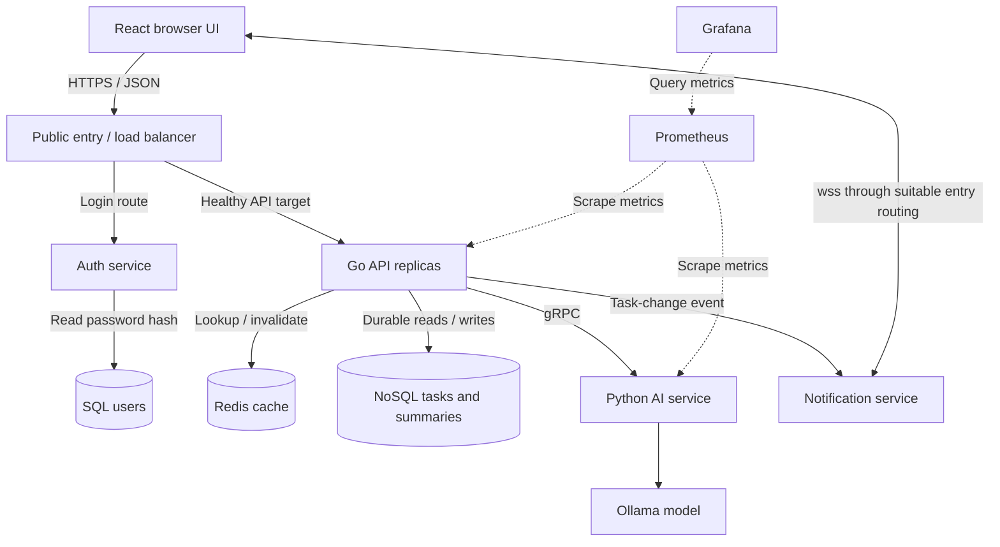

# Part 05 — System Design Fundamentals

This part joins the networking course into one application. Follow the lecture's order: understand the design problem, uncover the components behind familiar products, walk through DevBoard, then compare ways to organise an application and its code.

**Lecture:** 03:30:07–04:19:58 in [Computer Networking & System Design For DevOps in OneShot](https://youtu.be/xN3BKHji12I). Parts 1–4 supply the underlying DNS, transport, TLS, addressing, and access-control concepts. **Source supplements** below preserve useful extensions from the original notes while distinguishing them from the demonstrated project.

Use [Diagrams](Part_05_Diagrams.md) beside the explanations, [Resources and commands](Part_05_Additional_Resources.md) for selected follow-up, and [Interview questions](Part_05_Interview_Questions.md) to check your reasoning.

## Design starts with a user promise

System design decides how an application will fulfil its requirements: which components have which responsibilities, how they communicate, where state lives, and how the system behaves under load and failure. Security, operational effort, and cost belong in those decisions. The instructor's phrase about the cost of not thinking before building captures the consequence of skipping design, rather than the whole definition.

A useful design connects a user promise to a technical decision. “Users can move a task to Done” requires a persistent status change and an authorization check. “Task edits remain available while AI is down” requires the task path to avoid depending on successful model calls. A box without a requirement behind it is a candidate for removal.

**Functional requirements** describe behaviour: sign in, create a project, edit a task, request a summary. **Non-functional requirements** describe constraints and quality: expected load, response time, availability, data isolation, durability, and budget. “Fast” leaves too much unspecified. An illustrative requirement is “p95 task-read latency below 300 ms at the expected peak request rate.” The 95th percentile means 95% of observed durations are at or below that value.

The source notes use 10,000 daily users, room for tenfold growth, and 99.9% availability as example targets, not measurements of DevBoard. Daily users alone do not reveal concurrent users or peak requests per second. Ask when people use the app, how often they act, and which operations are expensive. Define the availability measurement window and which requests count. Numbers focus investigation; they do not automatically prove a cache or microservices are necessary.

Design remains iterative. Start with an understandable arrangement, measure it, and revise the actual bottleneck. More components introduce more interfaces, failure paths, deployments, and bills. The aim is enough structure to meet requirements with explainable trade-offs.

## The examples reveal the system behind the screen

The **Book Kida** story begins with a book-exchange page running on `localhost`. It worked on its creator's computer, but did not answer how other people would access it, discover books, provide addresses, pay, or avoid two buyers obtaining the same copy. Public hosting solves reachability, while the remaining promises need application and data decisions. A polished screen can still be an incomplete product.

The YouTube walkthrough makes these hidden responsibilities visible. A page lists videos, but clicking Upload requires identity checks, file validation, durable storage, and metadata such as owner, title, and visibility. Playback needs delivery suitable for many viewers. Subscriber notifications require another path. Processing a large upload may take longer than a normal browser request should wait.

```text
Upload request
  → authenticate and authorize
  → validate file and store it durably
  → record metadata and processing status
  → process/transcode in background
  → publish available playback versions
  → deliver video through CDN
  → notify interested users and monitor the pipeline
```

**Object storage** holds files/blobs; a metadata database supports queries about those files. **Transcoding** produces suitable formats or resolutions. Workers perform background processing. Search and recommendations are further capabilities when required, rather than mandatory boxes in every beginner design.

The Netflix-clone example makes the same distinction: rendering movie posters implements presentation, but does not itself implement licensed playback, storage, authentication, availability, and operations. Large scale does not establish that MySQL is unsuitable. SQL databases can be part of large platforms, and Spark is a data-processing engine rather than a substitute category for an application's database.

The **TrainWithShubham** example adds delivery and cost. Live interactive classes benefit from low-delay media delivery, commonly using UDP-based protocols. Recorded video commonly arrives as HTTP segments, while static notes can be cached by a CDN. Uploading files to a drive and serving course materials are different access and delivery problems; private paid content still needs access control.

Use the lecture's payment figures as an arithmetic assumption: on a ₹1,000 sale, a 2% fee is ₹20, and 18% tax on that fee is ₹3.60. Net receipts are ₹976.40 before other costs. These are example inputs, not a current provider quotation. Hosting, database capacity, storage, delivery traffic, and payment fees all affect whether the product is affordable.

## DevBoard gives each responsibility a home

DevBoard is a task tracker with sign-in, projects, tasks moving between to-do/in-progress/done, an AI summary feature, and live notifications. Its architecture is useful because every component supports one of those behaviours.

The classic three responsibilities are **presentation**, **application/business logic**, and **data**. The lecture calls these tiers and adds an AI tier. A logical layer describes responsibility; a deployment tier describes where software runs. The lecture's tier labels help explain both, but they do not require one machine per responsibility.

| Responsibility | DevBoard's demonstrated choice | Boundary |
|---|---|---|
| Presentation | React UI | Displays data and submits actions |
| Application | Go API | Validates, authorizes, and applies business rules |
| Data | SQL users, NoSQL tasks/summaries | Stores durable state |
| AI | Python service and Ollama | Builds prompts and produces summaries |
| Identity | Auth service | Verifies login and issues tokens |
| Live updates | Notification service | Pushes changes to connected clients |
| Repeated reads | Redis | Stores selected temporary copies |
| Entry and operations | Gateway/ELB, Kubernetes, Prometheus/Grafana | Routes traffic, runs workloads, observes behaviour |



This is a logical view: the WebSocket connection also needs public entry routing. Kubernetes runs and manages application workloads around this picture; it is not another hop in a task request. [Diagram 3](Part_05_Diagrams.md#diagram-3-devboard-and-its-trust-boundaries) expands the boundaries.

The browser has no database credentials and cannot bypass backend permission checks. The API calls data and AI services through explicit interfaces. Private placement and security groups from Part 4 restrict which services can connect. A Java/Spring Boot API could fill the same application role; the design depends on responsibilities and contracts rather than a particular language.

Separation makes independent deployment and scaling possible. Failure isolation also needs timeouts, resource limits, and independent recovery. An isolated AI process can still exhaust API connections if the API waits without bounds for every summary.

## Contracts connect the browser and services

An **API**, Application Programming Interface, defines what another component can request, the data it must send, expected results, and errors. REST-style HTTP APIs and gRPC are both approaches to exposing APIs. “API versus gRPC” therefore mixes a general category with one member.

DevBoard's browser-facing API uses HTTP methods, paths, status codes, and JSON. A task creation might look like this:

```http
POST /api/tasks HTTP/1.1
Host: app.example.com
Authorization: Bearer <access-token>
Content-Type: application/json

{"projectId":"proj_9","title":"Wire up TLS","status":"todo"}
```

The server must validate the fields and permission to modify `proj_9`. A successful creation might return `201 Created` and the task representation. Invalid credentials, forbidden project access, and malformed input are different conditions and should have deliberate error responses.

For Go-to-Python calls, the lecture chooses **gRPC**. A `.proto` schema defines messages and remote procedures, from which tooling generates client and server code:

```proto
syntax = "proto3";

service SummaryService {
  rpc SummarizeProject (SummaryRequest) returns (SummaryResponse);
}

message SummaryRequest {
  string project_id = 1;
}

message SummaryResponse {
  string summary = 1;
}
```

Protocol Buffers commonly encode messages compactly, and ordinary gRPC uses HTTP/2. Generated contracts, multiplexed calls, and unary or streaming communication can suit internal services. A schema reduces ambiguity but does not eliminate deployment-version or runtime errors.

| Browser-facing REST-style HTTP/JSON | gRPC |
|---|---|
| Resource/method conventions | Named remote procedures |
| Human-readable JSON is common | Typed Protocol Buffers are common |
| Straightforward browser and `curl` inspection | Generated clients and specialist inspection tools |
| Can define a formal OpenAPI contract | Schema central to the usual development workflow |
| Useful for public/browser interfaces | Useful for service-to-service and streaming calls |

REST is not defined by JSON or restricted to HTTP/1.1. Browsers generally need gRPC-Web or adapters for gRPC-style access. Efficient encoding can help, but neither approach is always faster.

A contract also needs timeouts, compatible evolution, and retry rules. A call can time out after the remote service committed its work. **Idempotency** means repetition has the same intended effect as performing an operation once. For creation/payment operations, an idempotency key can let the application identify a repeated request rather than create a duplicate. Transport reliability alone cannot settle an uncertain business outcome.

## Choose storage from relationships and access patterns

The lecture stores users in SQL because email uniqueness, relationships, and identity updates benefit from explicit constraints and transactions. It stores tasks and summaries as NoSQL documents because nested fields and evolving document shapes fit the demonstrated access pattern. Tasks could also use SQL; the split is a choice.

```text
SQL user:
  id | email UNIQUE | password_hash | created_at

Task document:
  { id, projectId, title, status, assignee, labels, aiSummary }
```

Store a password hash produced by a suitable password-hashing mechanism, never a reversible plain password. The API needs validation and authorization regardless of database type.

Relational systems support joins, constraints, indexes, and transactions. **ACID** names four transaction properties: atomicity applies all changes or none, consistency preserves defined invariants, isolation governs concurrent interactions, and durability preserves committed data under the system's guarantees. The word consistency here should not be confused with every other use of consistency in distributed systems.

**NoSQL** includes document, key-value, wide-column, and graph models. Transaction, query, and consistency guarantees depend on the product and configuration. Flexible documents still need validation. NoSQL does not mean “no schema,” “always faster,” or “always eventually consistent”; SQL does not mean “cannot scale.”

**Normalization** reduces duplicated relational data; **denormalization** copies selected information to suit reads. Copying an assignee name into each task can save a read, but changing the name then creates update/freshness work. Choose using actual queries and invariants rather than fashion.

An **index** accelerates relevant lookups at a storage and write-maintenance cost. **Replication** maintains copies for availability and sometimes read scaling. **Sharding** splits different data across nodes and requires a useful partition key. Replicas do not automatically remove write bottlenecks; sharding complicates cross-shard queries and rebalancing.

**Source supplement — finding a data bottleneck:** measure query latency, slow queries, CPU, active connections, and pool waits. Fix missing indexes and inefficient access before adding servers. In Java/JPA, an N+1 pattern performs one initial query followed by many related queries. Improve that access pattern, then consider cache or read replicas if the workload justifies them. Replica lag may make a fresh write temporarily absent from a replica read.

Two stores also create two backup/migration paths and cross-store failure cases. Deleting a SQL user does not atomically remove that user's tasks in an independent store. A retryable cleanup process, soft deletion, and reconciliation can make the operation converge. **Eventual consistency** means replicas/copies can temporarily differ and converge when updates stop and communication recovers. More elaborate sagas coordinate steps and compensating actions, but are optional follow-up rather than a prerequisite for understanding DevBoard.

## Login establishes identity, then every operation checks permission

**Authentication** establishes who the caller is. **Authorization** decides whether that identity may perform this operation on this resource. A signed-in user still cannot edit another user's project merely by guessing its identifier.

At login, the auth service verifies credentials against the users store and issues a token. **JWT means JSON Web Token**, correcting the lecture's “Java Web Token.” The signed JWT used here has a header, a payload of claims, and a signature. Claims can include subject (`sub`), expiry (`exp`), issuer (`iss`), and audience (`aud`). Encoding is not encryption; the signed payload is readable and must not contain secrets.

```text
UI → HTTPS login → auth service → verify password hash in SQL
UI ← signed access token ← auth service

UI → API request + bearer token
API → verify signature, allowed algorithm, expiry, issuer and audience
    → check project/task permission
    → apply business rule
```

The API can validate tokens locally using trusted verification keys, avoiding an auth-service/database lookup on every request. Local validation does not remove resource-level authorization checks. A bearer token authorizes its holder to present it, so theft matters.

Stateless validation trades fewer lookups for harder immediate revocation. Short-lived access tokens, carefully handled refresh tokens, and a denylist for critical revocations are possible choices. Key rotation needs a planned overlap/key-selection process. An auth outage may block new logins while existing tokens work, but only while suitable keys and required authorization information remain available. Never turn a verification failure into permission to continue.

Browser storage also needs thought. localStorage is accessible to injected scripts. HttpOnly cookies prevent JavaScript reading the cookie, but cookie-based authentication needs appropriate CSRF protection and cookie settings. Memory has different lifetime/usability trade-offs. The goal is a deliberate threat model, not declaring one storage location universally safe.

## Live updates use a connection, durable state survives it

A task board needs normal request/response operations and can additionally push updates. Polling repeatedly asks whether something changed. **WebSocket** keeps a bidirectional connection open so the server can send a change when it happens.

The familiar HTTP/1.1 handshake sends an Upgrade request and receives `101 Switching Protocols`, then exchanges WebSocket frames. `wss` adds TLS protection. Authentication and authorization still apply to establishing the connection and subscribing to a project's changes.

When an API update succeeds, the notification service can push `task.updated` to connected viewers. Heartbeats help identify dead connections; reconnecting clients can refetch durable task state or replay stored updates if that delivery feature is implemented. WebSocket itself does not save messages for offline users.

Multiple notification instances complicate delivery: the instance receiving an event may not hold the intended user's socket. Shared pub/sub or another routing arrangement distributes events to the right instances. Bound connection counts and message buffers so a slow client cannot consume unlimited memory. A missed live notification should leave a persisted task recoverable by refresh.

## Redis saves repeated work but creates a freshness decision

The source uses **cache-aside**. The API checks Redis for a project task list. A cache hit returns the saved copy; a miss reads the durable database, stores a copy with a TTL, and returns it.

```text
GET tasks:project:9
  hit  → return cached task list
  miss → query durable task store
       → cache result with an illustrative 60-second TTL
       → return result

Task edit → commit durable change → invalidate affected cached list
```

TTL is the cache entry's lifetime, not a guarantee that data remains correct until expiry. Explicit invalidation reduces stale reads after writes, but deleting a key does not eliminate every race. An old in-flight read could refill the cache after invalidation. The policy must match tolerated freshness, and strict cases need stronger coordination.

Prefer caching work whose result is expensive and repeatedly useful. Key by the relevant project/user and enforce permissions before returning it; a cache must not leak one user's data to another. Summaries may need a task-version or last-update component in their key so changed projects do not receive an old summary.

Redis failure can fall through to the database only if the database has capacity. Many simultaneous misses can overload it, so bound fallback work and consider coalescing concurrent requests for the same hot key. Keep durable task data elsewhere in this design.

**Source supplement:** read-through moves loading behind the cache interface, write-through synchronously updates the cache/backing store, and write-behind defers durable writes. Each needs explicit consistency and failure semantics. Write-through does not automatically provide an atomic transaction across independent systems; write-behind risks loss if an acknowledged cache-only write disappears.

## Distribute load without hiding the bottleneck

A **gateway** centralises entry routing and configured shared policies. A **load balancer** distributes connections or requests across healthy targets. The lecture's gateway layer uses an Elastic Load Balancer, but ELB/ALB does not automatically provide every desired authorization, quota, or rate-limit policy. Those need supported gateway/WAF/application features.

Layer-4 balancing works with transport/network information; layer-7 balancing can route by HTTP host/path and terminate TLS. Algorithms include round robin, least connections, and hashing. Health checks stop directing new work to failing targets. A reverse proxy forwards on behalf of servers; many HTTP load balancers also act as reverse proxies.

**Horizontal scaling** adds instances. **Vertical scaling** increases one instance's CPU/RAM. Horizontal scaling can improve capacity and resilience to an instance failure; vertical scaling can be simpler but reaches hardware/cost limits and may involve restart. Two 4 GB machines cannot run one indivisible operation needing 8 GB unless the work can actually be partitioned.

API replicas are easiest to distribute when required per-client state is outside one replica's local memory. A verifiable token and shared durable/session storage let another instance serve the next request. Stateless describes that request-handling arrangement, not an absence of databases or business state. Sticky sessions pin a client to one instance but complicate balancing and failover. Stateful services can also scale horizontally, with explicit ownership, partitioning, and coordination.

Kubernetes schedules and restarts workloads; autoscaling needs suitable metrics, application design, and infrastructure capacity. **HPA** changes pod replica count. **VPA** recommends or adjusts resource requests according to policy and platform support; applying changes can involve restarts, so check the actual configuration. Avoid assuming HPA/VPA can be combined on the same resource signal without considering their interaction.

For CPU utilization-based HPA, resource requests establish the reference capacity. A simplified estimate is `ceil(current replicas × current utilization / target utilization)`. Four replicas at 90% against a 70% target gives six, before controller limits and stabilization behaviour. Metrics delay, pod startup, and cooldown mean scaling is not instant. More API replicas can worsen load on an already saturated database.

## Measure user experience and contain partial failures

Services expose numeric metrics such as counts and durations. **Prometheus pulls/scrapes** samples, stores time series, and evaluates PromQL queries/rules. **Grafana queries** data sources to display dashboards. The lecture's request loop causes a visible spike, connecting actual traffic with the monitoring view.

Track traffic, latency, errors, and saturation: request rate, p95/p99, failed operations, CPU/memory, connection pools, database query time, queue backlog, and cache hit ratio. Averages can conceal slow requests. Metrics indicate aggregate trends; logs describe events; traces connect one request across services. An SLI measures behaviour, an SLO sets a target, and an SLA states an agreement.

```text
Prometheus ── GET /metrics ──→ services/exporters
Prometheus ←─ measurements ─── services/exporters
Grafana    ── queries ───────→ Prometheus
Alert rules → alert handling → operational notification
```

Design what remains usable when something fails. One dead API replica can be removed by health checks. An AI outage should affect summaries rather than task edits. Notifications may be delayed while task state persists. Cache failure may increase DB traffic. A task-store outage blocks board operations until recovery. A sole entry point or sole database is a **single point of failure**, a dependency whose loss removes the required service.

Replication/failover supports availability; independently recoverable backups protect against deletion/corruption that can replicate too. Set deadlines and resource budgets on dependency calls so a slow component does not consume every API worker/connection. A **circuit breaker** temporarily stops repeated calls to an unhealthy dependency. Monitoring failure removes visibility even if users still receive responses.

## Trace a task edit and an AI request

A task write connects these decisions: the UI sends `PATCH /api/tasks/123` with its token and new status. Entry routing chooses a healthy API replica. The API verifies identity, checks ownership and transition rules, commits the task update, invalidates related cache entries, and emits an event. The notification service pushes the change, while the API returns the result. Notification failure must not undo a completed task write.

A read follows a different path: authorize project access, check its task-list cache, query the durable store on a miss, populate the cache, and return data. Neither path needs a successful AI call. [Diagrams 5–7](Part_05_Diagrams.md#diagram-5-task-reads-and-cache-aside) separate these journeys.

For `POST /api/projects/9/summary`, the API authorizes the project, loads relevant tasks, calls Python over gRPC, and Python builds a prompt for Ollama. The summary is stored and returned. A synchronous implementation is simple initially but keeps the request waiting for the model.

**Source supplement — slower jobs:** accept an authorized job into a durable queue and return `202 Accepted` with a job identifier. A worker processes it, saves status/result, and notifies the user or lets the UI poll. A queue buffers work and enables backpressure/retries under its configured guarantees. It does not make results immediate or business effects exactly-once. Jobs may be redelivered, so make processing idempotent, bound retries, and retain failed-job information.

A task commit and event publication can also fail independently. Reliable notifications need durable event recording/recovery or reconciliation, rather than assuming a network send can never be lost. That is a production improvement to the lecture skeleton, not an excuse to lose task state.

Other source production checks fit around the same design: rate limits/quotas and input caps control expensive AI usage; pagination bounds task lists; suitable indexing/search serves actual queries; secrets management keeps credentials out of code/browser; CI/CD makes deployment repeatable; tracing follows dependencies; retention/deletion policies and cost alarms make operation deliberate. CAP is a further resource topic about consistency versus availability during network partitions, not a universal “choose any two” rule.

## Architecture and repository choices answer different questions

The lecture closes with monolith, microservices, and monorepo. First distinguish two broader ideas: **client-server** names request/provider roles; **distributed** describes cooperating components across processes/machines. They overlap. A browser can be the client of a distributed backend, and a monolithic application can run as several replicas.

| Application arrangement | Advantage | Cost to consider |
|---|---|---|
| Monolith: application deployed as one unit | Simple local calls, development, transactions, and release workflow | Application features scale/release together |
| Microservices: independently deployable capability-oriented services | Independent deployment, ownership, and scaling where boundaries support it | Network delay, partial failure, data coordination, operational overhead |

A monolith can have strong internal modules and an external database. Microservices need useful business boundaries, not just separately deployed controller/service/repository layers. Data ownership matters more than forcing different database products. Tightly coupled services requiring lockstep releases can become a **distributed monolith**, adding network costs without real independence.

A **monorepo** stores several projects/services in one repository. It is compatible with microservices or a monolithic application. The lecture's Online Boutique example illustrates microservices in one repository. Shared tooling and atomic cross-project changes are useful, while large repositories need efficient CI and clear ownership. **Polyrepo** separates repositories, improving isolation but making coordinated changes and dependency versions harder.

For a small team with evolving requirements, a modular monolith can be a good starting point. Extract a capability when measured scaling, releases, or ownership justify the operational cost. The useful interview answer explains the chosen boundary and trade-off, then connects it back to the user's requirements.

**Next:** [Interview checkpoints](Part_05_Interview_Questions.md) · [Course revision](../Computer_Networking_And_System_Design_Final_Revision_Notes.md) · [Course home](../README.md)

