# Computer Networking & System Design — Core Concepts

A compact teaching guide for the complete five-part course. Read the parts in order, then use the final revision section before interviews. The recurring example is a browser reaching a task-tracking application: first we build its network path, then give it addresses, establish communication, secure it, and design the services behind it.

**Source basis:** all five files in each part folder—overview, detailed study notes, diagrams, resources/examples, and interview questions—plus the existing course revision file. The local materials are Markdown with embedded Mermaid/ASCII diagrams; no separate PDFs or images are stored in the workspace. Diagrams below redraw and combine those teaching ideas. Short sections labelled **source supplement** retain useful material already added to the detailed notes, rather than expanding the lecture into an advanced course. Important corrections are called out where they matter. Example IPs and outputs are illustrative, not live lookup results.

**Resource limitation:** the optional external networking-zine PDF linked in [Part 3 resources](03_Internet_Communication_And_Transport_Protocols/Part_03_Additional_Resources.md) could not be retrieved because of the browsing size limit and a failed download connection. Its contents are not claimed as reviewed. The guide covers the actual local course notes, resource explanations/examples, and diagrams without requiring that PDF.

| Read in this order | Lecture segment | Detailed source |
|---|---|---|
| [1. Internet & Physical Networking](#part-1) | 00:00–01:09:00 | [Part 1 notes](01_Internet_And_Physical_Networking/Part_01_Study_Notes.md) |
| [2. IP Addressing, Subnets & DNS](#part-2) | 01:09:00–02:06:35 | [Part 2 notes](02_IP_Addressing_Subnets_And_DNS/Part_02_Study_Notes.md) |
| [3. Internet Communication & Transport Protocols](#part-3) | 02:06:35–02:49:20 | [Part 3 notes](03_Internet_Communication_And_Transport_Protocols/Part_03_Study_Notes.md) |
| [4. Internet Security](#part-4) | 02:49:20–03:30:07 | [Part 4 notes](04_Internet_Security/Part_04_Study_Notes.md) |
| [5. System Design Fundamentals](#part-5) | 03:30:07–04:19:58 | [Part 5 notes](05_System_Design_Fundamentals/Part_05_Study_Notes.md) |
| [Final revision](#final-revision) | Whole course | Comparisons, maps, misconceptions, checklist |

---

<a id="part-1"></a>

## 1. Internet & Physical Networking

### From one computer to a network of networks

A stand-alone computer can run programs and use its own files. Connect it to another device through a cable or radio link, agree on communication rules, and the devices can exchange data: that is a **computer network**. A device is a **node**; an endpoint such as a laptop or server is a **host**. Its Wi-Fi adapter or Ethernet port is a **network interface**, and the rules for exchanging messages are **protocols**.

When your browser requests a page, it acts as a **client**; the program answering it acts as a **server**. These are roles, not special categories of hardware. A **LAN** connects a local area such as a home or office, a **MAN** covers a metropolitan area, and a **WAN** connects wider geographical areas. Connect independently operated networks together and you have an **internetwork**. The global Internet is the largest example.

The **Web** is one service using this infrastructure, mainly through HTTP/HTTPS. Email, DNS, SSH, games, and calls also use the Internet. Likewise, **Wi-Fi is a local radio connection**, not the whole Internet. You can be connected to an access point while the ISP connection is down.

### The Internet has a physical path

The lecture's Pune-to-overseas example becomes this possible route:

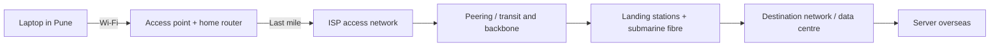

Your **ISP**, or Internet Service Provider, supplies access. The **last mile** connects its network to your premises. High-capacity **backbone** links carry traffic between major locations. Networks can **peer**, exchanging traffic directly, often at an **IXP** (Internet Exchange Point), or buy **transit** from an upstream network. An ISP is a provider; an IXP is an interconnection facility/switching fabric; a data centre hosts computing equipment.

Fibre carries light signals, with submarine cables joining continents through coastal **landing stations**. Radio, including cellular and satellite access, also has a role, but ordinary intercontinental traffic relies heavily on fibre. The path is not a mandatory world→country→city tree: nearby content might stay within the ISP or reach a local CDN. Return traffic can take a different route.

A router forwarding step is a **hop**. Switches, cables, and landing stations in a physical diagram are not each necessarily visible as separate hops in `tracert`.

### Packets let everyone share the path

A large file is not sent as one indivisible object. Protocols carry its data in smaller units. An IP **packet** has a **header** containing control information, such as source/destination addresses and a hop limit, plus a **payload**. **Packet switching** allows many conversations to share links instead of reserving an entire circuit for one transfer.

```text
Application bytes
      ↓ transport adds service information
TCP segment / UDP datagram
      ↓ IP adds source and destination addresses
IP packet
      ↓ local-link framing
Ethernet / Wi-Fi frame
      ↓ transmission
Electrical signals / light / radio
```

These names describe different layers of the same transmission. TCP can recover missing data; IP itself does not promise delivery or order. Packets often follow the same route during a connection, but routes can change. At a router, the incoming link framing is removed and new framing is built for the next link. Part 3 explains this wrapping process in detail.

The **MTU**, Maximum Transmission Unit, is the largest IP packet a link can carry in one link-layer payload; ordinary Ethernet commonly uses 1500 bytes. Headers consume some of that space, so application data per packet is smaller.

### “Slow Internet” can mean several different things

| Measure | Meaning | Typical effect |
|---|---|---|
| **Bandwidth** | Link capacity, in bits per second | Limits how much traffic can fit |
| **Throughput** | Rate actually achieved | Determines real download time |
| **Latency** | Delay, often one-way unless specified | Delayed interactions |
| **RTT** | Round-trip time: there and back | What `ping` normally reports |
| **Jitter** | Variation in delay | Uneven voice/video delivery |
| **Packet loss** | Packets that fail to arrive | Missing media or retransmissions |

A 1 Gbps connection can still have a poor video call if Wi-Fi is congested, packets are lost, or the call server is far away. A bigger pipe cannot remove distance. It can reduce transmission time and queueing when capacity was the bottleneck.

```text
Packet delay = processing + queueing + transmission + propagation
               lookup       waiting    putting bits   travelling
                                       onto a link    across it
```

**Congestion** occurs when traffic exceeds available capacity; queues grow and can overflow. Excessive buffering can keep packets waiting for too long, called **bufferbloat**. A small jitter buffer smooths real-time media, but buffering also adds delay. A speed test measures achieved throughput to a particular server under current conditions, not a permanent guarantee.

For scale: a decimal 1 GB file contains 8,000 megabits. At 100 Mbps, the ideal transfer time is `8,000 / 100 = 80 seconds`, before overhead and congestion.

### Hubs, switches, routers, and the Wi-Fi access point

| Device | Usual OSI layer | Forwarding behaviour | Main use |
|---|---|---|---|
| **Hub** | 1: physical | Repeats signals to other ports; no address lookup | Obsolete shared Ethernet |
| **Switch** | 2: data link | Learns MAC→port; forwards known unicast; floods broadcasts/unknown destinations within the VLAN | Connect devices on a LAN |
| **Router** | 3: network | Looks up destination IP prefixes and selects the next hop | Connect different networks |

A **MAC address** identifies an interface for local link delivery; it can be changed or randomised. A switch learns the source MAC of frames arriving on each port. A router instead consults a **routing table**, using the most specific matching destination prefix. A basic hub creates one shared collision domain; modern switched full-duplex Ethernet avoids those shared-link collisions. A **VLAN** logically separates a switched network into broadcast domains.

For a remote destination, your laptop sends the local frame to its **default gateway**, usually the home router. The frame's MAC destination is the gateway; the packet's IP destination is the remote server. For a local destination, the laptop can deliver directly over the LAN. Part 2 shows how it decides and uses **ARP** to discover a local IPv4 neighbour's MAC address.

A Wi-Fi **access point** bridges wireless clients into the LAN. The radio medium is shared, so interference, signal quality, and competing users affect it. The home “router” commonly combines an access point, Ethernet switch, router, DHCP server, and NAT in one box. These are separate functions even when the hardware is shared.

### Where servers live, and why location matters

A **data centre** contains racks of servers, storage, and networking equipment. Rack switches connect machines; larger switching fabrics connect racks. Reliable operation also needs power, batteries/generators, cooling, physical security, and redundant network links. Cloud virtual machines and containers run on this physical equipment. The lecture's Ubuntu EC2 instance in Oregon is a rented part of that infrastructure.

If every user fetched every image from Oregon, distance would add repeated delay. A **CDN**, Content Delivery Network, serves cacheable content from distributed **edge locations**, also called **PoPs** (Points of Presence). The original server is the **origin**.

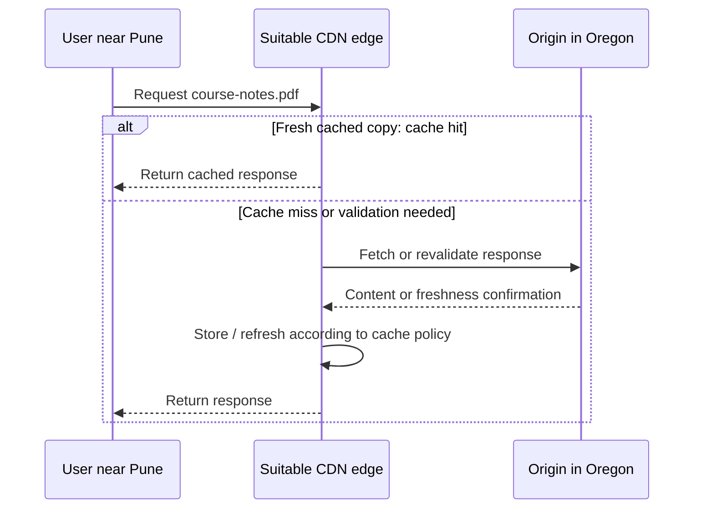

The edge reduces origin traffic and often latency. Expiry, eviction, a different cache key, or a policy requiring validation can contact the origin again. **TTL** and HTTP cache rules control freshness; **invalidation/purge** removes a cached copy early. Versioned filenames such as `app.a1b2.js` let a new release use a new cache key.

Images, scripts, styles, PDFs, and recorded-video segments are common cache candidates. Personalised account/payment responses need careful policies to avoid sharing private data. A CDN can proxy dynamic requests too; it does not make a slow database query disappear. Edge selection follows network/provider policy and is not guaranteed to pick the geographically closest city.

| Location term | Meaning | Main purpose |
|---|---|---|
| **Data centre** | Physical facility with computing equipment | Run and store workloads |
| **CDN** | Distributed content-delivery service across many locations | Cache/deliver responses near users |
| **Edge location** | A delivery PoP; may also offer limited edge execution | Nearby content delivery |
| **Region** | Geographic deployment area containing multiple AZs | Choose where workloads run |
| **Availability Zone (AZ)** | One or more data centres engineered as an isolated failure domain within a region | Limit the effect of a location failure |
| **Local Zone** | Extension of selected regional compute/storage/network services into another metro | Place latency-sensitive compute closer |

```text
Region
├── AZ A: data-centre group ── app replica
├── AZ B: data-centre group ── app replica
└── Regional services
      └── Local Zone: selected compute closer to another metro

CDN edge PoPs: a separate distributed delivery footprint near users
```

**Edge computing** means doing some processing nearer users. A Local Zone offers regional-style compute closer to a metro; a CDN edge mainly delivers content. To survive an AZ outage, deploy across AZs and plan load balancing, data failover, and shared state. Merely selecting a region does not provide that resilience. Choose location using user latency, data residency, available services, failure tolerance, and cost; avoid memorising the recording's changing region counts.

### Commands that reveal the physical network

```powershell
# Windows
ipconfig /all                 # Interfaces, addresses, mask, gateway, DNS
route print                  # Routing table
arp -a                       # Learned local IPv4-to-MAC mappings
ping -n 4 8.8.8.8            # ICMP reachability, RTT and observed loss
tracert example.com          # Probe successive routed hops
```

On Linux, equivalents include `ip -br addr`, `ip route`, `ping -c 4 8.8.8.8`, and `traceroute example.com`. On macOS, `ifconfig` and `netstat -rn` show interface/route information. `mtr` combines repeated hop and timing observations when installed.

```text
Illustrative ping reply: time=24ms     → round trip, not one-way delay
Illustrative trace:     1  192.168.1.1 → home gateway
                        2  ...         → ISP router
                        3  * * *       → no probe reply received
```

`tracert`/`traceroute` increase IP TTL/hop limit to discover router responses. A `*` can mean probes are filtered or rate-limited; it does not prove normal traffic is lost there. IP geolocation is approximate. A failed ping also does not prove a service is down: ICMP might be blocked. Wireshark can show the actual ICMP/IP/link headers; more useful filters appear in Part 3.

### Interview checkpoint — Part 1

1. **Internet versus Web?** The Internet connects networks; the Web uses HTTP/HTTPS over that infrastructure.
2. **Why split data into packets?** To share links among flows and let higher protocols recover missing pieces efficiently.
3. **Bandwidth versus latency?** Capacity in bits/s versus delay in ms; RTT includes both directions.
4. **Why can a fast broadband plan still lag?** Distance, congestion, Wi-Fi interference, jitter, or loss can dominate.
5. **Hub versus switch versus router?** Repeat signals; forward local frames by MAC; route IP packets between networks.
6. **What does the default gateway do?** It forwards traffic for destinations reached through that next hop, typically outside the local subnet.
7. **When does a CDN contact its origin?** On misses, revalidation, or requests that cache policy requires forwarding.
8. **AZ versus edge versus Local Zone?** An AZ is a regional failure domain; an edge is a delivery PoP; a Local Zone extends selected compute services nearer a metro.

---

<a id="part-2"></a>

## 2. IP Addressing, Subnets & DNS

### Addresses identify interfaces within a scope

The physical path needs a destination. An **IP address** is a logical address assigned to a network interface. A laptop can have Wi-Fi and Ethernet addresses, IPv4 and IPv6 addresses, and loopback addresses. An IP is not a permanent identity for a person.

With **static addressing**, configuration is assigned deliberately. With **DHCP**, Dynamic Host Configuration Protocol, the device obtains a leased IPv4 configuration automatically, usually including address, mask, gateway, and DNS resolver. On a typical desktop, an unexpected `169.254.x.x` link-local address can indicate DHCP failed. **Loopback**, `127.0.0.1` in IPv4 or `::1` in IPv6, reaches the same host; `localhost` on a friend's laptop points to their laptop, not yours.

An address must be unique where it is used. Two uncoordinated hosts using the same address on a LAN conflict, but millions of separate homes can reuse `192.168.1.1`.

### IPv4, private addressing, and NAT

IPv4 uses **32 bits**, written as four decimal **octets**, each from 0 to 255:

```text
192       .168       .1         .10
11000000  .10101000  .00000001  .00001010
 8 bits     8 bits     8 bits     8 bits
```

There are `2^32 = 4,294,967,296` representable addresses; reservations leave fewer for ordinary public use. Increasing demand exhausted freely available pools. **CIDR** reduced allocation waste, **private addressing + NAT** allowed reuse, and IPv6 provides a much larger address space. Subnetting divides a block; it does not create additional addresses or solve exhaustion alone.

| Public IP | Private IPv4 address |
|---|---|
| Intended for globally routed addressing | Used within private networks; not routed across the public Internet |
| May identify a server, router, or shared service entry | Can repeat in separate private networks |
| Reachability still depends on routes, filters, and a listening service | Internet access commonly uses NAT/PAT |

The three private IPv4 ranges are:

| CIDR range | Address interval |
|---|---|
| `10.0.0.0/8` | `10.0.0.0`–`10.255.255.255` |
| `172.16.0.0/12` | `172.16.0.0`–`172.31.255.255` |
| `192.168.0.0/16` | `192.168.0.0`–`192.168.255.255` |

Only `172.16` through `172.31` are private in that range, not all `172.*` addresses.

**NAT**, Network Address Translation, rewrites addresses. Home routers commonly also translate ports, called **PAT**, so many clients can share one public IPv4 address:

```text
Laptop                       NAT router                       Web server
192.168.1.23:51500  ────────→  198.51.100.7:62001  ──────────→  203.0.113.10:443

Mapping remembered by router:
192.168.1.23:51500  ↔  198.51.100.7:62001

Reply to public port 62001  ── mapping reversed ──→  laptop port 51500
```

The public addresses above are documentation examples. The translated source port distinguishes this connection from others sharing the address. NAT is neither encryption nor a complete security policy; filtering is a separate responsibility.

### IPv6 expands the space, while keeping prefixes

IPv6 uses **128 bits**, normally shown as eight hexadecimal groups. Leading zeroes may be omitted, and one consecutive run of zero groups may become `::`:

```text
2001:0db8:0000:0000:0000:0000:0000:0001
                    ↓
2001:db8::1
```

Its `2^128 ≈ 3.4 × 10^38` addresses remove the fundamental IPv4 size constraint. IPv6 still uses subnets, commonly `/64` for ordinary LANs. It uses **Neighbor Discovery** instead of ARP, has no broadcast, and can configure addresses through mechanisms such as **Stateless Address Autoconfiguration (SLAAC)**. **Dual stack** means running IPv4 and IPv6 together. IPv6 is not automatically encrypted or safe to expose without firewall rules.

| Feature | IPv4 | IPv6 |
|---|---|---|
| Address size | 32 bits | 128 bits |
| Representation | Decimal octets: `192.168.1.10` | Hex groups: `2001:db8::1` |
| Address-space pressure | Severe; NAT widely used | Much larger space; NAT generally unnecessary for address conservation |
| Local neighbour discovery | ARP | Neighbor Discovery |
| Broadcast | Supported | No broadcast; uses multicast where appropriate |
| Loopback | `127.0.0.1` | `::1` |

### A subnet is a network boundary; a mask expresses its prefix

A **subnet** groups an IP address range for routing and management. In a basic LAN, local destinations are reached directly; other destinations go through a router. Hosts actually consult their routing tables, which can contain more specific routes as well as a default route.

A **subnet mask** marks network bits with leading `1`s and host bits with `0`s. `/24` means 24 network bits:

```text
IP:       192.168.1.10   = 11000000.10101000.00000001.00001010
Mask:     255.255.255.0  = 11111111.11111111.11111111.00000000
Bitwise AND:              11000000.10101000.00000001.00000000
Network:  192.168.1.0/24
```

For `192.168.1.23/24`, destination `192.168.1.99` is on the same ordinary subnet. The host uses **ARP**, Address Resolution Protocol, to ask for that local IP's MAC address, then sends directly. For `192.168.2.10`, the usual route is through the gateway: ARP resolves the gateway's MAC instead. ARP's request is a **link-layer broadcast**, not an IP packet sent to the subnet's directed-broadcast address.

Subnets help organise departments, environments, or application tiers. They can support security boundaries, but separation and firewall rules must actually enforce the policy. A VLAN is a layer-2 broadcast-domain boundary; a subnet is a layer-3 addressing boundary. They commonly align but describe different things.

### CIDR turns boundaries into useful arithmetic

**CIDR**, Classless Inter-Domain Routing, permits flexible prefix lengths instead of the old fixed address classes. It supports appropriately sized allocations and **route aggregation**, representing aligned smaller networks with a larger prefix. **VLSM**, Variable Length Subnet Masking, means choosing different subnet sizes where needed.

| Subnet | CIDR |
|---|---|
| The actual logical IP network, such as a LAN or VPC subdivision | The classless prefix system used to describe and route address blocks |
| Example: a task application's private subnet | Example notation: `10.0.11.0/24` |

For IPv4 prefix length `p`:

```text
Host bits       = 32 − p
Total addresses = 2^(32 − p)
Traditional usable hosts = total − 2   (network + broadcast reserved)
```

**Longer prefix → fewer host bits → smaller block.** Work through the source example `192.168.10.50/26`:

1. `/26` leaves six host bits: `2^6 = 64` addresses.
2. Mask: `255.255.255.192`; final octet is `11000000`.
3. Blocks start every 64 addresses: `.0`, `.64`, `.128`, `.192`.
4. `.50` belongs to `.0–.63`: network `.0`, broadcast `.63`, ordinary hosts `.1–.62`.

```text
192.168.10.0/24 — 256 addresses divided into four /26 subnets

┌────────────────┬────────────────┬────────────────┬────────────────┐
│ .0–.63         │ .64–.127       │ .128–.191      │ .192–.255      │
│ network .0     │ network .64    │ network .128   │ network .192   │
│ broadcast .63  │ broadcast .127 │ broadcast .191 │ broadcast .255 │
│ 62 host IPs    │ 62 host IPs    │ 62 host IPs    │ 62 host IPs    │
└────────────────┴────────────────┴────────────────┴────────────────┘
```

The **network address** has all host bits zero; the IPv4 **broadcast address** has all host bits one. In traditional subnets, these identify the network and a broadcast destination rather than ordinary hosts.

| Prefix | Mask | Total addresses | Traditional host use |
|---|---|---:|---:|
| `/16` | `255.255.0.0` | 65,536 | 65,534 |
| `/22` | `255.255.252.0` | 1,024 | 1,022 |
| `/23` | `255.255.254.0` | 512 | 510 |
| `/24` | `255.255.255.0` | 256 | 254 |
| `/25` | `255.255.255.128` | 128 | 126 |
| `/26` | `255.255.255.192` | 64 | 62 |
| `/27` | `255.255.255.224` | 32 | 30 |
| `/28` | `255.255.255.240` | 16 | 14 |
| `/29` | `255.255.255.248` | 8 | 6 |
| `/30` | `255.255.255.252` | 4 | 2 |
| `/31` | `255.255.255.254` | 2 | Both on supported point-to-point links |
| `/32` | `255.255.255.255` | 1 | Single host/address route |

For 500 ordinary hosts, allow at least 502 total addresses; the next power of two is 512, giving nine host bits and `/23`, with 510 usable. Prefixes can cross octets: `172.16.20.0/22` spans `172.16.20.0–172.16.23.255`. Use aligned blocks; `192.168.10.50/26` describes an interface in the block whose network prefix is `.0/26`.

**Exceptions matter:** `/31` and `/32` do not use the usual subtract-two rule. IPv6 has no broadcast. Standard AWS IPv4 subnets reserve five addresses, giving 251 assignable addresses in a `/24`; cloud counts differ from textbook host counts. See [AWS subnet sizing](https://docs.aws.amazon.com/vpc/latest/userguide/subnet-sizing.html). `0.0.0.0/0` matches all IPv4 addresses: it is a default route destination or an “any IPv4 source” rule, depending on context.

### DNS connects human names to addressable services

A URL contains more than a domain name:

```text
https://www.example.com:443/products?id=7
scheme  hostname        port path      query

www.example.com.
 │     │       │└─ root (.)
 │     │       └── TLD: com
 │     └────────── example.com: registrable domain in this example
 └──────────────── subdomain label: www
```

**DNS**, Domain Name System, looks up records for names such as `www.example.com`; it does not fetch `/products` or render a page. This separation lets the service change IP addresses while users keep the same name. One name can return multiple IPs, and many names can share an IP. A literal-IP connection can work without DNS, although web hosting and certificate validation often still require the intended hostname.

| DNS | IP address |
|---|---|
| Distributed naming/lookup system | Numeric addressing used for packet delivery |
| Answers questions about names and records | Identifies an IP endpoint within an addressing scope |
| Example: look up the A record for `www.example.com` | Example answer: `203.0.113.10` |

On a cache miss, a **stub resolver** on the client asks a **recursive resolver** to find an answer. The recursive resolver follows referrals through the hierarchy. The root and TLD servers point it onward; they do not forward the browser's HTTP request.

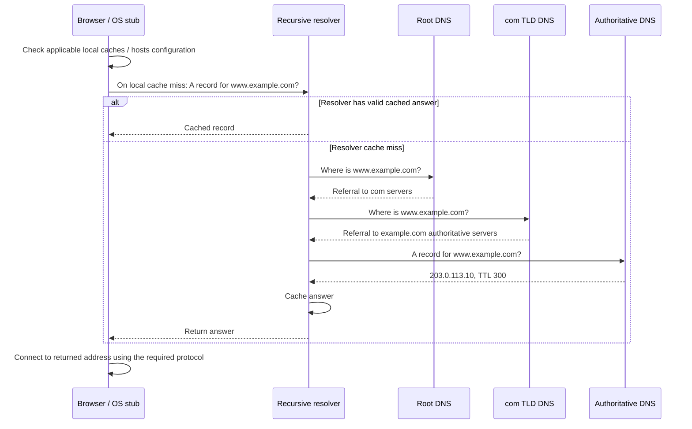

The client requests recursion—“return the answer or an error.” The resolver's hierarchy walk uses iterative responses—“here is the answer, or ask these servers next.” An **authoritative server** holds records for a **zone**, an administratively managed part of the DNS tree. `8.8.8.8` is Google's public recursive resolver, not a root or TLD server.

| Record | Carries | Example use |
|---|---|---|
| **A** | IPv4 address | Web hostname → IPv4 |
| **AAAA** | IPv6 address | Web hostname → IPv6 |
| **CNAME** | Alias to another hostname | `www` aliases a service hostname |
| **MX** | Mail-server name and priority | Route email to the domain's mail service |
| **TXT** | Text data | Domain verification or email policy |
| **NS** | Authoritative nameserver name | Delegation / zone nameservers |
| **SOA** | Zone administrative data | Authority and zone timing information |
| **PTR** | Reverse name mapping | Address → hostname |

A CNAME points to a **name**, not directly to an IP. An ordinary CNAME cannot coexist with other ordinary records at that same owner name, which constrains its use at a zone apex.

### Caching makes DNS fast—and changes less immediate

Browser, OS, and recursive caches avoid repeating lookups. DNS **TTL** is a cache lifetime in seconds; it is different from the IP header's hop-limiting TTL. A cached “name does not exist” response (**NXDOMAIN**) can also persist through **negative caching**.

“DNS propagation” usually means different caches expiring at different times, rather than a global push to every machine. Before moving a service, lower its TTL in advance, wait for the previous TTL to expire, prepare the new endpoint/certificate, change the record, and keep the old endpoint available during the transition. Flushing your OS cache does not flush your ISP's recursive cache.

```powershell
# Windows
nslookup example.com                # Query configured DNS server
nslookup example.com 8.8.8.8         # Query a chosen resolver
ipconfig /flushdns                  # Clear Windows DNS client cache
```

```bash
# Linux/macOS/WSL with dig installed
dig example.com                     # Record, TTL and response details
dig example.com +short              # Compact answers
dig AAAA example.com +short          # IPv6 address records
dig MX example.com +short            # Mail routing
dig NS example.com +short            # Nameservers
dig @8.8.8.8 example.com             # Choose recursive resolver
dig +trace example.com              # Perform a delegation walk
ipcalc 192.168.10.50/26              # Optional installed subnet calculator
```

In an illustrative answer `example.com. 300 IN A 203.0.113.10`, `300` is TTL in seconds, `IN` is the Internet class, and `A` identifies the record type. Tools such as `dig` query DNS directly and may not use the browser's caches.

### Names also have ownership and trust boundaries

A **registry** operates a namespace such as a TLD; a **registrar** provides domain registrations; the owner configures delegation and records. ICANN coordinates the global domain-name system. Read names from right to left: `.in` is a TLD, while `bank.in` and `gov.in` are beneath it. Calling `.bank.in` a separate TLD is a simplification in the source; registration boundaries need not always be the last two labels.

An attacker can register a lookalike name and copy a bank login page while DNS works exactly as designed. They have not “bypassed the TLD.” Restricted registration policies can reduce impersonation, but users still need to check the exact hostname. A valid HTTPS connection to a lookalike site does not prove it belongs to the intended bank.

**Source supplement:** DNSSEC adds signed DNS data for authenticity/integrity; DoH and DoT encrypt transport to a DNS service. DNSSEC does not encrypt queries, and encrypted DNS does not make a deceptive domain legitimate.

### Interview checkpoint — Part 2

1. **What does an IP address identify?** An IP interface/endpoint within an addressing scope; a device can have several addresses.
2. **IPv4 versus IPv6?** 32-bit dotted decimal versus 128-bit hexadecimal, with a much larger space and different local discovery.
3. **Why can homes share a private address?** They are separate private networks; NAT/PAT maps Internet-bound connections through public addresses/ports.
4. **Subnet versus CIDR?** A subnet is a logical IP network; CIDR describes classless prefixes and supports flexible allocation/aggregation.
5. **Calculate `192.168.10.50/26`.** Mask `255.255.255.192`; network `.0`, broadcast `.63`, 64 total and 62 traditional hosts.
6. **Why not always subtract two?** `/31` point-to-point and `/32` routes are special; cloud platforms can reserve extra addresses.
7. **Explain a cold DNS lookup.** Client → recursive resolver; resolver asks root, TLD, authoritative; caches and returns the answer.
8. **Why do users see different answers after a DNS change?** Their caches can retain the old record until its TTL expires.

---

<a id="part-3"></a>

## 3. Internet Communication & Transport Protocols

### Layers turn one complicated job into cooperating jobs

The lecture follows a WhatsApp message from sender to receiver. The application creates content, software formats and protects it, transport handles endpoint delivery, IP supplies addressing, and a local link carries signals. These are separate responsibilities: a browser should keep working when you switch from Ethernet to Wi-Fi.

The **OSI model**, Open Systems Interconnection, is a seven-layer reference vocabulary. The deployed Internet protocol suite is usually described with the four-layer **TCP/IP model**:

| OSI layer, top to bottom | Responsibility and examples | TCP/IP grouping |
|---|---|---|
| 7. Application | Application protocols: HTTP, DNS, SMTP, SSH | Application |
| 6. Presentation | Representation, encoding, compression, encryption concepts | Application |
| 5. Session | Managing dialogue/session context | Application |
| 4. Transport | TCP/UDP, ports, endpoint communication | Transport |
| 3. Network | IP addressing and routing | Internet |
| 2. Data link | Frames, MAC delivery, link error detection | Network access |
| 1. Physical | Signals over copper, fibre, radio | Network access |

The top three OSI responsibilities are usually implemented together in application software/libraries. TLS sits between HTTP and TCP in the familiar HTTPS stack; mapping it loosely to presentation/session does not mean a browser has seven separate programs. Authentication and application sessions likewise do not belong exclusively to one OSI layer.

### Encapsulation explains what each device can deliver

**Encapsulation** wraps upper-layer data in lower-layer headers; **decapsulation** removes them at the receiving endpoint. A **PDU**, Protocol Data Unit, is simply a layer's unit of data.

```text
Application:  [HTTP message]                     (or TLS-protected bytes)
TCP:          [TCP header | application bytes]   = segment
IP:           [IP header  | TCP segment]         = packet
Ethernet:     [MAC header | IP packet | FCS]     = frame
Physical:     electrical / optical / radio signals

Sender → frame for gateway → ROUTER → new frame for next hop → ... → Receiver
          local MAC pair              different local MAC pair
          IP destination normally remains the remote endpoint
```

The TCP/UDP header contains **ports**; the IP header contains **IP addresses** and TTL/hop limit; link framing handles local delivery. An Ethernet **FCS**, Frame Check Sequence, detects frame corruption. Basic switches forward at layer 2; routers inspect layer-3 destinations and replace link framing. Ordinary routing retains endpoint IPs while decreasing TTL; NAT is an important exception that rewrites addressing. Encapsulation is wrapping, not encryption.

### Ports and sockets get traffic to the right application

An IP address gets traffic to an IP endpoint; a **port** identifies a transport endpoint on it. TCP and UDP each use 16-bit port numbers, `0–65535`. A server **binds** a socket to an address/port; a TCP server **listens** and accepts connections. A client normally uses a temporary **ephemeral source port**.

```text
Client endpoint                         Server endpoint
198.51.100.7:54321  ─── TCP connection ── 203.0.113.10:443

TCP connection identity: source IP + source port + destination IP + destination port
Include protocol as well when describing the general network five-tuple.
```

A **socket** is the operating system's communication endpoint; `IP:port` is its common address representation. Multiple TCP clients can connect to the same server port because their endpoint pairs differ. TCP 53 and UDP 53 are separate transport endpoints.

The registered ranges are `0–1023` (system/well-known), `1024–49151` (registered/user), and `49152–65535` (dynamic/private). Operating systems can configure different ephemeral allocation ranges. `127.0.0.1:8080` binds only loopback; `0.0.0.0:8080` means all local IPv4 interfaces. A firewall rule permitting a port cannot create a listening service.

### TCP builds an ordered byte stream over unreliable IP

**TCP**, Transmission Control Protocol, establishes connection state and provides a reliable, ordered **byte stream**. It numbers bytes, acknowledges progress, retransmits missing data, and avoids delivering duplicate bytes to the application. It does not preserve application message boundaries: one write is not guaranteed to equal one read.

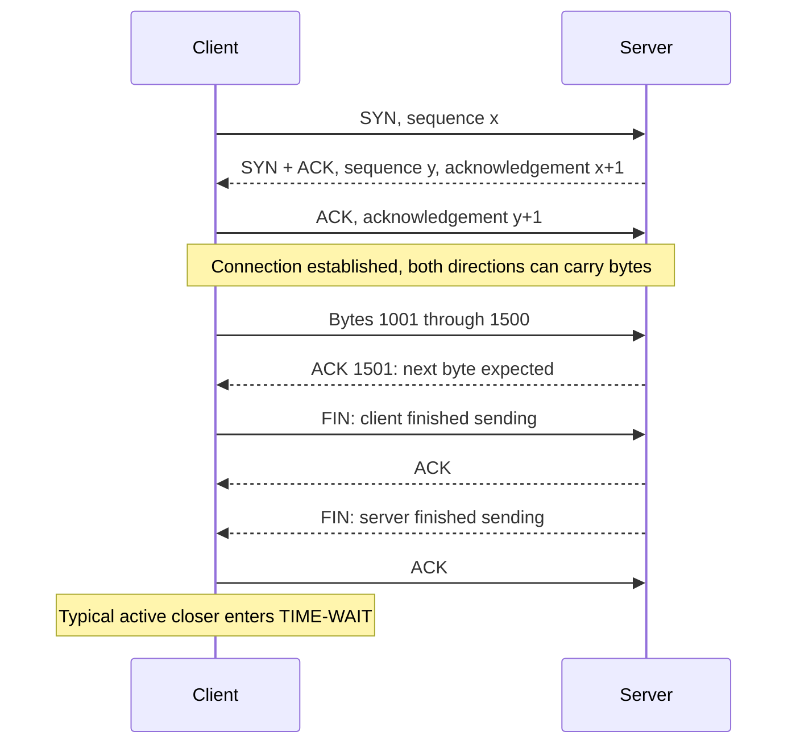

The **three-way handshake** synchronises initial sequence numbers, confirms communication in both directions, and negotiates options. SYN consumes a sequence number. The data example uses separate illustrative sequence values; an ACK is the **next expected byte**, not a packet count. A lost data segment or acknowledgement can trigger retransmission.

**Flow control** protects the receiver: it advertises available receive-window capacity. **Congestion control** protects the network: the sender adjusts how much data it puts in flight as conditions change. Both affect throughput. A useful source supplement is the bandwidth-delay product: `rate × RTT` estimates the data that must be in flight to fill a path.

TCP is **full duplex**—both sides can send. Each direction can close separately with FIN/ACK, commonly shown as four messages; acknowledgements can be combined. **TIME-WAIT** lets the active closer handle a retransmitted FIN and keeps delayed old segments from immediately interfering with a reused connection. **RST** aborts a connection.

**Correction to the lecture:** a page arriving correctly does not mean “TCP caused zero packet loss.” Packets can be lost underneath; TCP repairs losses when possible. Persistent failure can still end a connection. A transport ACK confirms receipt by the peer's TCP stack, not that a payment or database update completed. Applications must handle timeouts, errors, and uncertain outcomes.

### UDP leaves more policy to the application

**UDP**, User Datagram Protocol, sends individual **datagrams** without a transport handshake, built-in retransmission, ordering, flow control, or congestion control. It preserves datagram boundaries. Its header is eight bytes: source port, destination port, length, and checksum. The checksum detects corruption, not loss; it is generally required with IPv6 and optional in IPv4.

This suits short request/response exchanges and time-sensitive media where stale information may be less useful than continuing. Applications/protocols above UDP must supply any needed recovery, pacing, and congestion response. Voice, games, DNS, DHCP, and NTP commonly use it. An interactive video call often uses UDP-based media, while a recorded lecture may arrive as HTTP video segments. “All video uses UDP” is incorrect.

| Property | TCP | UDP |
|---|---|---|
| Setup | Three-way transport handshake | No UDP handshake |
| Data presented | Ordered byte stream | Separate datagrams |
| Reliability/order | Sequence numbers, ACKs, retransmission | No built-in delivery/order guarantee |
| Flow/congestion control | Built in | Responsibility of higher protocols/application |
| Header | At least 20 bytes | 8 bytes |
| Typical uses | Web over HTTP/1.1 or HTTP/2, SSH, mail, file transfer | DNS queries, real-time media, games, QUIC |
| Main decision | Need a reliable stream | Need datagrams or application-controlled transport behaviour |

UDP is not universally faster, and TCP is not universally better. DNS commonly uses UDP for short exchanges, but also supports TCP, including fallback for truncated replies and zone transfers. **QUIC** adds reliable streams, congestion control, and security over UDP; **HTTP/3** uses QUIC. This is the compact exception to the lecture's “HTTP uses TCP” rule. See [HTTP/3 specification](https://www.rfc-editor.org/rfc/rfc9114.html).

### HTTP gives the connection an application-level meaning

**HTTP**, Hypertext Transfer Protocol, is request/response communication for resources, including HTML, JSON, images, and arbitrary binary data. A request includes a method, target, headers, and sometimes a body; a response includes a status, headers, and usually content.

```http
GET /api/tasks HTTP/1.1
Host: app.example.com
Accept: application/json
Authorization: Bearer <token>

```

```http
HTTP/1.1 200 OK
Content-Type: application/json

[{"id":"123","status":"done"}]
```

`GET` retrieves a representation; `POST` commonly creates/submits; `PUT` replaces; `PATCH` applies a partial change; `DELETE` removes; `HEAD` requests response headers without the response body. Status families are `2xx` success, `3xx` redirection/cache-related responses, `4xx` request/client-side issues, and `5xx` server-side failures. Common examples: `200`, `201`, `202`, `301/302`, `400`, `401`, `403`, `404`, `429`, `500`, and `503`.

HTTP is **stateless** in its request semantics; cookies, session stores, and tokens provide application-level state. Connection reuse is a different matter: HTTP/1.1 normally uses persistent connections, so a `Connection: keep-alive` header is not required to make every reuse possible. Reuse saves repeated connection setup.

**Idempotent** operations have the same intended effect when repeated as when performed once. PUT and DELETE have this property by their defined semantics, even when repeated responses differ. POST generally needs an application idempotency mechanism for safe retries of actions such as payment creation.

| HTTP | HTTPS |
|---|---|
| No TLS protection in ordinary HTTP | HTTP carried through TLS protection |
| Common default TCP port 80 | Common default 443; TCP for HTTP/1.1–2, UDP for HTTP/3 |
| On-path parties may read/change plaintext | Confidentiality, integrity, and authenticated server connection |
| Same resource/method/status concepts | Same HTTP concepts, protected in transit |

```text
HTTP/1.1:  HTTP → TCP → IP → link
HTTPS:     HTTP → TLS → TCP → IP → link   (HTTP/1.1 and HTTP/2 path)
HTTP/3:    HTTP → QUIC with TLS security → UDP → IP → link
```

**SSH**, Secure Shell, uses an encrypted, authenticated connection, normally TCP 22, for remote administration. **SMTP**, Simple Mail Transfer Protocol, sends/relays email over TCP; DNS MX records identify mail destinations. Port 25 commonly handles server relay, 587 submission with STARTTLS, and 465 submission with implicit TLS. Delivery by SMTP and delivery of bytes by TCP are different levels of acknowledgement.

### Inspect communication, then debug by layer

```powershell
# Windows: curl.exe avoids the legacy PowerShell curl alias
curl.exe -I https://example.com       # HEAD: response headers
curl.exe -v https://example.com       # Connection/TLS details and HTTP exchange
Test-NetConnection example.com -Port 443
netstat -ano                         # Connections/listeners and process IDs
```

```bash
# Linux; curl also works on macOS
curl -I https://example.com
curl -v https://example.com
ss -tan                              # TCP states
sudo ss -tulpn                       # TCP/UDP listeners and processes
nc -vz example.com 443                # Probe TCP port, if netcat is installed
```

In **Wireshark**, capture the active interface, perform a request, and inspect the nested headers. Useful **display filters** are `icmp`, `dns`, `tcp`, `udp`, `tcp.port == 443`, `tcp.flags.syn == 1`, and `tcp.analysis.retransmission`. Follow a TCP stream to see its conversation. HTTPS content remains encrypted unless you deliberately provide suitable decryption secrets; an HTTPS capture does not automatically reveal JSON/passwords. Encrypted DNS may not appear as plain `dns` traffic either.

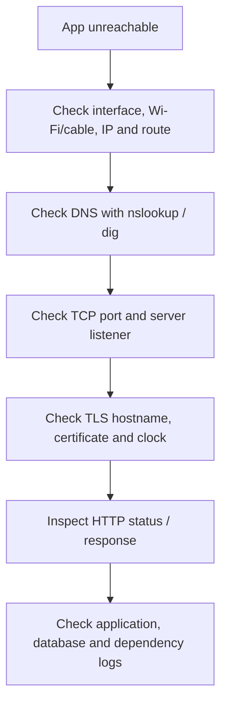

Move through these evidence checks; do not interpret a failed ping as conclusive proof of a broken route. A TCP timeout suggests filtering, a path issue, or a nonresponsive endpoint; an immediate refusal often means no listener or an explicit rejection. An HTTP `403` shows that an HTTP-speaking component was reached and denied the request. A `5xx` can come from a proxy or backend. If localhost works but external access fails, check **bind address**, publication/routing, filters, and the intended destination—not only the security group.

### Interview checkpoint — Part 3

1. **Why use layers?** They separate responsibilities, support interchangeable link technologies, and make troubleshooting manageable.
2. **OSI versus TCP/IP?** Seven reference layers versus four practical groupings: application, transport, Internet, network access.
3. **What changes at a router?** Local framing changes, TTL decreases; endpoint IPs normally persist unless translation occurs.
4. **Explain TCP setup.** SYN → SYN-ACK → ACK synchronises sequence numbers and establishes connection state.
5. **Flow control versus congestion control?** Protect the receiver's capacity versus adapt to network capacity.
6. **When choose UDP?** When datagrams, timeliness, or higher-level transport control suit the application; supply needed recovery/congestion handling above it.
7. **Is all HTTP over TCP?** HTTP/1.1 and HTTP/2 normally use TCP; HTTP/3 uses QUIC over UDP.
8. **What happens after entering an HTTPS URL?** Resolve hostname, route/connect, establish TLS, exchange HTTP, process resources, render; existing caches/connections can skip setup.

---

<a id="part-4"></a>

## 4. Internet Security

### Reachability and permission begin with direction

**Ingress** is traffic entering a boundary; **egress** is traffic leaving it. The same packet is egress from the client and ingress to the server. For connection policy, distinguish a new inbound/outbound connection from reply traffic belonging to one already permitted.

A **firewall** inspects traffic against rules, commonly using protocol, source/destination IPs, ports, and connection state. **Drop** silently discards; **reject** returns an error. An **allow-list** permits specified traffic and denies the rest. A packet filter cannot fix malicious behaviour inside an otherwise allowed request.

The source's nginx example makes this concrete: nginx served HTTP locally, but the cloud security group allowed only SSH. Allowing TCP 80 from the intended source made HTTP reachable. HTTPS still required its own TLS listener/certificate configuration and a TCP 443 rule. Opening a port, starting a listener, and configuring a secure protocol are three different actions.

### Security groups express the minimum connections required

An AWS **security group (SG)** is a stateful virtual firewall associated with resources' network interfaces. It has **allow rules only**; rules across associated groups combine, rather than using first-match ordering. Traffic not permitted is denied. Tracked replies to permitted connections are automatically allowed in the reverse direction, subject to connection tracking. See [AWS security groups](https://docs.aws.amazon.com/vpc/latest/userguide/vpc-security-groups.html).

| Control | Scope | Rules/state | Appropriate job |
|---|---|---|---|
| **Security group** | Associated resource interfaces | Stateful; allow rules; combined evaluation | Permit required tier-to-tier connections |
| **Network ACL (NACL)** | Subnet boundary | Stateless; ordered allow/deny | Additional network filtering; explicitly allow return traffic |
| **Host firewall / UFW** | Operating system | Host rules, usually with state tracking | Control services on the machine |
| **WAF** | HTTP application boundary | HTTP-aware rules | Filter suspicious HTTP patterns; complement application security |

A rule needs a direction, protocol, source/destination, and applicable port range. `0.0.0.0/0` means any IPv4 address; `/32` selects one IPv4 address. IPv6 requires its own rules, commonly `::/0` for any IPv6 source. ICMP has types/codes rather than TCP/UDP ports.

**Least privilege** means allowing the minimum access needed. A basic three-tier policy is:

| Receiving tier | Allow inbound | Purpose |
|---|---|---|
| Public load balancer: `alb-sg` | TCP 443 from clients; optionally 80 for redirect | Public entry |
| App: `app-sg` | TCP 8080 from `alb-sg` | Only entry tier reaches API |
| Database: `db-sg` | TCP 3306 from `app-sg` for this MySQL example | Only API reaches data |
| Administration | TCP 22 from a controlled admin address/bastion, if needed | Restricted management |

Permit the corresponding **outbound initiation** on the sending tier too. Replies need no separate SG allow rule. A security-group reference expresses the permitted source/destination resource group without hardcoding every replica's IP; it does not create a route or grant every protocol.

```text
Internet ── TCP 443 ──→ load balancer ── TCP 8080 ──→ app ── TCP 3306 ──→ DB
                         alb-sg                      app-sg                db-sg
No direct public database connection is part of this design.
```

Allowing public HTTPS is intentional for a public site; exposing SSH/database ports to everyone is usually unnecessary. Egress restrictions reduce unwanted outbound connections and data exfiltration, but must account for real dependencies such as DNS, updates, and external APIs. Restricting ports does not replace user authentication or task-level authorization.

### Ports are conventions, not security guarantees

| Service | Common port / transport |
|---|---|
| SSH | TCP 22 |
| DNS | UDP and TCP 53 |
| HTTP | TCP 80 |
| HTTPS | TCP 443; HTTP/3 commonly UDP 443 |
| SMTP | TCP 25 / 587 / 465, with different roles/security setup |
| MySQL / PostgreSQL | TCP 3306 / 5432 |
| Redis / MongoDB | TCP 6379 / 27017 |

A different program can listen on 443; the number alone does not prove HTTPS. If the process listens only on `127.0.0.1`, an allow rule cannot make it accept traffic on its private/public-facing interface.

### TLS protects the channel and authenticates its peer

**TLS**, Transport Layer Security, provides **confidentiality** through encryption, **integrity** through tamper detection, and normally **server authentication**. **SSL** is its obsolete predecessor; “SSL certificate” is common wording for a certificate used with modern TLS. Use supported TLS 1.2/1.3 configurations rather than obsolete SSL/TLS versions.

A certificate binds names and a public key to an identity under a **Certificate Authority (CA)**. The browser has trusted root CAs; intermediate certificates connect a site's certificate to that trust anchor. The server proves possession of the matching private key. The private key stays private; it is not sent to the browser.

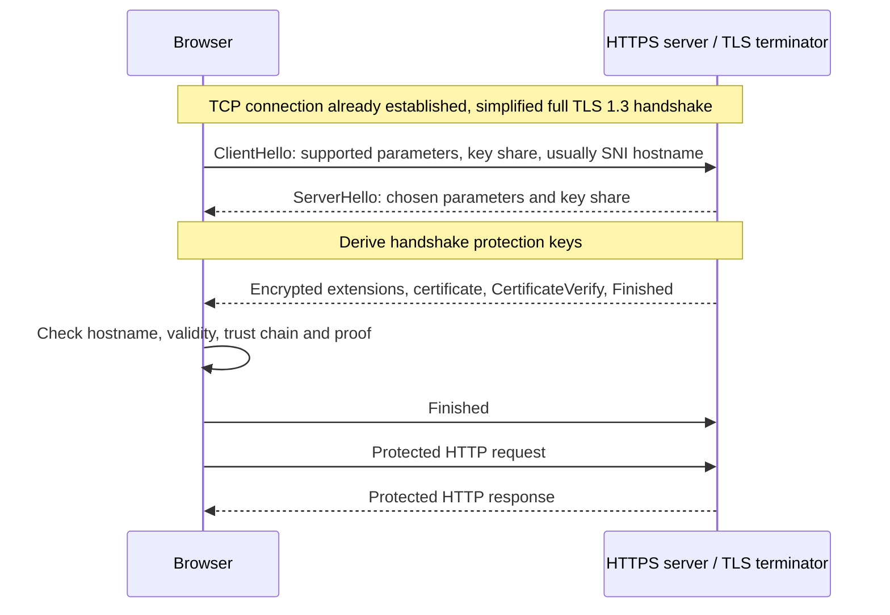

This diagram groups messages for clarity. In a typical fresh TLS 1.3 handshake, key shares help derive secrets before the protected certificate/authentication messages; the certificate's key is used to authenticate the handshake, not simply to encrypt every HTTP byte. Efficient symmetric keys protect traffic after negotiation. See [TLS 1.3 overview](https://www.rfc-editor.org/rfc/rfc8446.html#section-2).

```text
Trusted root CA
      └── signs intermediate CA
                 └── signs site certificate
                         ├── permitted hostname(s)
                         ├── public key
                         └── validity period
```

The client checks hostname matching, validity dates, a valid trusted chain, and the server's cryptographic proof; revocation handling depends on client/policy. The local clock matters. **SNI**, Server Name Indication, helps a server choose the intended site's certificate. **HSTS** tells browsers to use HTTPS for a host after the policy is known, or through preloading.

TLS protects HTTP paths, headers, bodies, and credentials in transit. Destination IPs remain observable; DNS and the hostname in SNI may also be visible unless separately protected. A certificate matching `fake-bank.example` authenticates that hostname, not the real bank you intended to visit. HTTPS also does not fix SQL injection, weak authorization, or malware on an endpoint.

For a normal public web endpoint, configure the hostname/DNS, obtain a trusted certificate through a CA, install it with its private key at nginx/load balancer, enable TLS listening, permit the appropriate port, and automate renewal. **Let's Encrypt** is a CA; **Certbot** automates issuance/renewal using domain-control challenges. Certificate lifetimes and tooling can change, so rely on automated renewal rather than memorising a recording's duration.

```bash
# Linux/macOS with OpenSSL; inspect the presented certificate
openssl s_client -connect example.com:443 -servername example.com </dev/null 2>/dev/null \
  | openssl x509 -noout -subject -issuer -dates

# Existing Linux/nginx server with Certbot installed and domain configured
sudo certbot --nginx -d example.com
sudo certbot renew --dry-run
```

These are reference commands, not actions needed on your study machine. `curl -v` or the browser's certificate viewer also helps diagnose trust/hostname/expiry issues. Inspection alone does not imply that every validation check was performed by the command.

### UFW adds protection on the host

**UFW**, Uncomplicated Firewall, manages Linux host packet-filter rules. Cloud SGs and host filtering are independent checks: both must permit the intended connection.

```bash
# Illustrative policy for your own Ubuntu web server
sudo ufw default deny incoming
sudo ufw default allow outgoing
sudo ufw allow from 203.0.113.10 to any port 22 proto tcp
sudo ufw allow 80/tcp
sudo ufw allow 443/tcp
sudo ufw enable
sudo ufw status verbose
```

Replace the documentation admin address with the real permitted source, and allow the current SSH management path **before enabling** a remote firewall. `sudo ufw status numbered` lists rules; `sudo ufw delete allow 80/tcp` removes that allow rule when no longer needed. Published container ports can interact with Docker's packet-filter rules and bypass an assumed UFW policy, so verify actual exposure rather than relying only on UFW's displayed status.

### VPCs organise public entry and private application/data tiers

A **VPC**, Virtual Private Cloud, is an isolated virtual network with its own address space, subnets, and routing. An AWS VPC spans a region; each subnet belongs to one AZ. Multiple subnets can exist within an AZ—the lecture's three-public/three-private layout is an example, not a maximum.

A **route table** chooses the next target for a destination prefix; it is not an allow/deny firewall policy. A public subnet has a **direct route to an Internet Gateway (IGW)**. A private subnet does not. A particular IPv4 instance also needs appropriate public addressing, a listener, and permitted traffic for direct Internet reachability. The subnet's public/private classification itself is route-based. See [AWS subnet definitions](https://docs.aws.amazon.com/vpc/latest/userguide/configure-subnets.html).

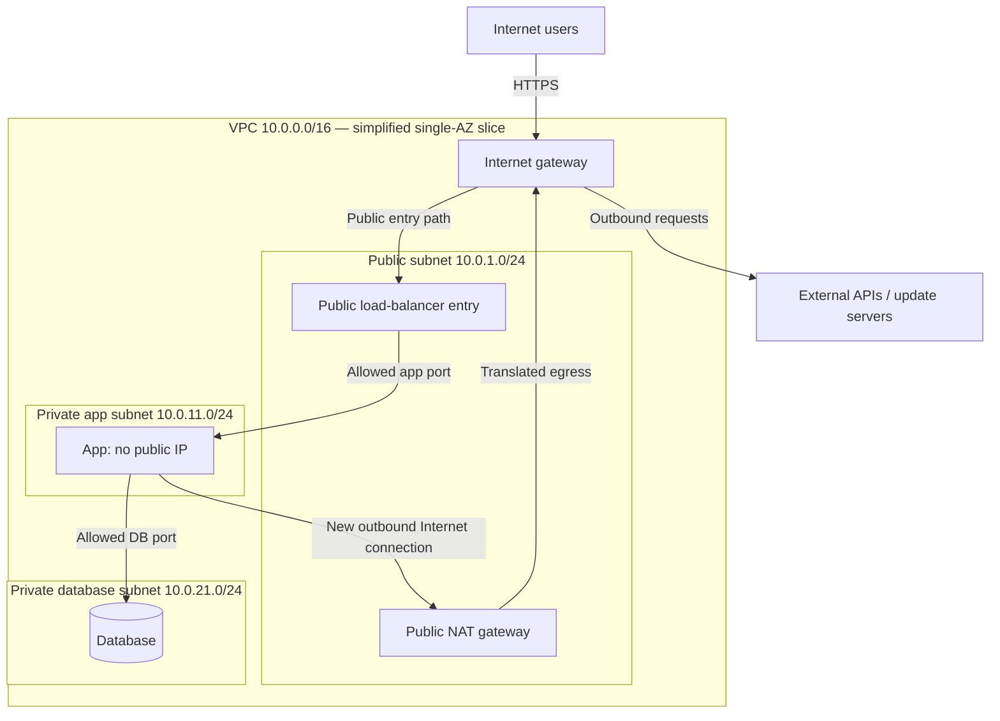

There are **two separate paths**: incoming users reach the public load balancer, which makes a permitted connection to the private app; outgoing connections initiated by the private app can use the NAT gateway and IGW. Replies travel back through the corresponding tracked path. NAT is not in the normal inbound user→load-balancer→app path.

For the source's conventional zonal **public NAT gateway** layout, NAT sits in a public subnet with public addressing; private app traffic routes to it. It translates outbound connections and their replies, without allowing unsolicited inbound Internet connections through that mapping. It does not inspect application authorization or replace firewall policy. See [AWS NAT gateway behaviour](https://docs.aws.amazon.com/vpc/latest/userguide/vpc-nat-gateway.html).

```text
Public-subnet route table:
  10.0.0.0/16 → local
  0.0.0.0/0   → Internet gateway

Private-app route table:
  10.0.0.0/16 → local
  0.0.0.0/0   → NAT gateway       # only if outbound Internet is needed

Private-database route table:
  10.0.0.0/16 → local             # no default Internet route required
```

The local route carries app-to-database traffic within the VPC; SGs/NACLs determine whether it is permitted. A **VPC endpoint** can give private access to supported cloud services without traversing the public Internet; VPC peering connects VPCs privately. They are optional connectivity choices, not requirements for every design.

| Internet gateway | Public NAT gateway in this IPv4 example |
|---|---|
| VPC attachment for Internet connectivity | Translation service used by private resources |
| Public-subnet routes target it directly | Private-subnet routes target NAT; NAT's public path uses IGW |
| Direct inbound/outbound possible with appropriate addressing and policy | Supports internally initiated connections and replies, not unsolicited inbound |
| Does not replace firewall filtering | Does not replace firewall filtering |

For availability, repeat the architecture across AZs and choose resilient load-balancer, application, data, and egress arrangements. The diagram shows one slice, not a complete highly available deployment.

### Defence in depth makes one mistake less damaging

Network controls reduce exposure; TLS protects transport; application authorization protects records; patching reduces vulnerabilities; secure secret storage reduces credential leaks; backups support recovery; monitoring detects failures or abuse. **Defence in depth** combines these controls so a single failure need not expose everything.

Common cloud mistakes include public database ports, unrestricted administrative access, accidentally public storage, credentials in source/browser code, overly broad IAM permissions, missing MFA, expired certificates, and absent logs/backups. **IAM** manages identities and permissions; **MFA** adds another authentication factor. Least privilege and segmentation reduce **blast radius**, the damage one compromised identity/component can cause. If a credential leaks, revoke/rotate it and audit its use rather than only deleting the visible copy.

Under **shared responsibility**, the provider secures its infrastructure while your responsibility includes your identities, configuration, application, and data, with details depending on the service. A private subnet is useful isolation, not proof that the application is safe.

### Interview checkpoint — Part 4

1. **Ingress versus egress?** Traffic entering versus leaving a chosen boundary; policies also distinguish new connections from replies.
2. **Security group versus NACL?** Resource/interface-level stateful allow rules versus subnet-level stateless ordered allow/deny rules.
3. **What does least privilege look like?** Public HTTPS to the entry tier, only entry→app, only app→DB, restricted administration.
4. **Does opening 443 create HTTPS?** No. A service must listen with correct TLS keys/certificate/configuration, and the network path must allow it.
5. **What does TLS guarantee?** Confidentiality, integrity, and authenticated peer connection under the trust model; it does not establish a site's honesty.
6. **What makes a subnet public?** A direct route to an IGW; an individual instance's direct IPv4 reachability also requires addressing and permitted traffic.
7. **How can a private app fetch updates?** Through an allowed NAT/IGW outbound path, or private endpoints for supported services.
8. **Why use both SGs and UFW?** They protect different enforcement points and add independent layers of control.

---

<a id="part-5"></a>

## 5. System Design Fundamentals

### Begin with the product's behaviour, then choose components

**System design** turns requirements into component responsibilities, interfaces, data models, and plans for load, failures, security, operations, and cost. The instructor's “cost of not thinking before building” describes the consequence of skipping those decisions. Design evolves as requirements and measurements change.

The **Book Kida** story shows the gap between a demo and a product: a book-exchange page on `localhost` did not explain how other people would reach it, pay, supply addresses, discover books, or handle two buyers wanting the same copy. A Netflix-style UI similarly does not implement the platform behind the posters.

The YouTube example reveals those hidden responsibilities:

```text
User uploads video
  → authenticate and validate
  → store video file durably in object storage
  → store title, owner and permissions in a metadata database
  → process/transcode into playback formats
  → deliver suitable video segments through CDN
  → notify subscribers and observe failures/load
```

Large files and searchable metadata have different storage/access needs. Upload processing can run in background workers. Search/recommendations add further capabilities if required; a fresher design need not reproduce every YouTube subsystem. A platform's size alone does not prove SQL is unsuitable, and Spark is a processing engine, not a replacement category for an application's database.

**Functional requirements** specify behaviour; **non-functional requirements** specify qualities and constraints. For the lecture's **DevBoard**, functional scope is sign-in, projects/tasks, moving tasks between to-do/in-progress/done, AI summaries, and notifications. Example non-functional targets might be p95 API latency under 300 ms, 99.9% availability, per-user data isolation, and room for growth. These are illustrative goals from the notes, not verified project measurements. They guide investigation; a latency target does not automatically require Redis or microservices.

### DevBoard turns the networking course into an application

The classic three tiers are **presentation**, **application/logical**, and **data**. DevBoard adds an AI capability. These are responsibility boundaries; deployment boundaries need not match one-to-one.

| Responsibility | Lecture's choice | Main job |
|---|---|---|
| Presentation | React UI | Display projects/tasks and send user actions |
| Application/logical | Go API | Validate input, authorize operations, apply business rules |
| Data | SQL users; NoSQL tasks/summaries | Persist identity and application state |
| AI | Python service + Ollama | Build prompts and produce summaries |
| Cross-cutting services | Auth, notifications, Redis | Identity, live updates, faster hot reads |
| Entry / operations | Gateway/ELB, Kubernetes, Prometheus/Grafana | Routing, distribution, scaling, visibility |

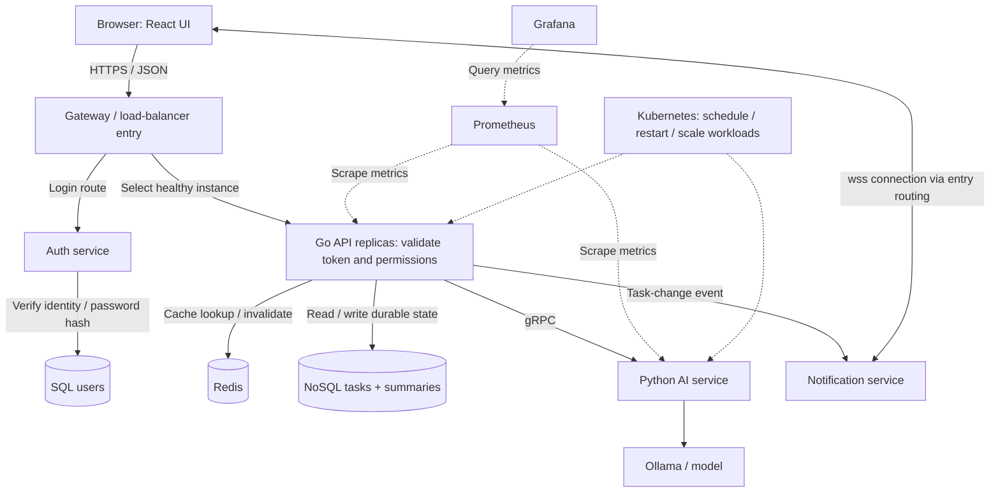

Solid arrows show application communication; dotted arrows show observation/control. This is a **logical design**: the WebSocket route also passes through suitable public entry routing, and production services/databases sit inside the network boundaries from Part 4. Login returns a token to the client; the API can verify later tokens locally. Monitoring and Kubernetes are not extra hops inside each user request.

The browser holds no database credentials and does not bypass application authorization. A Java/Spring Boot backend could fill the same logical role as the Go API; responsibilities and protocol choices matter more than the implementation language.

### Interfaces define what components promise each other

An **API**, Application Programming Interface, is a contract. **REST** and **gRPC** are approaches to exposing APIs, so “API versus gRPC” is not a strict distinction. DevBoard uses resource-oriented HTTP/JSON with browsers and gRPC between Go and Python.

| REST-style HTTP/JSON API | gRPC |
|---|---|
| Resources and methods, such as `PATCH /api/tasks/123` | Named remote procedures, such as `SummarizeProject` |
| JSON is common and easy to inspect | Protocol Buffers commonly provide compact typed messages |
| Browser support and `curl` debugging are straightforward | Generated client/server code from `.proto` contracts |
| Can have formal schemas such as OpenAPI | Strong contract/schema central to the usual workflow |
| Useful for public/browser interfaces | Useful for internal calls and unary/streaming interfaces |

gRPC typically runs over HTTP/2 and supports unary, client-streaming, server-streaming, and bidirectional calls. It offers efficient encoding and explicit contracts; actual performance depends on workload. Browsers generally need gRPC-Web/adapters. REST is not restricted to HTTP/1.1, and JSON is not its defining requirement. See [gRPC introduction](https://grpc.io/docs/what-is-grpc/introduction/).

```text
Browser → POST /api/projects/9/summary (HTTPS + JSON)
Go API  → SummarizeProject(request)    (gRPC + protobuf → Python)
Python  → model call → structured result → Go → JSON response
```

An interface also needs error behaviour, timeouts, compatible versioning, and retry semantics. A remote function call can fail after the remote side acted, so retries must respect idempotency.

### Choose storage from data and access patterns

The lecture chooses SQL for users because identity data benefits from unique emails, relationships, and transactions. It chooses a document-oriented NoSQL store for nested tasks and AI summaries. This is a reasonable example, not a rule that tasks cannot use SQL.

```text
SQL users:       id | email UNIQUE | password_hash | created_at
Task document:   { id, projectId, title, status, assignee, labels, aiSummary }
```

| SQL / relational databases | NoSQL families |
|---|---|
| Tables, relationships, constraints, joins | Document, key-value, wide-column, graph models |
| Strong transaction support is a common strength | Consistency/transaction features depend on the product/configuration |
| Good fit for relational queries and invariants | Good fit when a chosen model matches access patterns |
| Can store JSON and scale with replicas/partitioning/sharding | Flexible structure still needs validation and intentional design |

**ACID** means atomicity (all-or-nothing transaction), consistency (preserve defined invariants), isolation (control concurrent transaction interaction), and durability (committed data survives under the system's guarantees). **Normalization** reduces duplicated relational data; **denormalization** duplicates selected data to suit reads, adding update work.

An **index** accelerates relevant lookups at storage/write cost. **Replication** makes copies for availability and sometimes read scaling; **sharding** divides different data across nodes. **Eventual consistency** means replicas may temporarily differ but converge if updates stop and communication recovers. SQL does not mean “cannot scale,” and NoSQL does not mean “always eventual” or “no transactions.”

Two stores mean two operational/backup paths and possible cross-store inconsistency. Deleting a user in SQL does not atomically delete their tasks in a separate store; define ownership and a retryable cleanup/reconciliation process. When a database is slow, measure queries, indexes, connections, and access patterns first. In Java/JPA code, **N+1 queries**—one initial query followed by many related queries—can be a bottleneck before server size is.

### Authentication, authorization, and live updates

**Authentication** establishes who the caller is; **authorization** checks what that caller may do. Logging in is not enough to edit another user's task.

```text
Login:    UI → credentials over HTTPS → auth → verify password hash in SQL
          auth → signed token → UI

API call: UI → Authorization: Bearer <token> → API
          API → verify signature/expiry and expected issuer/audience
              → check project/task permission → perform operation
```

**JWT means JSON Web Token**, correcting the lecture's “Java Web Token.” The signed JWT used here has a header, payload of **claims** such as subject/expiry, and signature. Its encoded payload is readable, not encrypted; do not put secrets there. Verification keys let API instances validate tokens without calling auth on every request. Expiry, stolen tokens, revocation, and key rotation still require a plan.

An auth outage can prevent new logins while existing tokens continue only if valid keys and required authorization information remain available. Never skip verification during failure. Browser token storage has trade-offs: localStorage is accessible to injected scripts; HttpOnly cookies restrict script access but need appropriate CSRF protection; memory loses state across some lifecycle events.

**WebSocket** provides a persistent bidirectional channel for live updates. The familiar HTTP/1.1 setup uses an Upgrade request and `101 Switching Protocols`, then exchanges WebSocket frames. **`wss`** secures it with TLS. Ordinary CRUD can remain HTTP while notifications use WebSocket.

For a task move, the API persists the change, then sends an event to the notification service, which pushes to connected clients. Reconnection/heartbeats handle broken connections; refetching durable state recovers missed updates. WebSocket itself does not store offline messages. Multiple notification replicas may need shared pub/sub so the instance holding a user's connection receives the right event.

### Redis reduces repeated work, with a freshness trade-off

The source uses **cache-aside**: the application checks Redis before loading durable data.

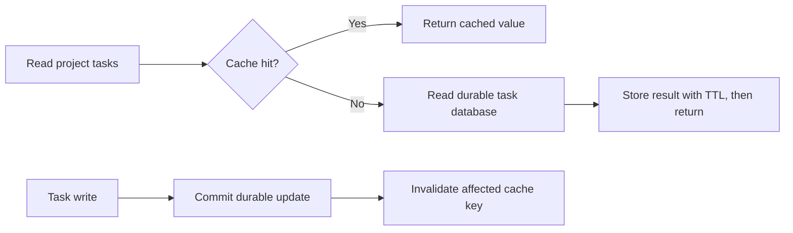

For key `tasks:project:9`, an illustrative TTL is 60 seconds. Writes update the database before invalidating related entries. TTL and invalidation limit stale reads, but deletion alone does not remove every concurrency race: an older in-flight read could repopulate stale data. Choose acceptable freshness, and avoid treating this cache as the only durable copy. A failed Redis instance can fall back to the database only within the database's capacity; uncontrolled fallback may overload it.

### Gateways and load balancers prepare for growth

A **gateway** centralises entry routing and configured shared policies. A **load balancer** distributes connections/requests across healthy targets. Products can combine roles, but a plain ELB/ALB does not automatically implement every authentication or rate-limit requirement; use the appropriate gateway, WAF, or application features.

Layer-4 balancing uses transport/network information; layer-7 balancing can inspect HTTP host/path and terminate TLS. Algorithms include round robin, least connections, and hashing. **Health checks** keep failed targets out of rotation. A **reverse proxy** forwards requests on behalf of servers; many HTTP load balancers are reverse proxies, while not every load balancer is an HTTP proxy.

| Horizontal scaling | Vertical scaling |
|---|---|
| Add more instances/replicas | Give an instance more CPU/RAM |
| Supports distributing traffic and surviving instance loss | Often simple initially, bounded by machine size/cost |
| Needs load distribution and explicit state/data handling | Resizing may require restart, depending on platform |

Stateless API replicas avoid storing required per-client state only in one instance's memory; any suitable healthy replica can handle a request. Shared data/session storage or verifiable tokens support this. **Sticky sessions** keep a client on one instance but complicate balancing/failover. Stateful systems can also scale horizontally, with more coordination. Two 4 GB machines cannot automatically replace one 8 GB machine if one indivisible operation needs all 8 GB.

Kubernetes schedules and restarts workloads; autoscaling still depends on application design and available infrastructure. **HPA**, Horizontal Pod Autoscaler, changes replica count; **VPA**, Vertical Pod Autoscaler, adjusts workload resource requests according to policy. Scaling is delayed by measurement, decisions, and startup. For CPU utilisation targets, resource requests establish the reference capacity. A simplified HPA estimate is `ceil(current replicas × current utilisation / target)`; four replicas at 90% with a 70% target gives `ceil(4 × 90/70) = 6`. See [Kubernetes HPA](https://kubernetes.io/docs/concepts/workloads/autoscaling/horizontal-pod-autoscale/).

`kubectl get hpa -w` observes HPA status in an existing cluster. More API replicas do not automatically fix a saturated database, and independently adding services does not guarantee fault isolation.

### Observe user experience and design for partial failure

Services expose numeric **metrics**; **Prometheus scrapes/pulls** them, stores time series, and evaluates queries/rules. **Grafana** queries data sources to display dashboards. The source's request loop produces a visible traffic spike; the useful lesson is linking observed traffic with latency, errors, and resource saturation. See [Prometheus overview](https://prometheus.io/docs/introduction/overview/).

```text
Prometheus ── GET /metrics ──→ API / AI / exporters
Prometheus ←─ measurements ─── services
Grafana    ── queries ───────→ Prometheus
Alert rules → alert handling → operational notification
```

Watch **traffic, latency, errors, and saturation**: request rate, p95/p99 response time, failures, CPU/memory/connections, DB latency, queue depth, and cache hit ratio. **p95** is the value at or below which 95% of observed durations fall; averages can hide a slow tail. **Logs** describe events; **traces** connect a request across services; metrics show aggregate trends. An **SLI** measures behaviour, an **SLO** sets a target, and an **SLA** states an agreement.

| Failure | Intended effect and response |
|---|---|
| One API replica | Other healthy replicas serve traffic, with reduced capacity |
| AI/model | Summaries unavailable; timeouts/resource limits keep task operations usable |
| Notifications | Live updates delayed; durable task state remains available to refetch |
| Redis | Controlled database fallback; expect more latency/load |
| Task database | Board operations fail; replicas/failover and backups support recovery |
| Auth service | New logins fail; existing valid tokens may work under the conditions above |
| Sole gateway / sole database | A **single point of failure (SPOF)**; add appropriate redundancy/failover |
| Monitoring | Visibility degrades even if the application still serves users |

Separate components provide potential failure boundaries; enforce deadlines, resource limits, and independent recovery so failures do not cascade. Replication is not a substitute for backups: erroneous deletion/corruption can replicate too.

### Two DevBoard journeys make the architecture concrete

**Moving a task:** the UI sends `PATCH /api/tasks/123` with a token and new status. Entry routing selects a healthy API; it verifies the token, checks permission and transition validity, persists the update, invalidates the affected cache, and emits a notification event. It returns the result to the UI. A notification failure should not undo a successfully committed task change; reliable event delivery requires an explicit recovery plan.

**Requesting a summary:** the UI sends `POST /api/projects/9/summary`. The API authorizes access, loads tasks, calls Python over gRPC, and Python builds a prompt and calls Ollama. The result is stored and returned. If model work takes seconds, keeping it inside the request increases latency and ties up capacity.

**Source supplement — slow work and production gaps:** background jobs can decouple slow work from the request:

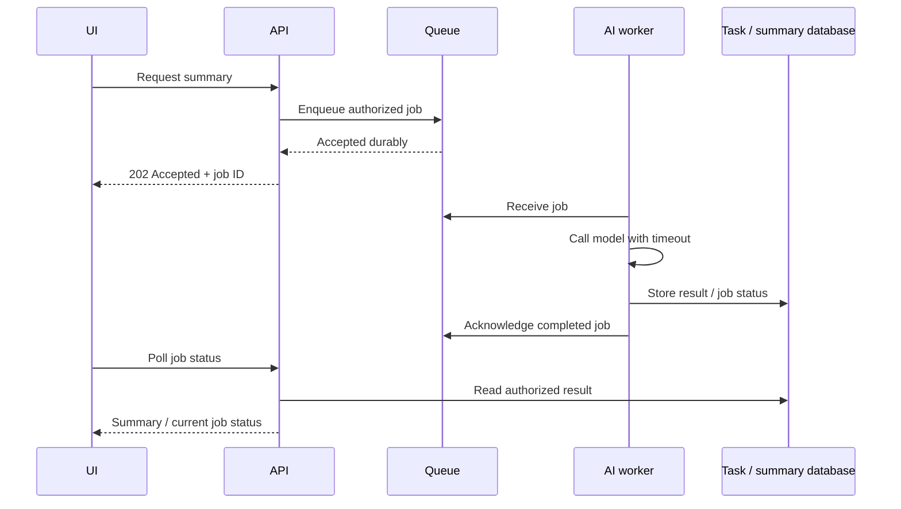

A **queue** buffers work and supports backpressure/retries according to its guarantees. Jobs may be redelivered; make effects idempotent, bound retries, and record failed work for investigation. A queue does not by itself provide exactly-once business effects or instant results. A **circuit breaker** temporarily stops repeated calls to a failing dependency.

Other production concerns already flagged in the source are rate limits/quotas and input limits for expensive AI calls, pagination for task lists, indexing/search where needed, backups, secrets management, repeatable CI/CD deployments, tracing, retention/deletion, and cost monitoring. **CAP**, briefly referenced in the resources, concerns the consistency-versus-availability trade-off during a network partition; it is not “choose any two” under all conditions. These are design checks, not reasons to add every component immediately.

The TrainWithShubham example connects cost to delivery: live interaction, recorded video, static notes, payments, and infrastructure need different handling. Using the source's assumed payment figures, a ₹1,000 sale with a 2% fee and 18% tax **on the fee** deducts `₹20 + ₹3.60`, leaving `₹976.40` before other costs. This is an arithmetic example, not current pricing/tax guidance. CDN hits, efficient queries, appropriate instance sizes, and bounded AI usage can all reduce operating cost.

### The closing “types” distinguish architecture from code organisation

**Client-server** describes request/provider roles. **Distributed architecture** describes components coordinating across processes/machines. They overlap: a browser can be the client of a distributed backend.

| View | Simple client-server deployment | Distributed deployment |
|---|---|---|
| Example | Browser → one app → database | Browser → entry → replicas/services/data nodes |
| Main focus | Who requests and who serves | Where responsibilities/state run and coordinate |
| Operational concern | App/database failure and limited capacity | Partial failures, network delay, consistency, coordination |
| Relationship | Can grow into or already be distributed | Commonly still exposes client-server APIs |

The lecture ends with **monolith**, **microservices**, and **monorepo**. The first two describe application/deployment organisation; the third describes repository organisation.

| Monolithic application | Microservices |
|---|---|
| Application deployed as one unit; can have clear internal modules | Capability-oriented services deployed independently |
| Local calls and transactions often simpler | Independent scaling/deployments/ownership possible |
| Scale/deploy the application together | Network calls, partial failures, data coordination, more operations |
| Good starting point for a small team with evolving boundaries | Useful when independent capabilities and operational maturity justify cost |

```text
Modular monolith:   [auth module | tasks module | summaries module] → external DB
                           one application deployment

Microservices:     [auth service]  [tasks service]  [AI service]
                           independent application deployments

Monorepo:          one repository /services/auth /services/tasks /services/ai
                   Can contain microservices or a monolithic application.
```

A **monorepo** helps shared tooling and atomic cross-project code changes, but needs efficient CI and ownership. **Polyrepo** uses separate repositories, trading isolation for harder coordinated changes and possible version drift. The source's Online Boutique example illustrates microservices in one repository.

Start with clear business responsibilities. Extract services when independent scaling, releases, or ownership justify it. Services that require lockstep releases and share tightly coupled state can become a **distributed monolith**: network costs without meaningful independence. A monolith is not automatically obsolete, nor are microservices automatically resilient.

### Interview checkpoint — Part 5

1. **What is system design?** Turning requirements into components, interfaces, data choices, scaling/failure plans, and explicit trade-offs.
2. **What are the tiers?** Presentation, application/business logic, data; DevBoard also isolates AI work.
3. **Why REST/JSON and gRPC here?** Browser-friendly resource APIs versus typed generated contracts and streaming for internal service calls.
4. **How choose SQL or NoSQL?** Use relationships, transactions, consistency, queries, volume, and operational fit; avoid blanket rules.
5. **How does JWT login work?** Verify credentials, issue signed claims, then verify each token and separately authorize the requested resource operation.
6. **How help a slow, growing API?** Measure its bottleneck, improve queries/cache policy, distribute among healthy replicas, and plan shared state/data capacity.
7. **Monolith, microservices, monorepo?** One application deployment, independent service deployments, and repository strategy respectively.
8. **How handle an eight-second AI summary?** Accept a bounded background job, return `202`/job ID, persist its result, and notify/poll while ordinary task operations remain usable.

---

<a id="final-revision"></a>

## Final revision — connect the whole course

### One complete website request

This follows a fresh HTTPS connection using HTTP/1.1 or HTTP/2. DNS and connection caches can shorten it; HTTP/3 uses QUIC instead of this TCP setup. Network forwarding and filtering apply throughout, including connection setup—not only after TLS.

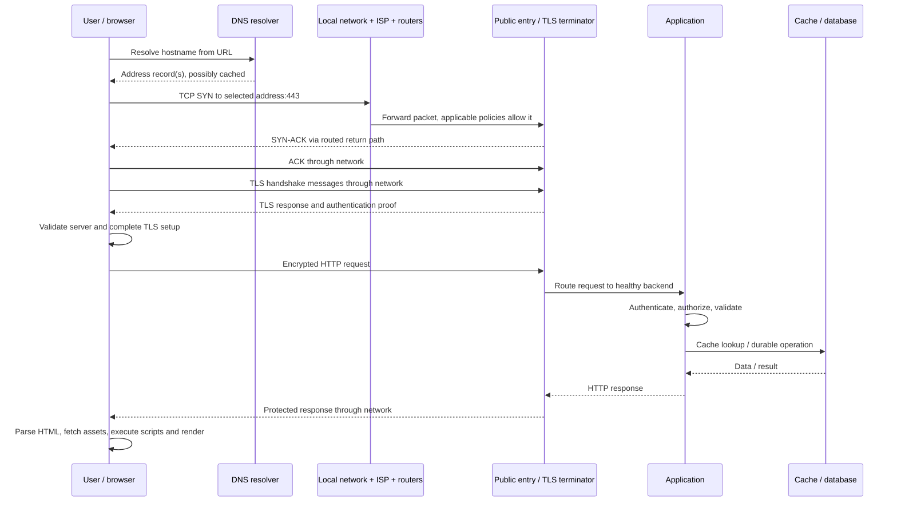

DNS gives an address, routing delivers packets, TCP supplies the stream, and TLS protects the browser-to-terminator channel. A gateway can end that TLS connection and initiate a separate backend connection, which needs its own security policy. The app checks identity/permissions, uses data stores, and returns a result. Loading a page can trigger further DNS lookups and requests for assets; a CDN can serve cacheable ones without reaching the application origin.

### One-minute revision for each part

| Part | Say this in your own words |
|---|---|
| **1. Physical Internet** | Networks join through providers, peering/transit, routers, and fibre. Wi-Fi is one local link. Packets share capacity. Bandwidth/throughput differ from latency, jitter, and loss. Hubs repeat, switches use MACs, routers use IP routes. Data centres host workloads; CDNs serve nearby copies; AZs isolate failures; Local Zones bring selected compute nearer. |
| **2. Addressing and DNS** | IPv4 is 32-bit and IPv6 128-bit. Private IPv4 ranges can repeat; NAT/PAT translates shared Internet access. Prefixes identify subnet boundaries: `/26` means 64 addresses, traditionally 62 hosts. DNS resolvers follow delegated root/TLD/authoritative data and cache by TTL. DNS maps names to records, not complete URLs to pages. |
| **3. Communication** | Data is wrapped as transport unit→IP packet→link frame→signals. OSI names seven responsibilities; TCP/IP groups them into four. Ports/sockets select endpoints. TCP uses handshake, sequence numbers, ACKs, windows, and retransmission; UDP supplies datagrams. HTTP defines requests/responses; HTTPS adds TLS; HTTP/3 uses QUIC/UDP. |
| **4. Security** | Ingress/egress are relative to a boundary. SGs are stateful and allow-only; NACLs are stateless ordered filters. Limit entry to required services/sources. TLS authenticates and protects the channel. Public/private subnets differ by routing. Private apps can use NAT for initiated egress; databases should accept only required app traffic. Combine identity, network, host, app, data, and monitoring controls. |
| **5. System design** | Start with behaviour and quality targets. DevBoard connects UI, API, auth, stores, cache, AI, and notifications behind entry routing. Choose APIs/storage from needs. Scale healthy replicas with deliberate state management, measure user-facing signals, and contain failures. Monolith/microservices describe deployments; monorepo describes source organisation. State trade-offs and cost. |

### High-value comparisons at a glance

These are the distinctions worth recalling without rereading the longer tables above.

| Compare | Keep the boundary clear |
|---|---|
| Router / switch / hub | IP route between networks / MAC frame forwarding on LAN / signal repetition |
| Data centre / CDN / edge | Physical hosting facility / distributed delivery service / one nearby delivery location |
| Region / AZ / Local Zone | Geographic deployment area / isolated regional failure domain / nearby extension of selected regional services |
| IPv4 / IPv6 | 32-bit decimal / 128-bit hex; both need prefixes and security policy |
| Public / private IPv4 | Globally routed addressing / internal reusable ranges; public does not imply permitted access |
| Subnet / CIDR | Logical address network / classless prefix allocation and routing system |
| DNS / IP address | Naming lookup system / numerical packet destination |
| TCP / UDP | Reliable ordered stream / datagrams with no built-in delivery guarantee |
| HTTP / HTTPS | Application semantics / same semantics protected by TLS |
| SG / NACL | Stateful combined allow rules / stateless ordered allow-deny rules |
| IGW / public NAT gateway | Direct Internet connectivity attachment / translation for private initiated connections |
| Authentication / authorization | Establish identity / permit the specific operation |
| Replication / sharding / backup | Copy data / divide data / preserve recoverable history |
| Horizontal / vertical | More instances / more resources per instance |
| Client-server / distributed | Request/provider roles / components coordinating across locations; they overlap |
| Monolith / microservices / monorepo | One app deploy / independent service deploys / one source repository |

### Key terminology and numbers

| Terms | Recall |
|---|---|
| Interface, MAC, ARP | Network attachment, local link address, IPv4 neighbour lookup |
| Gateway, route, prefix | Next-hop router, forwarding choice, destination address block |
| Segment, packet, frame, payload | TCP unit, IP unit, link unit, carried content |
| RTT, jitter, congestion | Round trip, delay variation, excess offered load |
| MTU | Largest IP packet carried in one link-layer payload |
| DHCP, NAT/PAT | Automatic IPv4 configuration, address/port translation |
| Resolver, authoritative, zone | Lookup worker, source of zone records, delegated administrative DNS portion |
| TTL | DNS/cache lifetime; IP TTL is a different hop-limiting field |
| SYN, ACK, FIN, RST | TCP setup, acknowledgement, graceful send close, reset |
| CA, certificate, TLS, SNI | Trust signer, identity/key binding, protected channel, requested TLS hostname indication |
| Cache hit/miss, invalidation | Copy available/absent, explicitly removing a stale copy |
| JWT, claim, WebSocket | Token format, token field, persistent bidirectional channel |
| Contract, REST, gRPC | Agreed interface, resource style, RPC framework |
| Health check, SPOF, degradation | Target probe, critical sole dependency, reduced service during failure |
| Metrics, logs, traces, p95 | Trends, events, request journeys, 95th percentile |

```text
IPv4 / IPv6:     32 / 128 bits
Private IPv4:    10/8, 172.16/12, 192.168/16
IPv4 block:      2^(32 − prefix); traditional hosts = total − 2, with exceptions
/24 /26 /28:     256 / 64 / 16 total → 254 / 62 / 14 traditional hosts
DNS records:     A IPv4; AAAA IPv6; CNAME alias; MX mail; TXT text; NS authority
Ports:           SSH 22; DNS 53; HTTP 80; HTTPS 443
                 MySQL 3306; PostgreSQL 5432; Redis 6379; MongoDB 27017
TCP handshake:   SYN → SYN-ACK → ACK
HTTP statuses:   2xx success; 3xx redirection/cache; 4xx request; 5xx server
```

### The three drawings to reconstruct before an interview

```text
NETWORK:
host → AP/switch → gateway/router → ISP/backbone → destination network → server
       local frame delivery          routed IP delivery

DNS:
client → recursive resolver
          ├─ root: referral to TLD
          ├─ TLD: referral to authoritative server
          └─ authoritative: records → resolver cache → client

APPLICATION + SECURITY:
browser ─HTTPS→ public entry ─allowed app port→ private API replicas
                                                   ├─ auth/token checks
                                                   ├─ cache lookup
                                                   ├─ durable data on miss / write
                                                   ├─ gRPC → AI/model
                                                   └─ event → notification → browser
private API ─initiated egress→ NAT → IGW → external service
Prometheus pulls metrics; Grafana displays them; Kubernetes manages workloads.
```

These sketches compress the detailed diagrams: keep local frame delivery, DNS referrals, public entry, private services, and initiated egress distinct. Name the protocol and allowed source on important arrows; describe what happens if an endpoint fails.

### Common misconceptions to correct immediately

| Misconception | Correct idea |
|---|---|
| Wi-Fi, Internet, and Web are interchangeable | Local radio link, interconnected networks, and one application service |
| More Mbps always fixes lag | RTT, jitter, loss, queueing, and application delay can dominate |
| MAC addresses travel unchanged to the remote host | Routing replaces local framing; endpoint IPs normally persist, except translation |
| Subnetting creates more IPv4 addresses | It divides existing space; CIDR improves allocation, NAT supports reuse |
| Every IPv4 block has total−2 usable hosts | `/31`, `/32`, and cloud reservations need different treatment |
| Every DNS lookup reaches root; `8.8.8.8` is a TLD server | Caches often answer; `8.8.8.8` is recursive |
| DNS checks whether a website is honest | It resolves records; lookalike domains can resolve correctly |
| TCP prevents packet loss or proves the business operation succeeded | It repairs stream loss where possible; app-level outcomes need app-level acknowledgement |
| UDP means no reliability can exist | Protocols such as QUIC add reliability above UDP |
| HTTPS/open 443 means the app/site is safe | Correct TLS configuration protects the channel; app/brand trust remains separate |
| NAT/private subnet/security group alone secures everything | Translation, placement, filtering, identity, and application checks do different jobs |
| Signed JWT means encrypted user data | Typical signed JWT payloads are readable; verify and authorize separately |
| NoSQL always scales better; SQL cannot handle flexible tasks | Access patterns, product guarantees, and operations determine fit |
| Adding replicas/services guarantees resilience | Shared bottlenecks, state, failed dependencies, and capacity still matter |
| Monorepo is a third application architecture | It is a repository strategy compatible with different architectures |

### Complete course concept map

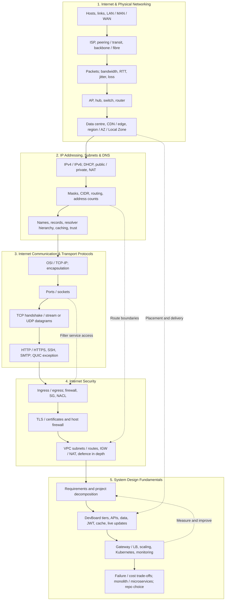

The solid path preserves the five-part learning sequence. Dotted links explain reuse: subnets shape the VPC, ports shape access rules, locations shape application placement, and measurements feed design decisions. The course is one connected system, not five independent vocabularies.

### Quick self-assessment

- [ ] I can trace a packet from my LAN to an overseas server and distinguish a physical link from a routed hop.
- [ ] I can explain bandwidth, throughput, latency/RTT, jitter, and loss with a practical symptom.
- [ ] I can compare hub/switch/router and data centre/CDN/edge/AZ/Local Zone.
- [ ] I can name private IPv4 ranges, explain NAT/PAT, and distinguish static configuration from DHCP.
- [ ] I can calculate network, broadcast, and host range for a `/26`, and size a block for 500 hosts.
- [ ] I can explain DNS cache hits/misses, record types, root/TLD/authoritative roles, and TTL changes.
- [ ] I can map OSI to TCP/IP and label a segment, packet, frame, port, and socket.
- [ ] I can explain TCP setup/reliability/flow control and choose UDP with a concrete reason.
- [ ] I can narrate DNS → connection → TLS → HTTP → application → response without treating them as the same protocol.
- [ ] I can distinguish a missing listener, blocked port, bad route, failed DNS lookup, invalid certificate, and HTTP error.
- [ ] I can design public entry→private app→private DB rules and draw NAT egress separately.
- [ ] I can explain certificates, least privilege, and why HTTPS/private placement do not prove an application is safe.
- [ ] I can draw DevBoard, justify each component, and trace both a task update and an AI summary.
- [ ] I can explain JWT verification and resource authorization, WebSocket recovery, cache freshness, and database choice without blanket claims.
- [ ] I can discuss one bottleneck, one failure, one monitoring signal, and one cost trade-off in my project.
- [ ] I can distinguish deployment architecture from repository strategy and justify a simple starting design.

For a project interview, use this order: **requirements → user journey → components and contracts → data/security → bottleneck and scaling → failure behaviour → monitoring/cost trade-off**. Explain why each box exists and what each arrow carries.
