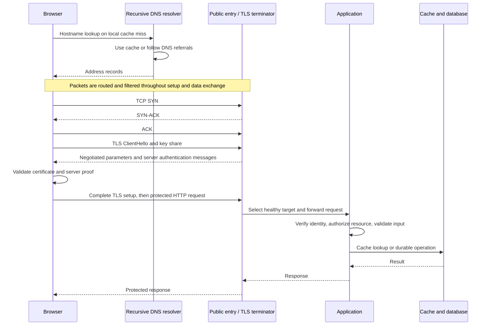
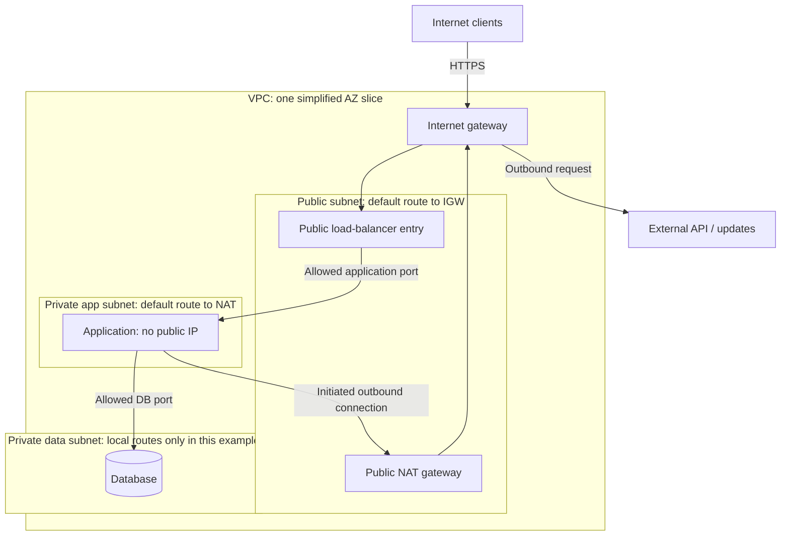
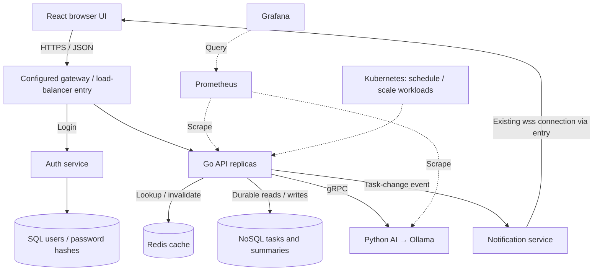
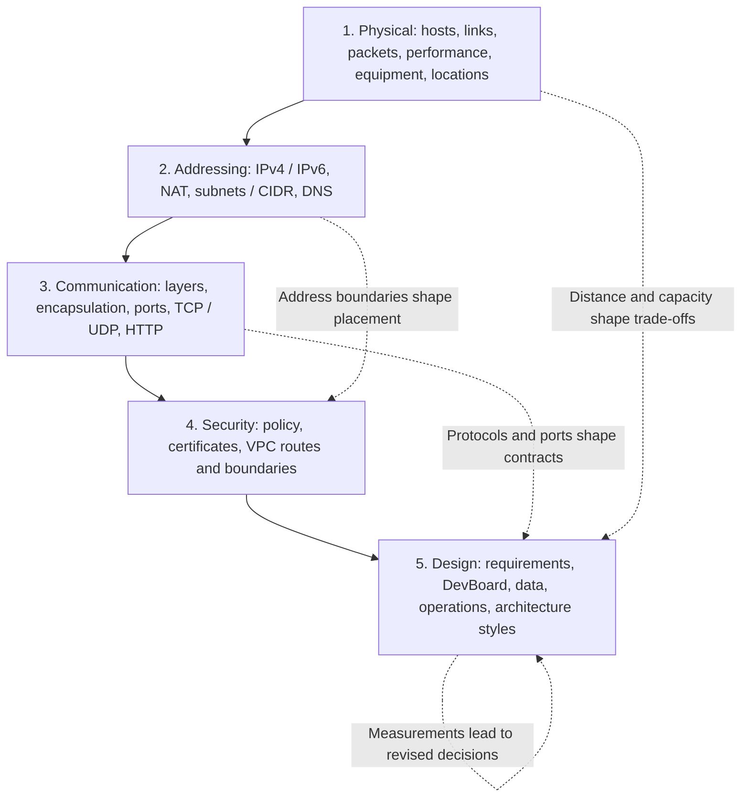

# Computer Networking & System Design — Final Revision Notes

Use this file to reconnect ideas you have already studied. For a first explanation, use [Core Concepts](Computer_Networking_And_System_Design_Core_Concepts.md); for depth, use the [five-part workspace](README.md). The order remains physical networking → addressing/DNS → communication → security → system design.

## Follow one request across the whole course

A user opens `https://app.example.com/projects/9`. The hostname is looked up; the path belongs to the later HTTP request. Local/browser/resolver caches may answer immediately. On a resolver cache miss, the recursive resolver follows root and TLD referrals to the authoritative records, then returns an address.

The client consults its routes. A remote destination normally goes to the default gateway: the local frame addresses that next hop, while its IP packet addresses the remote endpoint. Routers forward across networks, decreasing TTL/hop limit and replacing link framing. NAT can also rewrite addresses and ports. Wi-Fi, Ethernet, fibre, and provider interconnections carry the signals.

For a fresh HTTP/1.1 or HTTP/2 HTTPS connection, TCP synchronises sequence numbers, then TLS negotiates protection and authenticates the server. Routing and filtering apply to these setup packets too. The browser sends protected HTTP; the public entry routes it to an application instance. The application checks the caller's identity and permissions, accesses cache/durable data, and returns a result. Rendering can trigger additional asset requests, often served by a CDN. Existing connections can be reused; HTTP/3 instead uses QUIC over UDP with integrated TLS security.



The entry can terminate the browser's TLS connection and establish a separate backend connection. Label that boundary when discussing end-to-end security. TCP acknowledgement means bytes reached the peer's transport stack; it does not prove the application committed a task update or payment. [TCP specification](https://www.rfc-editor.org/rfc/rfc9293.html), [HTTP/3 specification](https://www.rfc-editor.org/rfc/rfc9114.html).

## Recall each part in one minute

| Part | The connected explanation to recall |
|---|---|
| **1. Internet & Physical Networking** | Devices form local networks, and providers join networks through peering/transit and backbone links. Packets share links. Bandwidth is capacity, throughput is achieved rate, RTT is round-trip delay, jitter is variation, and loss is failed delivery. Hubs repeat signals, switches forward frames, and routers forward IP packets. Data centres run workloads, CDNs deliver nearby copies, AZs isolate regional failures, and Local Zones extend selected compute services closer to a metro. |
| **2. IP Addressing, Subnets & DNS** | Interfaces receive static or dynamic configuration. IPv4 is 32 bits and IPv6 128 bits; private IPv4 space can repeat, with NAT/PAT commonly providing shared Internet access. Prefixes describe network boundaries and block sizes. DNS resolves names to records through delegated authority and caching. A resolver is not an authoritative server, and TTL expiry explains many inconsistent answers after changes. |
| **3. Internet Communication & Transport Protocols** | Application bytes become a TCP segment or UDP datagram, then an IP packet, then a link frame and signals. OSI's seven layers map to four TCP/IP groups. Ports and sockets select endpoints. TCP supplies an ordered byte stream with recovery and control; UDP leaves delivery policy to higher protocols. HTTP defines methods/statuses, HTTPS protects HTTP with TLS, SSH supports remote administration, and SMTP transfers email. |
| **4. Internet Security** | Ingress/egress are relative directions. SGs use stateful combined allow rules; NACLs are stateless ordered allow/deny rules; host filtering is another boundary. TLS provides confidentiality, integrity, and peer authentication under its trust model. A public subnet has a direct IGW route; private resources can initiate outbound traffic through a public NAT path. Placement, identity, application checks, patching, secrets, and monitoring work together. |
| **5. System Design Fundamentals** | Requirements justify components and contracts. DevBoard connects presentation, application, data, and AI responsibilities with identity, caching, notifications, entry routing, scaling, and monitoring. Data/access patterns guide storage. Failure boundaries require timeouts, limits, and recovery. Monolith/microservices describe deployment boundaries; monorepo/polyrepo describe where source lives. Every design accepts trade-offs in complexity, latency, reliability, and cost. |

## Keep these distinctions clear

| Compare | Difference that matters |
|---|---|
| Internet / Web / Wi-Fi | Interconnected networks / HTTP-based service / local radio link |
| Router / switch / hub | Destination-IP route / local MAC forwarding / signal repetition |
| Data centre / CDN / edge PoP | Physical hosting facility / distributed delivery service / one delivery location |
| Region / AZ / Local Zone | Geographic deployment area / isolated regional failure domain / selected regional services nearer another metro |
| IPv4 / IPv6 | 32-bit dotted decimal / 128-bit hexadecimal; both use prefixes and need security policy |
| Public / private IPv4 | Globally routed addressing / internally reusable RFC 1918 ranges; reachability also needs routes/listeners/permissions |
| Subnet / CIDR | Logical address network / classless prefix allocation and route-aggregation system |
| DNS / IP address | Name/record lookup system / numerical addressing for packet delivery |
| Recursive / authoritative DNS | Finds/caches answers for clients / serves records for its zone |
| TCP / UDP | Reliable ordered byte stream / separate datagrams without built-in delivery or order guarantees |
| HTTP / HTTPS | Resource/request semantics / those semantics protected by TLS |
| SG / NACL | Stateful, interface/resource-associated allow rules / stateless subnet-associated ordered allow/deny rules |
| IGW / public NAT gateway | Direct Internet connectivity attachment / translation for internally initiated connections and their replies |
| Authentication / authorization | Establish identity / permit a particular operation on a particular resource |
| SQL / NoSQL | Relational model / family of alternative models; guarantees and scaling depend on the actual product/design |
| REST / gRPC | Resource-oriented API style / RPC framework with generated contracts and common protobuf/HTTP2 use |
| Horizontal / vertical scaling | More replicas / more resources per instance; either requires a capacity/failure plan |
| Replication / sharding / backup | Copy data / divide data / keep recoverable history |
| Monolith / microservices / monorepo | One application deploy / independent service deploys / one source repository |
| Client-server / distributed | Request/provider roles / components coordinating across processes or machines; these overlap |

TCP's base header is 20 bytes and UDP's is 8 bytes. Lower overhead does not make UDP universally faster; higher protocols can add reliability, handshakes, security, and congestion control. HTTP/1.1 normally reuses persistent connections. DNS supports both UDP and TCP, and encrypted DNS has additional transport choices.

## Three drawings worth reconstructing

### DNS referrals return to the resolver

```text
Client → recursive resolver
              ├── root query → referral to TLD servers ─────────────┐
              ├── TLD query → referral to authoritative servers ───┤
              └── authoritative query → records ───────────────────┘
          resolver caches permitted data → answer to client
```

This is a cold-cache sketch. Cache hits skip some or all of the hierarchy walk. DNS answers are not a chain of HTTP redirects, and authoritative servers do not send the browser its webpage.

### Public entry and private egress are different paths



A public subnet's classification is route-based. Direct public IPv4 reachability for an individual instance additionally requires suitable public addressing and permitted traffic. The database has a distinct subnet/route table here, so its local-only route statement is meaningful. Replicate the needed entry/app/data components across AZs for availability; the drawing itself is not a complete HA deployment. [AWS subnet definitions](https://docs.aws.amazon.com/vpc/latest/userguide/configure-subnets.html).

### DevBoard's responsibilities and observation paths



The API verifies signed tokens and resource permissions. Solid arrows describe application exchanges; dotted arrows describe observation/control. Prometheus pulls metrics; Grafana queries a data source. A load balancer's presence does not imply every auth/rate-limit policy has been implemented. [Prometheus overview](https://prometheus.io/docs/introduction/overview/).

A task move follows `PATCH → token and permission checks → durable update → cache invalidation → notification event → response`. A summary follows `authorize → load tasks → gRPC AI call → store result → response`, or becomes a queued job returning `202` when background work suits the requirement. Jobs may repeat: make effects idempotent and expose status/failure clearly.

## Numbers, names, and commands

### Address arithmetic

```text
IPv4: 32 bits                   IPv6: 128 bits
Total IPv4 block = 2^(32 − p)    Longer prefix → smaller block
Traditional usable hosts = total − 2, with /31 and /32 exceptions

192.168.10.50/26:
  mask       255.255.255.192
  network    192.168.10.0
  broadcast  192.168.10.63
  hosts      192.168.10.1–192.168.10.62 (62)

500 traditional hosts → need at least 502 addresses → 512 → /23
```

| Prefix | Total | Traditional hosts | Mask |
|---|---:|---:|---|
| `/16` | 65,536 | 65,534 | `255.255.0.0` |
| `/23` | 512 | 510 | `255.255.254.0` |
| `/24` | 256 | 254 | `255.255.255.0` |
| `/25` | 128 | 126 | `255.255.255.128` |
| `/26` | 64 | 62 | `255.255.255.192` |
| `/27` | 32 | 30 | `255.255.255.224` |
| `/28` | 16 | 14 | `255.255.255.240` |
| `/29` | 8 | 6 | `255.255.255.248` |
| `/30` | 4 | 2 | `255.255.255.252` |
| `/31` | 2 | Both on supported point-to-point links | `255.255.255.254` |
| `/32` | 1 | One host/address route | `255.255.255.255` |

Cloud reservations can differ: ordinary AWS IPv4 subnets reserve five addresses, giving 251 assignable in a `/24`. IPv6 has no broadcast and does not use the IPv4 subtract-two rule. A mask/prefix expresses address membership, not firewall permission.

| Address category | Recall |
|---|---|
| RFC 1918 private | `10.0.0.0/8`, `172.16.0.0/12`, `192.168.0.0/16` |
| IPv4 loopback | `127.0.0.0/8`; commonly `127.0.0.1` |
| IPv4 link-local | `169.254.0.0/16`; not RFC 1918 private space |
| IPv6 loopback | `::1` |
| IPv6 documentation example | `2001:db8::/32` |
| Default IPv4 route / any source | `0.0.0.0/0`, depending on route/rule context |

### DNS, ports, and HTTP

| DNS record | Purpose |
|---|---|
| A / AAAA | IPv4 / IPv6 address |
| CNAME | Alias to another name, not an IP |
| MX / TXT | Mail destination with priority / text such as verification or email policy |
| NS / SOA | Nameserver/delegation information / zone administration |
| PTR | Reverse address-to-name lookup |

DNS TTL is a cache lifetime; IP TTL is a hop-limiting field. `.in` is a TLD; `bank.in` and `gov.in` lie beneath it. DNSSEC authenticates signed DNS data; DoH/DoT protect DNS transport. None makes a lookalike domain honest.

| Common port | Service |
|---|---|
| TCP 22 | SSH |
| UDP/TCP 53 | DNS |
| UDP 67/68; UDP 123 | DHCPv4; NTP |
| TCP 80 | HTTP |
| TCP 443; commonly UDP 443 | HTTPS with HTTP/1.1–2; HTTP/3 |
| TCP 25 / 587 / 465 | SMTP relay / submission with STARTTLS / implicit-TLS submission |
| TCP 3306 / 5432 | MySQL / PostgreSQL |
| TCP 6379 / 27017 | Redis / MongoDB |

Legacy-reference ports include FTP control TCP 21, POP3 TCP 110, IMAP TCP 143, and Telnet TCP 23; these names/ports alone do not imply encrypted transport. FTP data connections vary by active/passive mode. Port numbers are conventions, not proof of a service's protocol or security.

HTTP statuses: `200` success, `201` created, `202` accepted for processing, `301/302` redirects, `304` not modified, `400` malformed request, `401` authentication required/failed, `403` forbidden, `404` not found, `409` conflict, `429` rate limited, `500` server error, `502` bad gateway, `503` unavailable, `504` gateway timeout. A status can originate at a proxy as well as the application.

### Diagnose one layer at a time

| Check | Windows | Linux/macOS where available | Interpretation |
|---|---|---|---|
| Interface / route | `ipconfig /all`, `route print` | Linux `ip -br addr`, `ip route`; macOS `ifconfig`, `netstat -rn` | Check intended interface, prefix, gateway, resolver |
| RTT / routed probes | `ping -n 4 8.8.8.8`, `tracert example.com` | `ping -c 4 8.8.8.8`, `traceroute example.com` | ICMP/probe behaviour is evidence, not a full service-health test |
| DNS | `nslookup example.com` | `dig example.com`, `dig +tcp example.com` | Compare record, resolver, TTL, and errors |
| TCP service | `Test-NetConnection example.com -Port 443`, `netstat -ano` | `nc -vz example.com 443`, Linux `ss -tulpn` | Distinguish network reachability from a local listener |
| HTTP / TLS | `curl.exe -vI https://example.com` | `curl -vI https://example.com` | Inspect connection, certificate result, status and headers |

OpenSSL can inspect a server with `openssl s_client -connect example.com:443 -servername example.com`; inspect output and validation options rather than assuming display equals full verification. Wireshark display filters such as `icmp`, `dns`, `tcp.flags.syn == 1`, and `tcp.analysis.retransmission` connect the layer model to actual packets. Encrypted traffic generally requires appropriate secrets to inspect application contents.

A trace `*` may be a missing/rate-limited probe reply. A TCP timeout can arise from filtering, loss, or routing; refusal commonly means no listener or active rejection. A localhost success still leaves bind address, publication, destination, routes, SG/NACL, and host filtering to inspect. Windows PowerShell may alias `curl`, so use `curl.exe` when needed.

## Architecture terms without blanket rules

| Term | Meaning to retain |
|---|---|
| JWT / claims | JSON Web Token / fields such as subject and expiry; the signed token used here is readable, and its validity does not grant every resource permission |
| Cache-aside / read-through | Application loads cache misses from DB / cache layer loads misses; cache-aside is DevBoard's illustrated pattern |
| Write-through / write-behind | Store writes as part of the write path / defer durable writes; atomicity and failure guarantees require explicit design |
| Invalidation / TTL | Remove an obsolete entry / bound its normal cache life; concurrent old reads can still repopulate stale values |
| ACID | Atomicity, consistency of defined invariants, isolation, durability |
| Index / normalization / denormalization | Lookup structure / reduce duplication / introduce selected duplication for access patterns |
| Queue / idempotency | Buffer work with defined delivery guarantees / repeated operation has the same intended effect |
| Backpressure / circuit breaker | Limit admitted work when downstream capacity is constrained / temporarily stop repeatedly calling an unhealthy dependency |
| HPA / VPA | Change workload replica count / adjust workload resource requests according to policy |
| Metrics / logs / traces | Numeric trends / event detail / a request's path across components |
| p95 / SLI / SLO / SLA | 95th-percentile value / measured behaviour / target / agreement |
| SPOF / graceful degradation | Sole dependency whose failure breaks a capability / preserve useful capabilities while others fail |
| RTO / RPO, optional | Recovery-time objective / acceptable recovery-point data-loss window |
| CAP, optional | Under a network partition, the specified consistency and availability guarantees cannot both be maintained |

SQL can hold documents and scale beyond one server. NoSQL consistency/transaction support varies by product. Stateless APIs simplify horizontal request distribution; stateful systems can scale with explicit coordination. More replicas do not remove a shared database bottleneck. [Kubernetes autoscaling](https://kubernetes.io/docs/concepts/workloads/autoscaling/).

## Reason through a few cross-course situations

**A site works by one path and fails by another.** Compare destination/hostname, DNS answers, route, port, bind address, and TLS/SNI before changing configuration. A successful ICMP probe does not establish HTTPS health; an HTTP response establishes more of the path but still might come from a proxy.

**A page loads correctly despite packet loss.** TCP may have recovered missing bytes. Inspect retransmissions/timing if performance matters, and distinguish successful transport from a committed application operation. Live media protocols may instead tolerate selected losses or use different recovery.

**DNS was changed but some users reach the old service.** Inspect authoritative answers and independent resolver caches. Lower TTL before a planned move and retain the previous endpoint while caches expire. Flushing one client's cache does not flush upstream caches.

**A private API needs an external model provider.** Keep public user entry separate from app-initiated egress. Provide the required route/NAT or supported private connection and outbound permissions, then enforce timeouts, quotas, and authenticated application access.

**Task reads became slow after growth.** Measure DB query latency, query count, indexes, connection saturation, and cache effectiveness. Fix a demonstrated bottleneck before adding architecture. A Java/JPA N+1 access pattern can cause many round trips even with a modest data set.

**The AI service is down.** Keep task CRUD usable through bounded AI resource usage and deadlines. For slow summaries, enqueue authorized work, return `202` plus job ID, record results/failures, and notify or poll. Retryable jobs need idempotent effects; a queue does not guarantee exactly-once business processing.

**The cache or an AZ fails.** A cache fallback must fit spare DB capacity. An AZ failure needs real spread of entry/app/data dependencies and tested failover. Replication can improve availability; independent backups protect against errors that replicate too.

**Explain a small system in an interview.** State requirements and quality targets, draw only justified components, name contracts and data ownership, trace a write/read, then discuss a bottleneck, failure, security boundary, and cost. For an optional URL-shortener example, cover create/redirect, code→URL storage, collision handling, hot-read cache, expiry, and abuse limits before considering more machinery.

## Common traps to avoid

- Treating Wi-Fi, the Internet, and the Web as synonyms, or confusing an IXP with an ISP/data centre.
- Calling a speed-test rate a latency measure, or assuming extra bandwidth removes propagation delay.
- Sending the frame directly to a remote server's MAC instead of the local next hop.
- Treating private/loopback/link-local ranges as one category, or subnetting as address creation.
- Calling `8.8.8.8` a root/TLD server, or treating DNS delegation as proof that a brand is genuine.
- Saying TCP prevents packet loss, UDP can never be reliable, or every HTTP version uses TCP.
- Treating port permission, a listening process, and valid TLS configuration as interchangeable.
- Treating NAT as a configurable firewall or assuming a private subnet has no permitted connections.
- Equating signed JWTs with encryption or authentication with authorization.
- Assuming SQL cannot scale, NoSQL guarantees eventual consistency, or cache invalidation removes every race.
- Assuming service separation automatically provides failure isolation, or autoscaling is instantaneous.
- Calling a monorepo a deployment architecture, or adding components without a requirement.

## Complete course map and final check



Solid arrows preserve the course sequence; dotted arrows show concepts reused later. Before an interview, check whether you can:

- [ ] Trace a browser request through DNS, local/routed delivery, transport, TLS, HTTP, and application logic.
- [ ] Calculate a subnet and explain exceptions to textbook host counts.
- [ ] Draw the DNS resolver's referrals and the VPC's separate inbound/egress paths.
- [ ] Justify the protocol, allowed source, and responsibility on an architecture arrow.
- [ ] Explain a task update and an AI summary, including identity, data, freshness, and failure handling.
- [ ] Choose a simple starting design and explain what measurement would justify making it more complex.

Follow the matching [part overview](README.md) when an answer exposes a gap; the detailed notes explain the reasoning behind this revision sheet.
